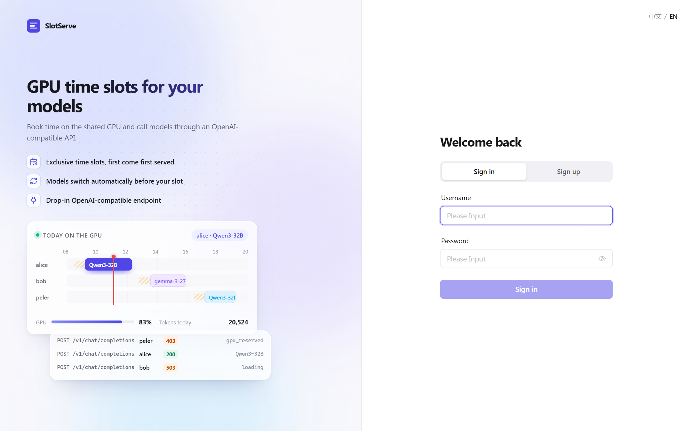
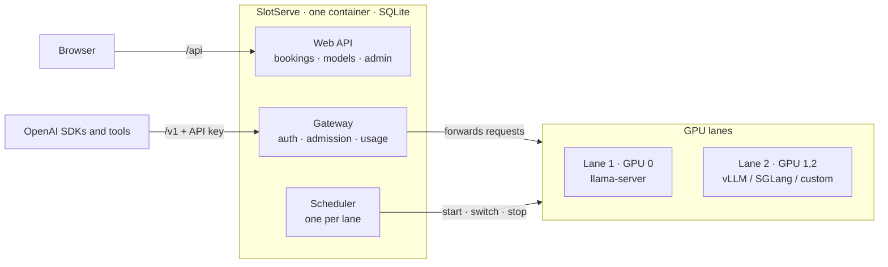

<p align="center">
  
</p>

<h1 align="center">SlotServe</h1>

<p align="center">
  <b>Book GPU time slots. Serve models behind an OpenAI-compatible API.</b>
</p>

<p align="center">
  English · <a href="README.zh-CN.md">简体中文</a> · <a href="https://peleryuan.github.io/slotserve/">Documentation</a>
</p>

<p align="center">
  <a href="https://github.com/PelerYuan/slotserve/actions/workflows/ci.yml"></a>
  <a href="https://github.com/PelerYuan/slotserve/releases"></a>
  <a href="https://github.com/PelerYuan/slotserve/pkgs/container/slotserve"></a>
  <a href="https://peleryuan.github.io/slotserve/"></a>
  <a href="LICENSE"></a>
  
</p>


SlotServe turns a GPU server into a shared, bookable service for a lab or small team. People book time in a web calendar and get the GPU exclusively during their slot. They call models through an OpenAI-compatible endpoint with their own API key. SlotServe runs the model server (llama.cpp, vLLM, SGLang or your own) for you, learns how long each model takes to load, and switches models *before* each booking starts.

## Features

- **Calendar booking**: drag across a week view to book exclusive GPU time. First come, first served.
- **OpenAI-compatible gateway**: `/v1/chat/completions`, `/v1/completions`, `/v1/embeddings` and every other route of the model server, with streaming.
- **Per-user API keys**: an idle GPU stays open to every key on the default model; a booking locks it to the booker's keys.
- **Managed model servers**: started, health-checked, restarted and switched automatically. Each model's launch arguments are edited in the browser.
- **Preloading**: load times are learned per model, so the next booking's model is ready when the slot begins.
- **Model downloads**: paste a direct `.gguf` link (Hugging Face `resolve` URLs work). Downloads are resumable and run one at a time.
- **Usage dashboard**: requests, prompt/completion tokens and booked hours per person and per model.
- **Admin panel**: manage users, bookings and API keys, change settings at runtime, and review an audit log.
- **Multiple GPUs and engines**: split GPUs into independently booked lanes; serve models with llama.cpp, vLLM, SGLang or any OpenAI-compatible server.
- **Approval mode** for teams that want an admin to sign off long bookings.
- **Flexible bookings**: whole-GPU slots for training, argument presets, weekly repeats, extensions, a waitlist and per-person quotas.
- **Telegram notifications** with reminders and one-tap extend, plus **calendar feeds**, **CSV export** and **Prometheus metrics**.
- **GPU status**: live memory, utilization, temperature and power.
- **English and Chinese UI**, light, minimal design, works on phones.
- **One container**: SQLite, three bind mounts, no external services.

<table>
  <tr>
    <td></td>
    <td></td>
  </tr>
  <tr>
    <td></td>
    <td></td>
  </tr>
</table>

## Quick start

Requirements: Linux, an NVIDIA GPU, Docker with Compose v2, the [NVIDIA Container Toolkit](https://docs.nvidia.com/datacenter/cloud-native/container-toolkit/latest/install-guide.html), and a CUDA build of [llama.cpp](https://github.com/ggml-org/llama.cpp).

```bash
git clone https://github.com/PelerYuan/slotserve
cd slotserve
cp .env.example .env
#   LLAMA_CPP_DIR   directory containing your compiled llama-server
#   MODELS_DIR      directory with .gguf files (an SSD helps a lot)
#   SLOTSERVE_INVITE_CODE / SLOTSERVE_SECRET_KEY
docker compose up -d --build
```

Open `http://<server>:8000`. The first account becomes the admin. Then go to **Models → Scan folder**, set a default model, create an API key, and call the API:

```python
from openai import OpenAI

client = OpenAI(base_url="http://<server>:8000/v1", api_key="sk-ss-...")
reply = client.chat.completions.create(
    model="Qwen3-32B-Q4_K_M",
    messages=[{"role": "user", "content": "Hello!"}],
)
print(reply.choices[0].message.content)
```

> [!NOTE]
> Keep the CUDA major version of `CUDA_IMAGE` equal to the one your `llama-server` was built with.

## How it works



Each lane (a group of GPUs) has its own model server and booking calendar. A single-GPU host has one lane.

| Situation | Booking owner | Everyone else |
| --- | --- | --- |
| Lane not booked | allowed, on the lane's model | allowed, on the lane's model |
| Booked, model ready | allowed | `403 gpu_reserved` |
| Booked, model loading | `503` + `Retry-After` | `403 gpu_reserved` |
| Whole-GPU booking | `503 gpu_exclusive` | `403 gpu_reserved` |

See [How scheduling works](https://peleryuan.github.io/slotserve/scheduling/) for the preloading rules.

## Documentation

| | |
| --- | --- |
| [Getting started](https://peleryuan.github.io/slotserve/getting-started/) | Build llama.cpp, configure, deploy, run without Docker |
| [Configuration](https://peleryuan.github.io/slotserve/configuration/) | Every environment variable, per-model launch arguments, admin CLI |
| [User guide](https://peleryuan.github.io/slotserve/user-guide/) | Booking, models, downloads, keys, usage, administration |
| [Notifications & integrations](https://peleryuan.github.io/slotserve/integrations/) | Telegram, calendar feeds, CSV export, Prometheus |
| [GPUs, lanes & engines](https://peleryuan.github.io/slotserve/gpus-and-engines/) | Multiple GPUs, vLLM / SGLang / custom servers, approval mode |
| [API](https://peleryuan.github.io/slotserve/api/) | Endpoints, the `model` field, error codes |
| [Development](https://peleryuan.github.io/slotserve/development/) | Mock model server, tests, frontend dev server |
| [FAQ](https://peleryuan.github.io/slotserve/faq/) | Slow loads, reverse proxy, backups |

The docs source lives in [`docs/`](docs/).

## Development

No GPU needed: a mock model server is included.

```bash
cd backend && python -m venv .venv && . .venv/bin/activate && pip install -e ".[dev]" && pytest
cd ../frontend && npm install && npm run dev
```

See [CONTRIBUTING.md](CONTRIBUTING.md).

## License

[MIT](LICENSE)
