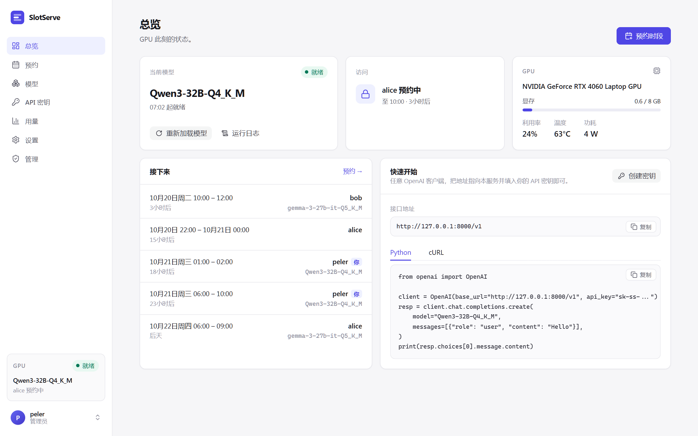
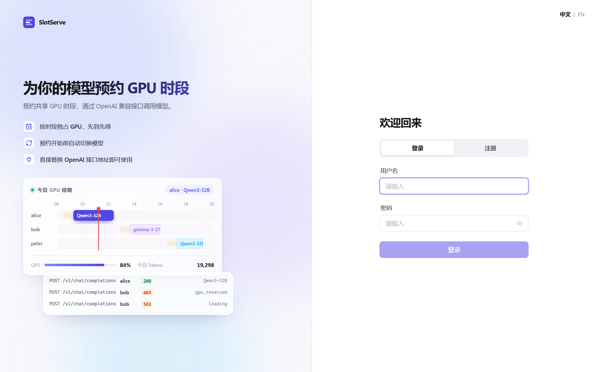

<p align="center">
  
</p>

<h1 align="center">SlotServe</h1>

<p align="center">
  <b>预约 GPU 时段，通过 OpenAI 兼容接口使用 llama.cpp 模型。</b>
</p>

<p align="center">
  <a href="README.md">English</a> · 简体中文 · <a href="https://peleryuan.github.io/slotserve/zh/">文档</a>
</p>

<p align="center">
  
  
  
  
</p>



SlotServe 把一张 GPU 变成实验室或小团队可预约的共享服务：大家在网页日历上预约时段，预约期间独占 GPU，并用自己的 API 密钥通过 OpenAI 兼容接口调用模型。SlotServe 负责托管 `llama-server`，学习每个模型的加载耗时，并在每个预约开始*之前*完成模型切换。

## 功能

- **日历预约**：在周视图上拖选即可预约独占时段，先到先得。
- **OpenAI 兼容网关**：`/v1/chat/completions`、`/v1/completions`、`/v1/embeddings` 及 llama-server 的其他接口，支持流式。
- **个人 API 密钥**：GPU 空闲时所有密钥都能使用默认模型；有预约时只接受预约者的密钥。
- **托管 llama-server**：自动启动、健康检查、重启和切换；每个模型的启动参数都可在网页上编辑。
- **预加载**：自动学习每个模型的加载耗时，让下一个预约的模型在时段开始时就已就绪。
- **模型下载**：粘贴 `.gguf` 直链（支持 Hugging Face 的 `resolve` 链接），断点续传，逐个下载。
- **用量看板**：按用户、按模型统计请求数、输入/输出 token 和预约时长。
- **管理面板**：管理用户、预约和 API 密钥，在线修改系统设置，查看审计日志。
- **灵活预约**：可整卡预约用于训练，支持参数预设、每周重复、延长、候补和每人配额。
- **Telegram 通知**：预约提醒、一键延长；另有**日历订阅**、**CSV 导出**和 **Prometheus 指标**。
- **GPU 状态**：实时显存、利用率、温度和功耗。
- **中英双语界面**，浅色简洁风格，手机也能用。
- **单容器部署**：SQLite、三个目录挂载，无需其他服务。

<table>
  <tr>
    <td></td>
    <td></td>
  </tr>
  <tr>
    <td></td>
    <td></td>
  </tr>
</table>

## 快速开始

环境要求：Linux、NVIDIA GPU、Docker 及 Compose v2、[NVIDIA Container Toolkit](https://docs.nvidia.com/datacenter/cloud-native/container-toolkit/latest/install-guide.html)、启用 CUDA 编译的 [llama.cpp](https://github.com/ggml-org/llama.cpp)。

```bash
git clone https://github.com/PelerYuan/slotserve
cd slotserve
cp .env.example .env
#   LLAMA_CPP_DIR   编译好的 llama-server 所在目录
#   MODELS_DIR      存放 .gguf 的目录（SSD 会快很多）
#   SLOTSERVE_INVITE_CODE / SLOTSERVE_SECRET_KEY
docker compose up -d --build
```

打开 `http://<服务器>:8000`，第一个注册的账号自动成为管理员。然后进入**模型 → 扫描目录**，设置默认模型，创建 API 密钥，即可调用：

```python
from openai import OpenAI

client = OpenAI(base_url="http://<服务器>:8000/v1", api_key="sk-ss-...")
reply = client.chat.completions.create(
    model="Qwen3-32B-Q4_K_M",
    messages=[{"role": "user", "content": "你好！"}],
)
print(reply.choices[0].message.content)
```

> [!NOTE]
> `CUDA_IMAGE` 的 CUDA 主版本需与编译 `llama-server` 时使用的保持一致。

## 工作原理

```
浏览器 ──/api──┐                      ┌──────────────────────────┐
               ├──► FastAPI ──────────►  llama-server（子进程）  │──► GPU
SDK/客户端 ─/v1┘    鉴权 · 准入        │  仅监听 127.0.0.1        │
                    调度 · 用量        └──────────────────────────┘
```

| 情况 | 预约者 | 其他人 |
| --- | --- | --- |
| 没有进行中的预约 | ✅ 当前模型 | ✅ 当前模型 |
| 预约进行中，模型已就绪 | ✅ | ❌ `403 gpu_reserved` |
| 预约进行中，模型加载中 | ⏳ `503` + `Retry-After` | ❌ `403 gpu_reserved` |

预加载规则见[调度原理](https://peleryuan.github.io/slotserve/zh/scheduling/)。

## 文档

| | |
| --- | --- |
| [快速开始](https://peleryuan.github.io/slotserve/zh/getting-started/) | 编译 llama.cpp、配置、部署、不用 Docker 运行 |
| [配置参考](https://peleryuan.github.io/slotserve/zh/configuration/) | 全部环境变量、每个模型的启动参数、管理员命令行 |
| [使用指南](https://peleryuan.github.io/slotserve/zh/user-guide/) | 预约、模型、下载、密钥、用量、管理 |
| [通知与集成](https://peleryuan.github.io/slotserve/zh/integrations/) | Telegram、日历订阅、CSV 导出、Prometheus |
| [接口](https://peleryuan.github.io/slotserve/zh/api/) | 接口列表、`model` 字段、错误码 |
| [开发](https://peleryuan.github.io/slotserve/zh/development/) | mock llama-server、测试、前端开发服务器 |
| [常见问题](https://peleryuan.github.io/slotserve/zh/faq/) | 加载慢、反向代理、备份 |

文档源文件在 [`docs/`](docs/) 目录。

## 开发

不需要 GPU，仓库自带 mock llama-server。

```bash
cd backend && python -m venv .venv && . .venv/bin/activate && pip install -e ".[dev]" && pytest
cd ../frontend && npm install && npm run dev
```

详见 [CONTRIBUTING.md](CONTRIBUTING.md)。

## 许可证

[MIT](LICENSE)
