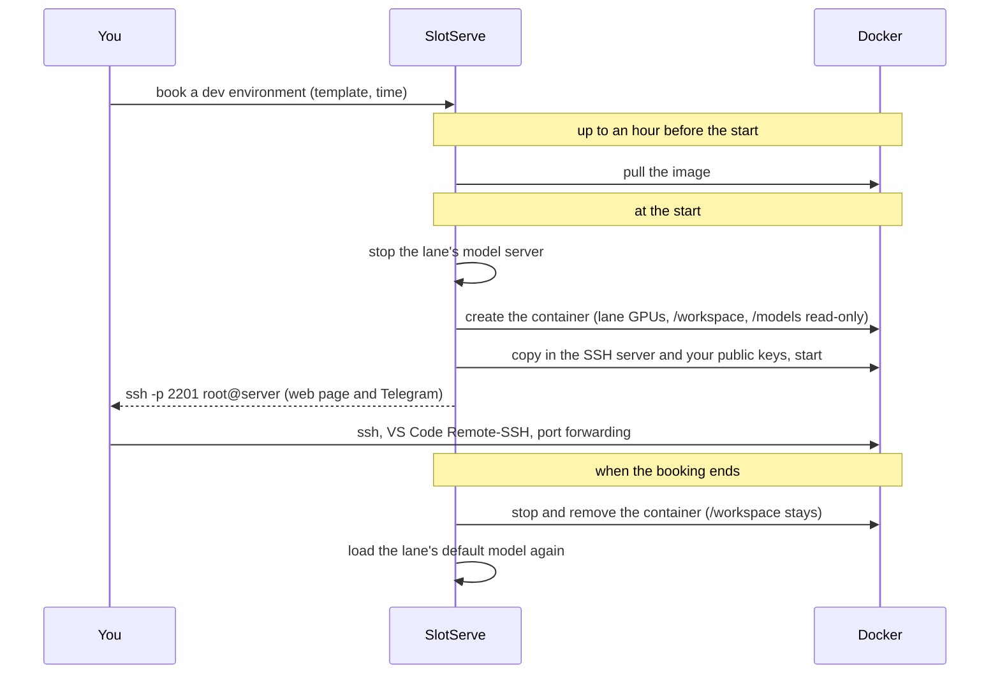

# Dev environments

Besides running a model or taking the whole GPU, a booking can be a **dev environment**: for the length of the booking SlotServe runs a Docker container with the lane's GPUs and an SSH server, and you log in with your SSH key. Your files in `/workspace` are kept between bookings.



## Setting it up (admin)

1. Mount the Docker socket into SlotServe. In `docker-compose.yml` uncomment

    ```yaml
    - /var/run/docker.sock:/var/run/docker.sock
    ```

    and run `docker compose up -d`. Containers need GPU access through the [NVIDIA Container Toolkit](https://docs.nvidia.com/datacenter/cloud-native/container-toolkit/latest/install-guide.html), which the SlotServe container already uses.

2. Turn on **Admin → System settings → Dev environments → Dev environments**.

3. Open the **SSH ports** range (default `2200-2299`) in the host firewall. Each running environment gets one port from it.

4. Optionally set **SSH host name** (what people should type after `root@`), CPU, memory and shared-memory limits, and which image registries are allowed.

!!! warning "Security"
    Whoever controls the Docker socket controls the host. SlotServe only starts containers without extra privileges, with the lane's GPUs, the person's `/workspace` volume and the models directory read-only, but anyone with admin rights in SlotServe can now run containers on the host. Only enable dev environments on a server whose users you trust.

    **Podman** provides a Docker-compatible API without a root daemon. Point `SLOTSERVE_DOCKER_HOST` at its socket (for example `unix:///run/podman/podman.sock`) to use it instead; GPU access then needs Podman's CDI setup.

## Using it

1. Open **Dev environments** and **Add SSH key**: paste the content of `~/.ssh/id_ed25519.pub` (create one with `ssh-keygen -t ed25519`). Only key logins are accepted.
2. Press **Book an environment** (or choose **Dev environment** in the booking dialog), pick a template and a time.
3. The image is downloaded ahead of time; the page shows the progress. When the booking starts, the page shows the command to connect:

    ```bash
    ssh -p 2201 root@server
    ```

    You are `root` inside the container. Your files belong in `/workspace`; the shared models are at `/models` (read-only).

4. **VS Code**: add the snippet from the page to `~/.ssh/config` and connect with Remote-SSH. The port can change between bookings.
5. **Jupyter or other web tools**: start them yourself and forward the port, e.g. `ssh -p 2201 -L 8888:localhost:8888 root@server`.

When the booking ends the container is removed. Extend the booking in time (the reminder 10 minutes before the end has buttons for that) if you need longer.

### Templates

| Template | Image |
| --- | --- |
| PyTorch | `pytorch/pytorch:2.14.1-cuda12.6-cudnn9-devel` |
| Jupyter + PyTorch | `quay.io/jupyter/pytorch-notebook:cuda12-pytorch-2.11.0` |
| TensorFlow | `tensorflow/tensorflow:2.21.0-gpu-jupyter` |
| CUDA | `nvidia/cuda:12.9.2-cudnn-devel-ubuntu24.04` |

The built-in templates use CUDA 12 builds, which run on a wide range of GPUs and drivers. Admins can change their images, switch them off or add shared templates.

Anyone can add **their own template** from any image (unless an admin turned custom images off or limited the registries), with an optional main process and environment variables. The image needs `/bin/sh`; SSH works in any image because SlotServe brings its own small static SSH server.

### Saving an environment

**Save as image** stores the running container (installed packages, files outside `/workspace`) as a new template of yours, so the next booking starts exactly where you left off. `/workspace` is kept anyway and is not part of the image. The number of saved images per person is limited (default 3); deleting a saved template removes the image from the server.

## What admins see

- **Dev environments** with **Everyone** switched on lists every environment with its state, image, port and errors; **Logs** shows the container output.
- A failed environment (image not found, container exited, no free port) shows the reason and can be started again with **Try again**. The person is notified.
- On restart SlotServe keeps environments that are still running and removes leftover containers.
