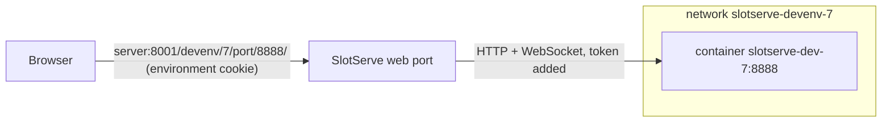
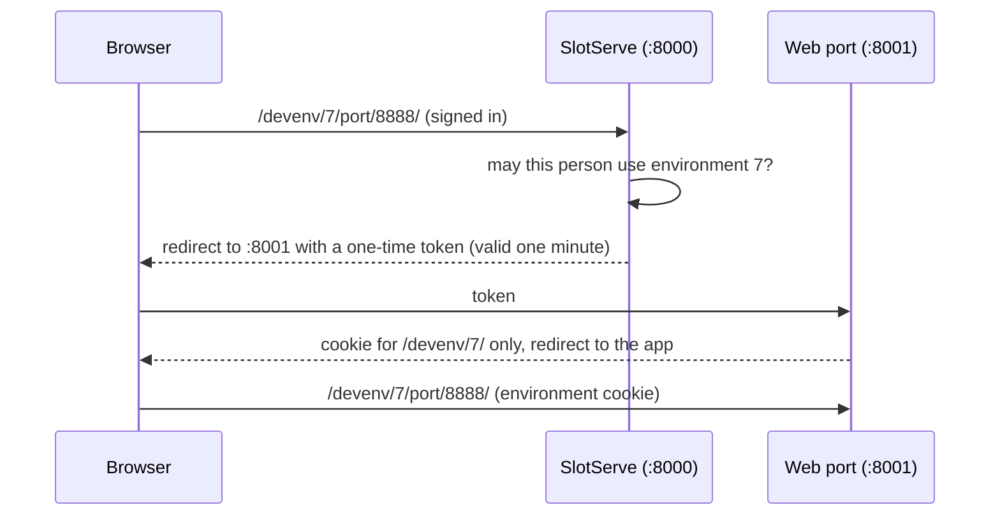
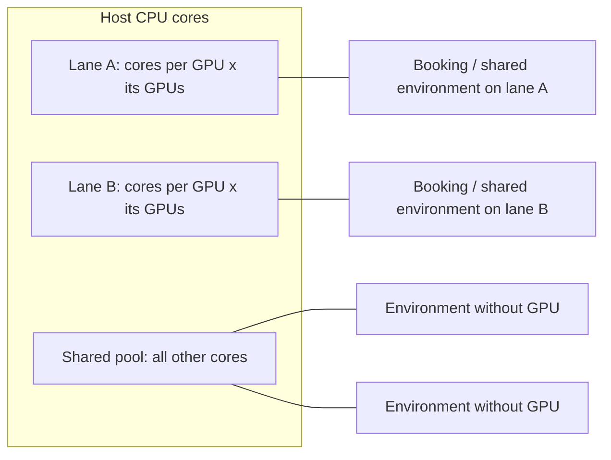

# Dev environments

A **dev environment** is a Docker container of your own on the server: VS Code, JupyterLab or a desktop in the browser, or a terminal over SSH. Your files in `/workspace` are kept between environments. Start one **without a GPU** at any time to write code and set things up, and **book a GPU** when you need it; you can keep the whole environment too. Lanes can also run a **shared environment** everyone who joined can log into while nobody has them booked.

```mermaid
sequenceDiagram
    participant U as You
    participant S as SlotServe
    participant D as Docker
    U->>S: Open: VS Code (browser), no GPU
    S->>D: pull the image if needed, create a network and the container (/workspace, /models read-only)
    S-->>U: the card shows Open when it is ready (about a minute)
    U->>S: Open
    S-->>U: one-time link to the web port (:8001), VS Code opens in a new tab
    Note over U,D: later: with a GPU for a booked time
    S->>S: at the start: stop the lane's model server
    S->>D: the container gets the lane's GPUs (and SSH, when you added a key)
    Note over S,D: when the booking ends
    S->>D: remove the container (/workspace stays; a kept environment is only paused)
    S->>S: load the lane's default model again
```

## Your first environment: VS Code in the browser {#first-environment}

1. Open **Dev environments**. Under **Open an environment**:
    - **Choose a tool**: **VS Code (browser)** (or JupyterLab, the Ubuntu desktop, a terminal, one of your kept environments or another template);
    - **Do you need a GPU?** **Not now** - recommended for setting up and writing code; you can move to a GPU any time;
    - press **Open**.
2. The new environment's card shows its progress (the image is downloaded the first time). After about a minute it has an **Open VS Code** button: VS Code opens in a new browser tab, on `/workspace`.
3. Work. Your files belong in `/workspace`, which is kept after the environment ends and is the same in every environment of yours. Everything else in the container (packages installed with `apt` or `pip` outside `/workspace`) is removed when it ends, unless you keep the environment or save it as an image (see [Kept environments](#kept-environments-projects) and [Saving an environment](#saving-an-environment)).
4. A terminal is inside VS Code (**Terminal → New Terminal**). You are `root` in the container, so `apt install` works without `sudo`. The shared models are at `/models` (read-only), and `OPENAI_BASE_URL` / `OPENAI_API_KEY` let code call SlotServe's models right away (see [Inside the environment](#inside-the-environment)).
5. When you are done, **Stop** it on its card. An environment without a GPU runs until you stop or pause it; there is no time limit.

No SSH key, no password and no booking are needed for the browser tools: you are signed in to SlotServe, and SlotServe signs you in to the app. Opening it goes through a one-time link to SlotServe's **web interface port** (8001), which keeps environments' pages apart from SlotServe itself (see [Their own origin](#their-own-origin)).

### With a GPU {#with-a-gpu}

Choose **Yes, with a GPU** instead of **Not now**, and pick a time: SlotServe books a free GPU for you (the same short booking dialog as on the Overview; **Book with a GPU** opens it directly). Or choose **Dev environment** in any booking dialog. The image is downloaded ahead of time; at the start of the booking the container starts with the lane's GPUs, and the card shows the time left, **+1 h** (it says why when the next hour is taken), live GPU use and **End**. When the booking ends the container is removed (`/workspace` stays) unless it is a kept environment; the reminder 10 minutes before the end has buttons to extend.

A kept environment you used without a GPU can be booked with a GPU and continues where you left it; see [Without a GPU](#without-a-gpu).

### From a terminal or local VS Code: SSH {#ssh}

The second way in is SSH, for your own terminal, VS Code **Remote-SSH**, `scp` or port forwarding. It needs an SSH public key (or the environment password) on SlotServe:

1. Choose **Terminal / SSH** as the tool (or any other: they all have SSH). The page asks for your public key inline the first time: paste it, use the two commands it shows for your system to make one, or let the browser make a key pair (the private key is downloaded once, only the public key is sent). See [Logging in](#logging-in-ssh-keys-and-the-environment-password).
2. When the environment runs, its card shows the command:

    ```bash
    ssh -p 2201 root@server
    ```

3. **VS Code Remote-SSH**: add the snippet from the card to `~/.ssh/config`; each environment has its own Host alias and host key, so connect to that alias. The port can change between bookings.
4. Anything you start yourself (TensorBoard, a demo, an API) can be opened in the browser under **Ports** on the card (see [Ports](#ports)), or with SSH port forwarding, e.g. `ssh -p 2201 -L 8888:localhost:8888 root@server`.

The first `ssh` to an environment asks to trust its host key: compare the fingerprint with the **Host key** on the card.

## Setting it up (admin) {#setting-it-up-admin}

### Docker access {#docker}

1. Mount the Docker socket into SlotServe. In `docker-compose.yml` uncomment

    ```yaml
    - /var/run/docker.sock:/var/run/docker.sock
    ```

    and run `docker compose up -d`. Containers need GPU access through the [NVIDIA Container Toolkit](https://docs.nvidia.com/datacenter/cloud-native/container-toolkit/latest/install-guide.html), which the SlotServe container already uses. Without Docker in a container, the user running SlotServe needs access to the socket (the `docker` group). `SLOTSERVE_DOCKER_HOST` points elsewhere (another socket, `tcp://`).

2. Turn on **Admin → System settings → Dev environments → Dev environments**. The setup checklist item **Dev environments** and the health check **docker** tick when Docker answers; if not, the check's evidence says why ("Cannot connect to the Docker daemon", permission denied on the socket).

3. Open the ports people need in the host firewall: the **web interface port** (`SLOTSERVE_DEVENV_WEB_PORT`, default `8001`, published by `docker-compose.yml`) for the browser tools, the **SSH ports** range (default `2200-2299`; each running environment gets one port from it), and the **Direct port range** (default `2300-2399`) if people may publish ports directly (see [Ports](#ports)). Docker publishes the SSH and direct ports itself, past `ufw`; see [Ports and firewall](operations.md#firewall).

4. Optionally set **SSH host name** (what people should type after `root@`), CPU, memory and shared-memory limits, which image registries are allowed, whether **Password logins** are allowed, a **Storage directory** for persistent data, and the limits for kept environments.

Behind a reverse proxy, also set **Web interface address** (`SLOTSERVE_DEVENV_WEB_URL`); see [Reverse proxy](operations.md#reverse-proxy).

!!! warning "Security"
    Whoever controls the Docker socket controls the host. SlotServe only starts hardened containers without extra privileges (see [Limits and hardening](#limits-and-hardening)), with the lane's GPUs, the person's `/workspace` and the models directory read-only, but anyone with admin rights in SlotServe can now run containers on the host. Only enable dev environments on a server whose users you trust.

    **Podman** provides a Docker-compatible API without a root daemon. Point `SLOTSERVE_DOCKER_HOST` at its socket (for example `unix:///run/podman/podman.sock`) to use it instead; GPU access then needs Podman's CDI setup.

### Templates {#templates}

| Template | Image | Web interface |
| --- | --- | --- |
| PyTorch | `pytorch/pytorch:2.14.1-cuda12.6-cudnn9-devel` | |
| JupyterLab + PyTorch | `quay.io/jupyter/pytorch-notebook:cuda12-pytorch-2.11.0` | JupyterLab |
| TensorFlow | `tensorflow/tensorflow:2.21.0-gpu-jupyter` | |
| CUDA | `nvidia/cuda:12.9.2-cudnn-devel-ubuntu24.04` | |
| Ubuntu desktop | `linuxserver/webtop:ubuntu-xfce-388f14a2-ls7` | Desktop (XFCE) |
| VS Code | `codercom/code-server:4.141.0` | VS Code (code-server) |

The built-in templates use CUDA 12 builds, which run on a wide range of GPUs and drivers. Admins can change their images, switch them off or add shared templates.

Anyone can add **their own template** from any image (unless an admin turned custom images off or limited the registries), with an optional main process and environment variables. The image needs `/bin/sh`; SSH works in any image because SlotServe brings its own small static SSH server.

### Web interfaces {#web-interfaces}

SlotServe opens any port of a running environment in the browser at `/devenv/<session>/port/<port>/`, served on the **web interface port** (see [Their own origin](#their-own-origin)). A template **declares its web interfaces** as a list of ports, each with a name and a kind (desktop, JupyterLab, VS Code or any other web app); while the environment runs, its card has an **Open …** button for each of them (new tab). Other ports, e.g. a TensorBoard you start yourself on port 6006, can be added under **Ports** or opened by typing `/devenv/<session>/port/6006/` on the SlotServe address. Only the person who booked the environment and admins can open its ports (environments that belong to no booking are open to everyone signed in); you need to be signed in to SlotServe.



- **Isolation**: every environment runs on its own Docker network. Web ports are never published: when SlotServe runs in a container it joins the environment's network and reaches any port by container name; when it runs directly on the host, Docker binds each declared port to a random port on `127.0.0.1`, and other ports are reached on the container's address in its network (on Linux hosts). The network is removed when the environment stops (a kept environment keeps its network, and its web addresses, until it is deleted), and leftovers are cleaned up after a restart. A lane's shared environment gets a network too; its web interfaces are open to everyone signed in.
- **Proxy**: SlotServe forwards HTTP (streamed) and WebSockets (Jupyter kernels, VS Code, desktop streaming), keeps redirects and cookies under the environment's path and never passes its own session cookie on.
- **Token**: each start gets a random token. JupyterLab is started with it (`--IdentityProvider.token`), the desktop uses it as its password and VS Code (code-server, `--auth password`) gets its SHA-256 as `HASHED_PASSWORD` (placeholder `{token_sha256}`); SlotServe signs you in on every request it trusts (a token header, or code-server's session cookie), so you never see a password page while nobody can use these apps without going through SlotServe. Opening one of these apps as a **direct port** bypasses that, so it has to be confirmed.
- **Base path**: the main process and environment variables can use the placeholders `{base_path}` and `{port}` (the first declared port, e.g. `/devenv/7/port/8888/` and `8888`), `{base_path_<port>}` (any declared port, e.g. `{base_path_6006}`), `{token}`, `{token_sha256}` and `{session}`. Ports whose app is given its base path (Jupyter `--ServerApp.base_url`, the desktop's `SUBFOLDER`) receive the full path; for all other ports (code-server, most simple apps, ports that are not declared) SlotServe strips the prefix, so those apps should use relative links. The variables `SLOTSERVE_WEB_BASE`, `SLOTSERVE_WEB_PORT` and `SLOTSERVE_WEB_TOKEN` (first declared port) are set as well.
- **Keep the image's entrypoint**: images such as the linuxserver desktop run their own init system. With this option SlotServe keeps the image's entrypoint and command and starts the SSH server next to it with `docker exec`, instead of using its own start script.

The built-ins: **JupyterLab + PyTorch** (JupyterLab on port 8888, files in `/workspace`), **Ubuntu desktop** (an XFCE desktop streamed to the browser, port 3000) and **VS Code** (code-server on port 8080, opened on `/workspace`; extensions come from Open VSX). SSH works in all of them as before.

!!! note
    The desktop streams video with modern browser APIs that need a secure context: open SlotServe over HTTPS (or on `localhost`). Hardware-accelerated graphics in the desktop may need `NVIDIA_DRIVER_CAPABILITIES=all` in the template's environment variables, depending on the host's driver setup.

#### Their own origin {#their-own-origin}

Apps in environments are written by whoever uses them. If they were served on SlotServe's own address, a page in someone's environment could use SlotServe with the rights of whoever opens it (an admin, for example). So the web interfaces are served on a **port of their own** (`SLOTSERVE_DEVENV_WEB_PORT`, default `8001`): browsers treat it as a different site origin, and it never accepts SlotServe's login cookie.



- The links on the environment cards (and old bookmarks of `/devenv/…` on SlotServe's address) go through SlotServe, which signs you in and hands you over; there is nothing to set up for users.
- The cookie on the web port is HttpOnly, belongs to one environment's path, lasts 12 hours and is checked against the database on every request (a disabled account or a lost booking ends access at once).
- SlotServe refuses changing requests (POST, PUT, PATCH, DELETE) sent by pages on the web port, and the web port refuses requests from a page of one environment to another one's address.
- **Behind a reverse proxy** or when the port is published on another number, set **Web interface address** (`SLOTSERVE_DEVENV_WEB_URL`, e.g. `https://gpu-box:8443`) and proxy that address to port 8001 with WebSockets enabled. For the way back to the sign-in, `SLOTSERVE_PUBLIC_URL` should be SlotServe's own address.
- Environments share the web port's origin among themselves. When an app must be fully isolated from other environments' pages, publish it as a [direct port](#ports) (each host port is an origin of its own).
- `SLOTSERVE_DEVENV_WEB_PORT=0` serves web interfaces on SlotServe's own address again, as in earlier versions. Not recommended.

code-server runs with `--auth password`: SlotServe signs you in with its session cookie, so a request that does not come through SlotServe (another container, someone on the host) gets its login page.

### Ports {#ports}

While an environment runs, its card lists its **ports**: the ones its template declares and any you add. For each port you see its name, the container port, how it is opened, its address with **Open** and **Copy** buttons, and whether something listens on it (SlotServe looks at the container's listening sockets; *Localhost only* means the app listens on `127.0.0.1` and must be told to listen on `0.0.0.0`). Ports that something listens on but that are not listed yet are offered for adding with one click.

Each port is opened one of two ways, which you can switch at any time:

| Mode | Address | Who can use it |
| --- | --- | --- |
| **SlotServe login** (default) | `http://server:8001/devenv/<session>/port/<port>/` | You and admins, signed in to SlotServe. For web apps. |
| **Direct** | `http://server:<host port>` | Anyone on the network, without SlotServe. Any app or protocol (HTTP, WebSocket, gRPC, databases, …). |

**Add port** asks for the container port, a name and the mode. Adding, switching and removing ports never restarts the environment. Ports declared by a template (desktop, JupyterLab, VS Code, …) are behind the login unless the template sets them to direct; for those, removing means going back to the template's setting.

- **Direct ports** come from the **Direct port range** (default `2300-2399`, separate from the SSH ports). SlotServe starts a tiny forwarder container (`socat`, image **Port forwarder image**, default `alpine/socat:1.8.1.1`) on the environment's network that publishes the host port and passes connections to the environment. It runs only while the environment runs: it is removed when the port is removed or switched to the login, and when the environment stops or is paused. Direct ports are open to everyone who can reach the server; protect the app itself (a password, a token) if it matters.
- **Fixed numbers**: a kept environment's direct port belongs to the kept environment. Its number stays while the environment is paused and is the same when it is continued; it is released when the kept environment is deleted (or removed for being unused). Any other environment's direct port belongs to its booking and is released when the booking ends.
- **Limits**: admins set **Direct ports per person** (default 5; admins have no limit; `0` lets only admins publish ports) and can switch **Direct ports** off (forwarders stop, the numbers stay assigned).
- **Shared environments** of idle lanes list only their template's ports; nobody can add ports to them.
- A port that the host already uses is skipped when it is first published (the next free number is taken). If a fixed port is taken later, the card shows the problem.
- **Direct ports** on the Dev environments page lists your direct ports, including those of paused kept environments, and lets you release one. Admins see everyone's with **Everyone** and can **reclaim** any: the host port goes back to the pool and the container port stays reachable behind the login.

### Saving an environment {#saving-an-environment}

**Save as image** stores the running container (installed packages, files outside `/workspace`) as a new template of yours, so the next booking starts exactly where you left off. `/workspace` is kept anyway and is not part of the image. The new template declares the environment's ports, including the ones you added and whether each is direct. The number of saved images per person is limited (default 3); deleting a saved template removes the image from the server.

Before saving (and before a kept environment is snapshotted) SlotServe empties what it copied in for this environment only: the environment key, the SSH host key and root's password hash; the `SLOTSERVE_*`, `OPENAI_*` and web token variables are emptied in the image, which keeps its own variables. The next start fills them in again.

## Inside the environment {#inside-the-environment}

Every new environment knows where it is and how to call a model (admins: **Platform context in environments**, on by default):

- **Variables**: `SLOTSERVE_USER`, `SLOTSERVE_END` (the booking's end), `SLOTSERVE_ENV_ID`, `SLOTSERVE_ENV` (the template's or kept environment's name), `SLOTSERVE_LANE`, `SLOTSERVE_GPUS`, `SLOTSERVE_MACHINE`, `SLOTSERVE_CHECKPOINT_DIR` (`/workspace/.checkpoints`, a convention for training scripts) and `OPENAI_BASE_URL`. When a booking is extended, login shells see the new end (`/run/slotserve/env`); the container's own environment keeps the end it started with.
- **The LLM endpoint**: `OPENAI_BASE_URL` is `http://slotserve-gw:8002/v1`, a small listener of SlotServe that serves only the `/v1` API to the environments (not the web UI or `/api`). Requests go through the same keys, admission and usage records as on SlotServe's own port. A template that sets its own `OPENAI_BASE_URL` keeps it.
- **The environment key**: a booked or CPU-only environment gets its own key (`sk-ss-env-...`, `llm` scope only, acting as you). It is written to `/run/slotserve/llm-key` (readable by root only) and exported as `OPENAI_API_KEY` in login shells, so `python3 -c 'from openai import OpenAI; print(OpenAI().models.list())'` works without any setup. It is never in the container's environment (`docker inspect` does not show it), is revoked when the environment stops and lives at most 24 hours at a time (moved on while the environment runs). Shared environments of idle lanes get no key: use your own API key there. Admins can switch keys off (**Environment LLM key**).
- **Login banner**: SSH logins show at most three lines: the environment, its GPUs and the time left; `/workspace` usage; the LLM endpoint with a one-line example.

Shells that are not login shells (some web terminals) do not read `/etc/profile.d`; run `. /etc/profile.d/slotserve-platform.sh` there. Images that run as another user than root (their own entrypoint) cannot read the key file.

Where the listener is: when SlotServe runs on the host, on the address of Docker's default bridge (`docker0`, e.g. `172.17.0.1`) - environments find it through `/etc/hosts`, and nothing outside the machine reaches it. When SlotServe runs in a container, on its own addresses, as `slotserve-gw` on each environment's network (the port is not published). `SLOTSERVE_DEVENV_GATEWAY_PORT` (default 8002, 0 = off) and `SLOTSERVE_DEVENV_GATEWAY_HOST` change it. A host firewall that drops traffic from containers to the host blocks it too. With Docker on another machine, environments get no LLM endpoint.

## Logging in: SSH keys and the environment password {#logging-in-ssh-keys-and-the-environment-password}

Your credentials are on the **Access credentials** page (next to your API keys):

- **SSH public keys**: paste the content of `~/.ssh/id_ed25519.pub` (create one with `ssh-keygen -t ed25519`).
- **Environment password**: an SSH password for dev environments, separate from your SlotServe password. SlotServe stores only its SHA-512-crypt hash (the `/etc/shadow` format) and writes that hash into the container; the password itself is never stored. Each connection gets three tries.

A template with a web interface (JupyterLab, the desktop, VS Code) starts without any credentials: you use it in the browser, and SSH simply lets nobody in until you add a key. Any other template needs an SSH key, or an environment password while **Password logins** is on (the default). Admins can switch password logins off; then only keys work and SSH servers reject passwords. A new password reaches a running booked environment the next time it starts. Shared environments only accept keys.

Every environment has its own SSH host key; its fingerprint is shown with the environment. A kept environment keeps its key across pauses, GPU changes and snapshots. Environments created before this version get their own key the next time they start, so `ssh` warns about a changed host key once: remove the old line from `~/.ssh/known_hosts` (`ssh-keygen -R "[server]:port"`) and check the new fingerprint.

## Limits and hardening {#limits-and-hardening}

Every container SlotServe creates goes through one last, fixed step before Docker sees it:

- **No new privileges** (setuid programs such as `sudo` cannot gain rights) and a few capabilities dropped (`NET_RAW`, `MKNOD`, `SYS_CHROOT`, `AUDIT_WRITE`, `SETFCAP`; `ping` does not work). Templates whose image needs setuid programs (the built-in desktop: its init system) run in **compatibility mode** without the first rule; admins switch it per template and the template shows it.
- **Processes**: at most `SLOTSERVE_DEVENV_PIDS_LIMIT` (default 4096), so a fork bomb stays inside its container.
- **Memory**: the **Memory limit** setting, or - when it is 0 - the host's memory less max(4 GB, 10 %). Before this version 0 meant "no limit"; now an out-of-memory process is killed inside its container instead of taking SlotServe and everyone else with it. Admins see the limit that applies on the Dev environments information (`/api/devenv`, `hardening`).
- **Open files**: 1048576. **Logs**: at most 5 files of 50 MB per container.
- **GPUs**: exactly the lane's GPUs. A lane that names no GPUs cannot start a GPU environment (it used to get every GPU of the machine); give the lane its GPUs under Admin.
- Never privileged, never the host's network, process or IPC namespace, never a bind of `/` or of the Docker socket.

Kept environments created by an older version are snapshotted and recreated once on their next start, because these settings cannot be added to an existing container.

What this means inside an environment (`sudo`, `ping`, killed jobs) and when to use compatibility mode: [Container hardening and compatibility mode](operations.md#hardening).

## Kept environments (projects) {#kept-environments-projects}

Normally the container is removed when the booking ends and only `/workspace` stays. To keep everything you installed, choose **Keep as new** in the booking dialog and give the environment a name. When that booking ends the container is only stopped (paused). A later booking can **Continue** it: the same container starts again, with your current keys and password copied in.

- If the next booking is on a lane with different GPUs, SlotServe saves the container as an image (a snapshot) and recreates it on the new GPUs, keeping its kept directories and settings. The same happens when its kept directories changed or its old SSH port is taken.
- **Kept directories**: besides `/workspace`, a template or kept environment can list more directories to keep, e.g. `/root` or `/opt/conda` (absolute paths; system directories such as `/etc`, `/usr`, `/proc` or `/opt/slotserve` are not allowed). A new directory starts with the image's content. Changing the list takes effect the next time the container is created.
- The **Dev environments** page lists your kept environments with their state (paused, running, not started yet, container missing), size and last use. You can rename them, change their kept directories and delete them; deleting removes the container and its snapshot, and optionally its kept directories. `/workspace` is never deleted.
- One kept environment cannot be booked twice at the same time. Admins limit how many each person may keep (**Kept environments per person**, default 3) and can remove kept environments unused for a number of days (**Remove unused kept environments after**; 0 = never; their data stays).

## Without a GPU {#without-a-gpu}

Not everything needs a GPU. Editing code, moving data, installing packages or a CPU job can run in a dev environment **without a GPU**, at any time and without a booking:

- On the **Dev environments** page, press **Start without GPU** in the **Without a GPU** section (or on a template or kept environment) and pick a template or one of your kept environments. It starts right away on the server's shared CPU cores, with the same SSH login, `/workspace`, kept directories and web interfaces as a booked environment, but no GPU.
- It runs until you **Pause** it (a kept environment keeps its container) or **Stop** it (any other environment; `/workspace` stays). There is no idle timeout and no end time. Its card shows the CPU cores and memory it uses right now.
- Admins limit how many each person may run at once (**Without-GPU environments per person**, default 2).

**One kept environment, two modes.** A kept environment can run without a GPU between its bookings. When a booking of it starts, SlotServe stops it and continues it with the booked lane's GPUs: the container is saved as a snapshot and recreated with the GPUs, so everything installed stays (as when a kept environment moves to other GPUs). When the booking ends it is paused as usual; with **Continue without GPU after bookings** switched on for that kept environment it goes on running without a GPU instead. You can also start it without a GPU again at any time. While a booking of it runs, it cannot be started without a GPU.

!!! note "Snapshots"
    Each switch between the CPU and a booking's GPUs saves the container as an image layer. If a kept environment switches very often over a long time, delete it and keep a fresh one now and then (or save it as an image and start a kept environment from that), because images have a limit on the number of layers.

### Sharing the CPU fairly {#sharing-the-cpu-fairly}



- Every GPU lane **reserves CPU cores** for whoever uses it: **CPU cores reserved per GPU** (default 8) times its number of GPUs (a lane that does not restrict its GPUs counts as one). Its booking containers and its shared idle environment run on exactly those cores (Docker cpuset), so CPU-only work cannot slow a GPU booking down. 0 reserves nothing.
- Environments without a GPU share **all other cores** (the pool). They all get the same CPU weight, so an idle core can be used by anyone and a busy pool is split evenly. On top of that each has a hard limit: **CPU limit without GPU** (cores, default 4; 0 = the whole pool) and **Memory limit without GPU** (default 16 GB; 0 = the host default, see [Limits](#limits-and-hardening)).
- **Memory pool without GPU** caps how much memory all environments without a GPU may claim together: when one starts, the memory limits of all running ones are added up, and a new one that would not fit is refused until another is paused. 0 = no total.
- SlotServe reads the number of cores and the memory of the host from Docker. If there are fewer cores than the lanes want, each lane gets its share and at least one core stays in the pool. The section on the Dev environments page shows the pool and each lane's cores. Reserved cores are assigned by logical CPU number, in lane order.

Changing these settings applies to containers created afterwards; a kept container gets its new CPU placement and limits the next time it starts.

### Usage {#usage}

The CPU time and memory of every environment without a GPU are read from Docker every few seconds and recorded each minute for its owner (kind "CPU-only environments"). The **Usage** page then shows **CPU core-hours** per person.

### What admins see {#cpu-what-admins-see}

The **Without a GPU** section lists every running environment without a GPU with its owner, state, CPU cores and memory in use, and a **Pause** / **Stop** button (logged in the audit log). Admins find the settings in **Admin → System settings → Dev environments**.

## Idle lanes: a shared environment {#idle-lanes-a-shared-environment}

Admins choose per lane what runs while nobody has it booked (**Admin → GPUs & lanes → When not booked**):

| Mode | While the lane is not booked |
| --- | --- |
| Run the default model | The lane's default model is loaded (as before). |
| Shared dev environment | One container from a chosen template runs with the lane's GPUs. Everyone who joined it can log in. |
| Nothing | No model server and no container; the GPUs stay free. |

The shared environment is stopped ahead of the next booking (like a model preload, or a whole-GPU booking's lead time) and starts again when the lane is idle; a model does not start loading until the shared environment has let go of the GPUs. The overview and the lanes page show what an idle lane is doing.

Inside, everyone who **joined** the lane's shared environment (on the Dev environments page; an SSH key is needed) has their own account (their user name in lower case, with characters other than letters, digits, `_` and `-` replaced) and their SSH keys in `~/.ssh/authorized_keys`. Password logins are off there, so no password hashes are copied into it. People who had an SSH key when SlotServe was upgraded to this version were joined to every lane. Home directories live on a volume per lane and are kept. `root` cannot log in. The **Dev environments** page shows the shared environment of each idle lane with your own command:

```bash
ssh -p 2205 alice@server
```

Accounts are created when the container starts and refreshed when someone joins, leaves or changes their keys (and once a minute). The image needs `useradd` or `adduser`; if it has neither the environment fails with a clear message. Only templates offered to everyone (built-in or shared by an admin) can be used.

## Storage {#storage}

Admins can add host directories, NFS exports and SMB shares in **Admin → Storage** for shared data, personal spaces (`/workspace`), project data and model libraries; see [Storage](storage.md). What follows is what happens without them.

By default persistent data lives in Docker named volumes: `slotserve-workspace-u<user id>` for `/workspace`, `slotserve-project<id>-<path>` for a kept environment's directories, `slotserve-u<user>-t<template>-<path>` for a template's kept directories and `slotserve-idle-home-l<lane>` for the homes of a lane's shared environment.

With **Storage directory** set to a directory on the Docker host (for example `/srv/slotserve`), bind mounts are used instead:

| Data | Directory |
| --- | --- |
| `/workspace` | `<storage>/users/u<user id>/workspace` |
| A template's kept directory | `<storage>/users/u<user id>/t<template id>/<path>` |
| A kept environment's directory | `<storage>/projects/p<id>/<path>` |
| Homes of a shared environment | `<storage>/lanes/l<lane id>/home` |

The path is a path on the Docker host, not inside the SlotServe container. Missing directories are created by a short-lived helper container of SlotServe's own helper image (`SLOTSERVE_STORAGE_HELPER_IMAGE`, default `busybox:1.37`) that mounts only the parent folders it works in, so SlotServe does not need access to the directory itself. A new directory is filled from the environment's image, like a new volume: the content is copied out of the image with Docker's archive API, the image itself never runs for this.

## What admins see {#what-admins-see}

- **Dev environments** with **Everyone** switched on lists every environment with its state, image, port and errors; **Logs** shows the container output.
- A failed environment (image not found, container exited, no free port) shows the reason and can be started again with **Try again**. The person is notified.
- On restart SlotServe keeps environments that are still running, stops kept environments whose booking is over and removes leftover containers and networks. Port forwarders are recreated for the environments that still run.
- **Direct ports** with **Everyone** lists every published host port with its owner and environment; **Reclaim** frees one.
- Shared environments: only admins can restart them or read their logs and errors (for example a failed account refresh).
