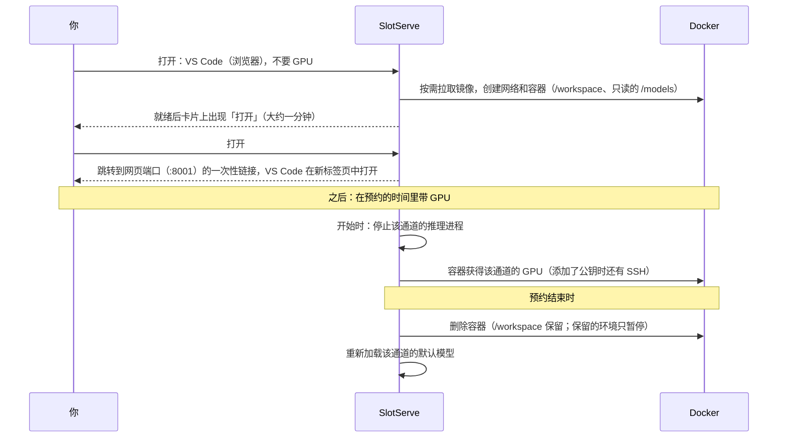
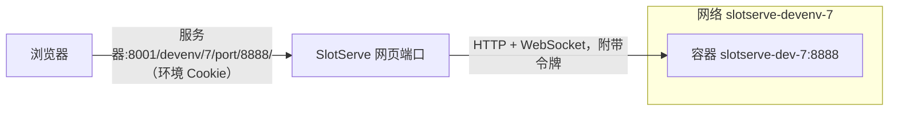
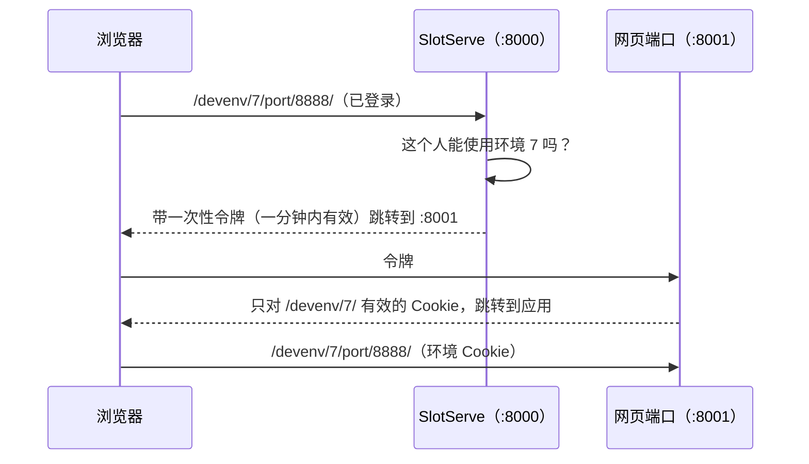
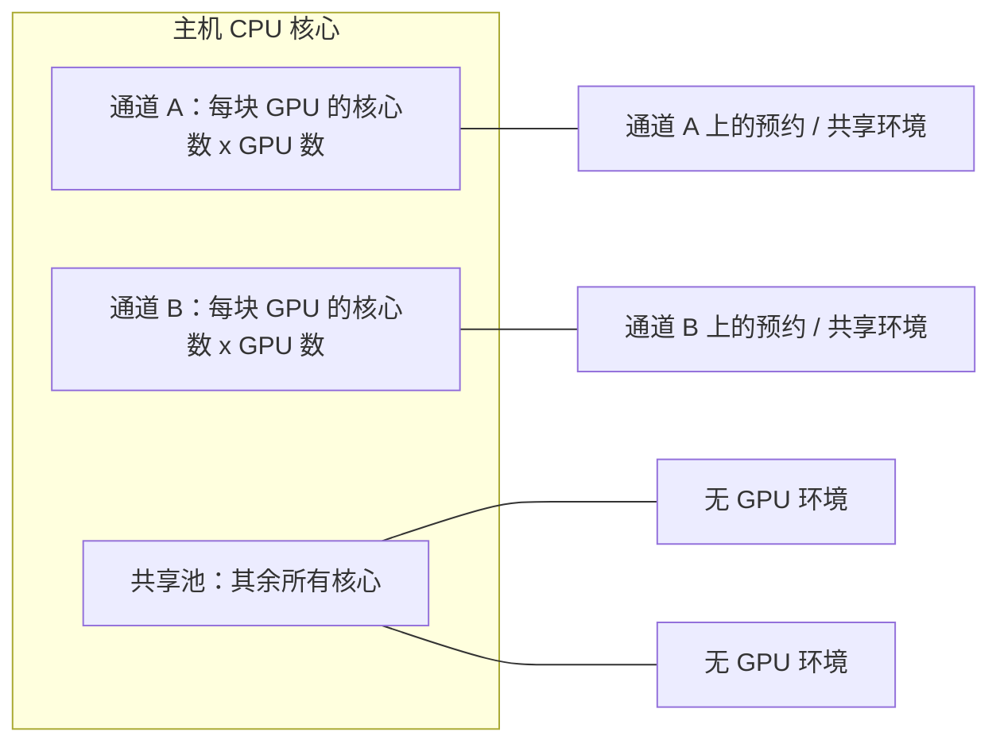

# 开发环境

**开发环境**是你在服务器上的一个专属 Docker 容器：浏览器里的 VS Code、JupyterLab 或桌面，或者通过 SSH 使用的终端。`/workspace` 里的文件在不同环境之间一直保留。你可以随时**不带 GPU** 启动一个环境来写代码、装环境，需要时再**预约 GPU**；也可以把整个环境保留下来。通道还可以在无人预约时运行一个**共享环境**，所有加入的人都能登录。



## 第一个环境：浏览器里的 VS Code {#first-environment}

1. 打开**开发环境**。在**打开一个环境**下：
    - **选择工具**：**VS Code（浏览器）**（或 JupyterLab、Ubuntu 桌面、终端、你保留的环境或其他模板）；
    - **要 GPU 吗？** 选**先不用**：推荐用来装环境、写代码，随时可以切到 GPU；
    - 点**打开**。
2. 新环境的卡片会显示进度（第一次需要下载镜像）。大约一分钟后卡片上出现**打开 VS Code** 按钮：VS Code 在新的浏览器标签页中打开 `/workspace`。
3. 开始工作。文件请放在 `/workspace`：环境结束后它仍然保留，并且你所有的环境看到的都是同一个 `/workspace`。容器里的其他内容（在 `/workspace` 以外用 `apt` 或 `pip` 装的软件包）会在环境结束时删除，除非你保留这个环境或把它保存为镜像（见[保留的环境](#kept-environments-projects)和[保存环境](#saving-an-environment)）。
4. VS Code 里有终端（**Terminal → New Terminal**）。你在容器里是 `root`，所以 `apt install` 不需要 `sudo`。共享模型在 `/models`（只读），`OPENAI_BASE_URL` / `OPENAI_API_KEY` 让代码可以直接调用 SlotServe 的模型（见[环境内的平台信息](#inside-the-environment)）。
5. 用完后在卡片上点**停止**。不带 GPU 的环境会一直运行到你停止或暂停它，没有时间限制。

浏览器里的工具不需要 SSH 密钥、密码或预约：你已经登录了 SlotServe，SlotServe 会替你登录应用。打开时会经过一个跳转到 SlotServe **网页界面端口**（8001）的一次性链接，这个端口把各环境的页面与 SlotServe 本身隔开（见[独立的源](#their-own-origin)）。

### 带 GPU {#with-a-gpu}

把**先不用**换成**要 GPU**，再选时间：SlotServe 会为你预约一块空闲的 GPU（和总览上一样的简短预约对话框；**预约带 GPU 的环境**会直接打开它）。也可以在任何预约对话框中选择「开发环境」。镜像会提前下载；预约开始时容器带着该通道的 GPU 启动，卡片上显示剩余时间、**+1 小时**（下一小时已被占用时会说明原因）、实时 GPU 使用情况和**结束**。预约结束时容器会被删除（`/workspace` 保留），保留的环境除外；结束前 10 分钟的提醒里有延长按钮。

你在无 GPU 状态下使用过的保留环境，可以预约 GPU 后从上次离开的地方继续；见[无 GPU 模式](#without-a-gpu)。

### 从终端或本地 VS Code 连接：SSH {#ssh}

第二种方式是 SSH，适用于你自己的终端、VS Code **Remote-SSH**、`scp` 或端口转发。需要在 SlotServe 上添加 SSH 公钥（或设置环境密码）：

1. 工具选择**终端 / SSH**（其他工具也都带 SSH）。第一次时页面会直接要求你填写公钥：粘贴公钥、按页面给出的两条命令为你的系统生成一个，或者让浏览器生成密钥对（私钥只下载一次，只有公钥发送给 SlotServe）。见[登录方式](#logging-in-ssh-keys-and-the-environment-password)。
2. 环境运行后，卡片上会显示连接命令：

    ```bash
    ssh -p 2201 root@服务器
    ```

3. **VS Code Remote-SSH**：把卡片上的配置片段加到 `~/.ssh/config`；每个环境都有自己的 Host 别名和主机密钥，连接那个别名即可。每次预约的端口可能不同。
4. 自己启动的程序（TensorBoard、演示页面、API）可以在卡片的**端口**里用浏览器打开（见[端口](#ports)），或用 SSH 端口转发访问，如 `ssh -p 2201 -L 8888:localhost:8888 root@服务器`。

第一次 `ssh` 到某个环境时会询问是否信任它的主机密钥：请与卡片上的**主机密钥**对比指纹。

## 开启（管理员） {#setting-it-up-admin}

### Docker 访问 {#docker}

1. 把 Docker 套接字挂载进 SlotServe：在 `docker-compose.yml` 里取消注释

    ```yaml
    - /var/run/docker.sock:/var/run/docker.sock
    ```

    然后执行 `docker compose up -d`。容器通过 [NVIDIA Container Toolkit](https://docs.nvidia.com/datacenter/cloud-native/container-toolkit/latest/install-guide.html) 使用 GPU，SlotServe 本身已经依赖它。不在容器中运行 SlotServe 时，运行它的用户需要有访问套接字的权限（`docker` 组）。`SLOTSERVE_DOCKER_HOST` 可以指向别处（其他套接字、`tcp://`）。

2. 打开**管理 → 系统设置 → 开发环境 → 开发环境**。Docker 有响应时，设置进度中的**开发环境**和健康检查 **docker** 会打勾；否则该检查的详情会说明原因（"Cannot connect to the Docker daemon"、套接字权限不足）。

3. 在宿主机防火墙中放行需要的端口：浏览器工具用的**网页界面端口**（`SLOTSERVE_DEVENV_WEB_PORT`，默认 `8001`，`docker-compose.yml` 已发布）；**SSH 端口范围**（默认 `2200-2299`，每个运行中的环境占用其中一个端口）；如果允许用户直接发布端口（见[端口](#ports)），还有**直连端口范围**（默认 `2300-2399`）。SSH 端口和直连端口由 Docker 自己发布，会绕过 `ufw`；见[端口与防火墙](operations.md#firewall)。

4. 按需设置 **SSH 主机名**（用户在 `root@` 后面输入的地址）、CPU、内存、共享内存上限、允许的镜像仓库、是否允许**密码登录**、存放持久数据的**存储目录**，以及保留环境的限制。

在反向代理之后，还要设置**网页界面地址**（`SLOTSERVE_DEVENV_WEB_URL`）；见[反向代理](operations.md#reverse-proxy)。

!!! warning "安全"
    能控制 Docker 套接字就能控制宿主机。SlotServe 只启动经过加固、不带额外特权的容器（见[资源上限与加固](#limits-and-hardening)），只挂载该通道的 GPU、用户自己的 `/workspace` 和只读的模型目录；但 SlotServe 的管理员从此可以在宿主机上运行容器。只在用户可信的服务器上开启开发环境。

    **Podman** 提供与 Docker 兼容、不需要 root 守护进程的接口。把 `SLOTSERVE_DOCKER_HOST` 指向它的套接字（如 `unix:///run/podman/podman.sock`）即可改用 Podman，GPU 需要按 Podman 的 CDI 方式配置。

### 模板 {#templates}

| 模板 | 镜像 | 网页界面 |
| --- | --- | --- |
| PyTorch | `pytorch/pytorch:2.14.1-cuda12.6-cudnn9-devel` | |
| JupyterLab + PyTorch | `quay.io/jupyter/pytorch-notebook:cuda12-pytorch-2.11.0` | JupyterLab |
| TensorFlow | `tensorflow/tensorflow:2.21.0-gpu-jupyter` | |
| CUDA | `nvidia/cuda:12.9.2-cudnn-devel-ubuntu24.04` | |
| Ubuntu desktop | `linuxserver/webtop:ubuntu-xfce-388f14a2-ls7` | 桌面（XFCE） |
| VS Code | `codercom/code-server:4.141.0` | VS Code（code-server） |

内置模板使用 CUDA 12 版本，兼容的显卡和驱动范围更广。管理员可以更换镜像、停用模板或添加共享模板。

每个人都可以用任意镜像新建**自己的模板**（除非管理员关闭了自定义镜像或限制了镜像仓库），可以指定主进程和环境变量。镜像需要包含 `/bin/sh`；SSH 不依赖镜像，SlotServe 会放入自带的小型静态 SSH 服务。

### 网页界面 {#web-interfaces}

SlotServe 可以在浏览器里打开运行中环境的任意端口，地址是 `/devenv/<会话>/port/<端口>/`，由**网页界面端口**提供（见下文「独立的源」）。模板以端口列表的形式**声明网页界面**，每个端口有名称和类型（桌面、JupyterLab、VS Code 或其他网页应用）；环境运行时，卡片上每个端口都有一个**打开…**按钮（新标签页）。其他端口（比如自己在 6006 端口启动的 TensorBoard）可以在**端口**里添加，或在 SlotServe 地址后直接输入 `/devenv/<会话>/port/6006/` 打开。只有预约人和管理员能打开（不属于任何预约的环境对所有已登录用户开放），并且需要先登录 SlotServe。



- **隔离**：每个环境运行在自己的 Docker 网络里。网页端口从不对外公开：SlotServe 运行在容器中时，会加入环境的网络，按容器名访问任意端口；直接运行在宿主机上时，Docker 把每个声明的端口绑定到 `127.0.0.1` 的随机端口，其他端口通过容器在其网络中的地址访问（Linux 宿主机）。环境停止时网络会被删除（保留环境会一直保留自己的网络和网页地址，直到它被删除），重启后会清理残留的网络。通道的共享环境也有自己的网络，它的网页界面对所有已登录用户开放。
- **代理**：SlotServe 转发 HTTP（流式）和 WebSocket（Jupyter 内核、VS Code、桌面画面都需要），让重定向和 Cookie 保持在环境的路径下，并且不会把自己的会话 Cookie 转给应用。
- **令牌**：每次启动生成一个随机令牌。JupyterLab 用它启动（`--IdentityProvider.token`），桌面用它作为密码，VS Code（code-server，`--auth password`）以它的 SHA-256 作为 `HASHED_PASSWORD`（占位符 `{token_sha256}`）；SlotServe 会在它信任的每个请求里替你登录（令牌请求头或 code-server 的会话 cookie），所以你不会看到密码页，而不经过 SlotServe 就无法使用这些应用。把这些应用开成**直连端口**会绕过这一点，因此需要确认。
- **基础路径**：主进程和环境变量里可以使用占位符 `{base_path}` 和 `{port}`（第一个声明的端口，如 `/devenv/7/port/8888/` 和 `8888`）、`{base_path_<端口>}`（任一声明的端口，如 `{base_path_6006}`）、`{token}` 和 `{session}`。应用拿到自己基础路径的端口（Jupyter 的 `--ServerApp.base_url`、桌面的 `SUBFOLDER`）收到完整路径；其他端口（code-server、大多数简单应用、未声明的端口）由 SlotServe 去掉前缀后转发，这些应用应使用相对链接。另外还会设置 `SLOTSERVE_WEB_BASE`、`SLOTSERVE_WEB_PORT` 和 `SLOTSERVE_WEB_TOKEN` 环境变量（第一个声明的端口）。
- **保留镜像自带的入口程序**：linuxserver 桌面这类镜像运行自己的 init 系统。打开这个选项后，SlotServe 保留镜像的入口程序和命令，并通过 `docker exec` 在旁边启动 SSH 服务，而不是使用自己的启动脚本。

内置模板：**JupyterLab + PyTorch**（JupyterLab，端口 8888，文件在 `/workspace`）、**Ubuntu desktop**（XFCE 桌面串流到浏览器，端口 3000）和 **VS Code**（code-server，端口 8080，打开 `/workspace`；扩展来自 Open VSX）。SSH 照常可用。

!!! note
    桌面使用的浏览器视频接口需要安全上下文：请通过 HTTPS（或 `localhost`）访问 SlotServe。桌面里的硬件加速图形可能需要在模板环境变量中加入 `NVIDIA_DRIVER_CAPABILITIES=all`，取决于宿主机的驱动配置。

#### 独立的源 {#their-own-origin}

环境里的应用由使用者自己编写。如果它们和 SlotServe 使用同一个地址，某人环境里的网页就能以打开者（比如管理员）的身份操作 SlotServe。因此网页界面使用**单独的端口**（`SLOTSERVE_DEVENV_WEB_PORT`，默认 `8001`）：浏览器把它当作不同的源，而且这个端口从不接受 SlotServe 的登录 Cookie。



- 环境卡片上的链接（以及 SlotServe 地址下旧的 `/devenv/…` 书签）都会先经过 SlotServe 完成登录和交接，用户无需任何设置。
- 网页端口上的 Cookie 是 HttpOnly 的，只属于一个环境的路径，有效 12 小时，并且每次请求都会查数据库（账号停用或失去预约后立即失效）。
- SlotServe 拒绝网页端口上的页面发来的修改类请求（POST、PUT、PATCH、DELETE）；网页端口也拒绝一个环境的页面访问另一个环境的地址。
- **使用反向代理**或把端口映射成其他号码时，请设置**网页界面地址**（`SLOTSERVE_DEVENV_WEB_URL`，如 `https://gpu-box:8443`），并把这个地址代理到 8001 端口（开启 WebSocket）。为了能跳回登录，`SLOTSERVE_PUBLIC_URL` 应设为 SlotServe 本身的地址。
- 各个环境之间共用网页端口这个源。如果某个应用需要和其他环境的页面完全隔离，请把它发布为直连端口（见下文「端口」；每个宿主机端口都是独立的源）。
- `SLOTSERVE_DEVENV_WEB_PORT=0` 会像旧版本一样在 SlotServe 自己的地址上提供网页界面，不推荐。

code-server 以 `--auth password` 运行：SlotServe 用它的会话 cookie 替你登录，不经过 SlotServe 的请求（其他容器、宿主机上的其他人）只会看到它的登录页。

### 端口 {#ports}

环境运行时，卡片上会列出它的**端口**：模板声明的端口和你添加的端口。每个端口显示名称、容器端口、访问方式、带**打开**和**复制**按钮的地址，以及是否有程序在监听（SlotServe 会查看容器里正在监听的套接字；「仅本机」表示应用只监听 `127.0.0.1`，需要改为监听 `0.0.0.0`）。正在监听但还没列出的端口会显示出来，一键即可添加。

每个端口有两种访问方式，随时可以切换：

| 方式 | 地址 | 谁能使用 |
| --- | --- | --- |
| **SlotServe 登录**（默认） | `http://服务器:8001/devenv/<会话>/port/<端口>/` | 你和管理员，需登录 SlotServe。适合网页应用。 |
| **直连** | `http://服务器:<宿主机端口>` | 局域网内任何人，不经过 SlotServe。任何应用或协议（HTTP、WebSocket、gRPC、数据库……）。 |

**添加端口**时填写容器端口、名称和访问方式。添加、切换和移除端口都不会重启环境。模板声明的端口（桌面、JupyterLab、VS Code……）默认需要登录，除非模板把它设为直连；对这些端口，「恢复默认」即回到模板的设置。

- **直连端口**取自**直连端口范围**（默认 `2300-2399`，与 SSH 端口分开）。SlotServe 会在环境的网络里启动一个很小的转发容器（`socat`，镜像为**端口转发镜像**，默认 `alpine/socat:1.8.1.1`），由它发布宿主机端口并把连接转给环境。它只在环境运行时存在：端口被移除或改回登录方式、环境停止或暂停时都会删除。直连端口对所有能访问服务器的人开放；如有需要，请让应用自己加上密码或令牌。
- **端口号固定**：保留环境的直连端口属于这个保留环境，暂停期间号码不变，继续使用时还是同一个号码；保留环境被删除（或因闲置被清理）时释放。其他环境的直连端口属于本次预约，预约结束时释放。
- **限制**：管理员可以设置**每人直连端口数**（默认 5；管理员不受限制；`0` 表示只有管理员能发布），也可以关闭**直连端口**（转发容器停止，号码仍然保留）。
- 空闲通道的**共享环境**只列出模板里的端口，任何人都不能添加。
- 首次发布时如果宿主机端口已被其他程序占用，会自动换用下一个空闲号码；固定号码后来被占用时，卡片上会显示问题。
- 开发环境页面的**直连端口**列出你的直连端口（包括暂停中的保留环境的端口），可以释放。管理员打开**所有人**可以看到所有人的直连端口并**收回**：宿主机端口回到池中，容器端口仍可在登录后访问。

### 保存环境 {#saving-an-environment}

**保存为镜像**会把运行中的容器（装好的软件、`/workspace` 以外的文件）保存成你自己的新模板，下次预约直接从这里继续。`/workspace` 本来就会保留，不会打进镜像。新模板会带上环境的端口声明，包括你添加的端口以及每个端口是否直连。每人可保存的镜像数量有上限（默认 3 个）；删除已保存的模板会同时删除服务器上的镜像。

保存之前（以及保留的环境做快照之前），SlotServe 会清空只属于本次环境、由它放进容器的内容：环境密钥、SSH 主机密钥和 root 的密码哈希；镜像里的 `SLOTSERVE_*`、`OPENAI_*` 和网页令牌变量会被置空，镜像自己的变量保持不变。下次启动时会重新写入。

## 环境内的平台信息 {#inside-the-environment}

每个新环境都知道自己在哪里、怎样调用模型（管理员设置：**环境内的平台信息**，默认开启）：

- **环境变量**：`SLOTSERVE_USER`、`SLOTSERVE_END`（预约结束时间）、`SLOTSERVE_ENV_ID`、`SLOTSERVE_ENV`（模板或保留环境的名称）、`SLOTSERVE_LANE`、`SLOTSERVE_GPUS`、`SLOTSERVE_MACHINE`、`SLOTSERVE_CHECKPOINT_DIR`（`/workspace/.checkpoints`，供训练脚本约定使用）以及 `OPENAI_BASE_URL`。预约延长后，登录 shell 会读到新的结束时间（`/run/slotserve/env`）；容器自身的环境变量保留启动时的值。
- **LLM 接口**：`OPENAI_BASE_URL` 为 `http://slotserve-gw:8002/v1`，这是 SlotServe 专门给环境用的小监听端口，只提供 `/v1` 接口（不提供网页界面和 `/api`）。请求与 SlotServe 自身端口上一样经过密钥校验、准入和用量记录。模板自己设置了 `OPENAI_BASE_URL` 时以模板为准。
- **环境密钥**：预约的环境和无 GPU 环境会得到一把专属密钥（`sk-ss-env-...`，仅 `llm` 权限，以你的身份调用）。它写在 `/run/slotserve/llm-key`（仅 root 可读），在登录 shell 中导出为 `OPENAI_API_KEY`，因此无需任何配置即可运行 `python3 -c 'from openai import OpenAI; print(OpenAI().models.list())'`。它从不出现在容器的环境变量里（`docker inspect` 看不到），环境停止即吊销，每次最长有效 24 小时（环境运行期间自动顺延）。空闲 lane 的共享环境没有密钥，请在那里使用你自己的 API 密钥。管理员可以关闭（**环境 LLM 密钥**）。
- **登录提示**：SSH 登录时最多显示三行：环境、GPU 与剩余时间；`/workspace` 用量；LLM 接口和一行示例。

非登录 shell（某些网页终端）不会读取 `/etc/profile.d`，可在其中执行 `. /etc/profile.d/slotserve-platform.sh`。以非 root 用户运行（保留镜像自身入口）的镜像读不到密钥文件。

监听位置：SlotServe 直接运行在主机上时，监听 Docker 默认网桥的地址（`docker0`，例如 `172.17.0.1`），环境通过 `/etc/hosts` 找到它，主机以外的网络访问不到；SlotServe 运行在容器中时，监听它自己的地址，并在每个环境的网络中以 `slotserve-gw` 的名字出现（端口不对外发布）。可用 `SLOTSERVE_DEVENV_GATEWAY_PORT`（默认 8002，0 表示关闭）和 `SLOTSERVE_DEVENV_GATEWAY_HOST` 调整。主机防火墙若丢弃容器到主机的流量，也会挡住它。Docker 在另一台机器上时，环境里没有 LLM 接口。

## 登录方式：SSH 公钥和环境密码 {#logging-in-ssh-keys-and-the-environment-password}

登录凭据在**访问凭据**页面（与 API 密钥在一起）：

- **SSH 公钥**：粘贴 `~/.ssh/id_ed25519.pub` 的内容（没有的话用 `ssh-keygen -t ed25519` 生成）。
- **环境密码**：登录开发环境用的 SSH 密码，与 SlotServe 登录密码相互独立。SlotServe 只保存它的 SHA-512-crypt 哈希（即 `/etc/shadow` 的格式），并把哈希写进容器；不会保存密码本身。每个连接最多尝试三次。

带网页界面的模板（JupyterLab、桌面、VS Code）无需任何凭据即可启动：在浏览器中使用，添加公钥之前 SSH 不允许任何人登录。其他模板需要 SSH 公钥；在**密码登录**开启时（默认开启），设置了环境密码也可以。管理员可以关闭密码登录，此后只能用公钥，SSH 服务会拒绝密码。修改后的密码会在正在运行的预约环境下次启动时生效。共享环境只接受公钥。

每个环境都有自己的 SSH 主机密钥，环境卡片上会显示它的指纹。保留环境在暂停、更换 GPU 和快照之后保持同一把密钥。本版本之前创建的环境会在下次启动时获得自己的密钥，因此 `ssh` 会提示一次主机密钥已变化：从 `~/.ssh/known_hosts` 中删除旧记录（`ssh-keygen -R "[服务器]:端口"`）并核对新的指纹。

## 资源上限与加固 {#limits-and-hardening}

SlotServe 创建的每个容器在交给 Docker 之前都要经过最后一个固定步骤：

- **禁止提权**（`sudo` 等 setuid 程序无法获得权限），并去掉少数能力（`NET_RAW`、`MKNOD`、`SYS_CHROOT`、`AUDIT_WRITE`、`SETFCAP`；`ping` 不可用）。镜像需要 setuid 程序的模板（内置桌面：它的 init 系统）以**兼容模式**运行，不应用第一条；管理员按模板开启，模板上会标明。
- **进程数**：最多 `SLOTSERVE_DEVENV_PIDS_LIMIT`（默认 4096），fork 炸弹只会影响它自己的容器。
- **内存**：使用**内存上限**设置；设置为 0 时为主机内存减去 max(4 GB, 10%)。本版本之前 0 表示不限；现在内存耗尽的进程只会在自己的容器里被结束，而不会拖垮 SlotServe 和其他人。管理员可以在开发环境信息（`/api/devenv` 的 `hardening`）中看到实际生效的上限。
- **打开文件数**：1048576。**日志**：每个容器最多 5 个 50 MB 的文件。
- **GPU**：严格使用通道的 GPU。没有指定 GPU 的通道无法启动 GPU 环境（以前会得到机器上的全部 GPU）；请在「管理」中为通道指定 GPU。
- 从不使用特权模式、宿主机的网络/进程/IPC 命名空间，也从不挂载 `/` 或 Docker socket。

旧版本创建的保留环境会在下次启动时做一次快照并重新创建，因为这些设置无法加到已有的容器上。

这些限制在环境里意味着什么（`sudo`、`ping`、任务被结束），以及何时使用兼容模式：见[容器加固与兼容模式](operations.md#hardening)。

## 保留的环境（项目） {#kept-environments-projects}

通常预约结束时容器会被删除，只保留 `/workspace`。如果想保留装好的一切，在预约对话框中选择**保留为新环境**并起个名字。这个预约结束时容器只会被停止（暂停）。之后的预约可以选择**继续使用**：同一个容器会重新启动，并放入你当前的公钥和密码。

- 如果下一次预约所在通道的 GPU 不同，SlotServe 会把容器保存为镜像（快照），再用新的 GPU 重新创建，保留的目录和设置不变。保留目录有变化或原来的 SSH 端口被占用时也会这样处理。
- **保留的目录**：除 `/workspace` 外，模板或保留的环境还可以列出其他要保留的目录，例如 `/root` 或 `/opt/conda`（绝对路径；不允许 `/etc`、`/usr`、`/proc`、`/opt/slotserve` 等系统目录）。新目录一开始会带有镜像里的内容。修改列表会在下次创建容器时生效。
- **开发环境**页面列出你保留的环境及其状态（已暂停、运行中、尚未启动、容器已丢失）、大小和上次使用时间。可以重命名、修改保留的目录或删除；删除会移除容器及其快照，并可选择同时删除保留的目录。`/workspace` 永远不会被删除。
- 同一个保留的环境不能在同一时间被预约两次。管理员可以限制每人可保留的数量（**每人可保留的环境数**，默认 3 个），并可自动删除闲置一定天数的保留环境（**自动删除闲置的保留环境**；0 表示从不；数据会保留）。

## 无 GPU 模式 {#without-a-gpu}

不是所有事情都需要 GPU。写代码、搬数据、装软件包或跑 CPU 任务，可以随时在**无 GPU** 的开发环境里进行，无需预约：

- 在**开发环境**页面的**无 GPU 模式**部分（或在模板、保留的环境上）点击**不用 GPU 启动**，选择一个模板或你保留的环境。它会立即在服务器的共享 CPU 核心上启动，SSH 登录、`/workspace`、保留的目录和网页界面都与预约的环境相同，只是没有 GPU。
- 它会一直运行，直到你**暂停**（保留的环境保留容器）或**停止**（其他环境；`/workspace` 保留）。没有空闲超时，也没有结束时间。卡片上会显示它当前使用的 CPU 核数和内存。
- 管理员可以限制每人同时运行的数量（**每人无 GPU 环境数**，默认 2 个）。

**同一个保留的环境，两种模式。** 保留的环境可以在两次预约之间以无 GPU 模式运行。它的预约开始时，SlotServe 会停止它，并带上预约通道的 GPU 继续运行：容器会保存为快照并带 GPU 重新创建，装好的东西都还在（与保留的环境换到其他 GPU 时一样）。预约结束时照常暂停；如果为这个保留的环境打开了**预约结束后继续无 GPU 运行**，它会改为继续以无 GPU 模式运行。你也可以随时再次以无 GPU 模式启动它。它的预约正在进行时，不能以无 GPU 模式启动。

!!! note "快照"
    每次在 CPU 和预约的 GPU 之间切换，都会把容器保存为一层镜像。如果一个保留的环境长期频繁切换，请不时删除它并重新保留一个（或把它保存为镜像，再从该镜像开始保留环境），因为镜像的层数有上限。

### 公平地共享 CPU {#sharing-the-cpu-fairly}



- 每个 GPU 通道为它的使用者**保留 CPU 核心**：**每块 GPU 保留的 CPU 核心**（默认 8）乘以它的 GPU 数（不限定 GPU 的通道按一块计）。它的预约容器和空闲时的共享环境只在这些核心上运行（Docker cpuset），因此 CPU 任务不会拖慢 GPU 预约。0 表示不保留。
- 无 GPU 环境共享**其余所有核心**（共享池）。它们的 CPU 权重相同，空闲的核心谁都能用，繁忙时平均分配。此外每个环境还有硬上限：**无 GPU 环境 CPU 上限**（核数，默认 4；0 表示整个共享池）和**无 GPU 环境内存上限**（默认 16 GB；0 表示使用主机默认值，见[资源上限与加固](#limits-and-hardening)）。
- **无 GPU 内存池**限制所有无 GPU 环境合计可占用的内存：启动时会把所有运行中环境的内存上限相加，放不下的新环境会被拒绝，直到有环境暂停。0 表示不限总量。
- SlotServe 从 Docker 读取主机的核心数和内存。如果核心数少于各通道想要的数量，每个通道按比例分配，并且共享池至少保留一个核心。开发环境页面的这一部分会显示共享池和每个通道的核心。保留的核心按逻辑 CPU 编号、按通道顺序分配。

修改这些设置只对之后创建的容器生效；保留的容器会在下次启动时获得新的 CPU 分配和上限。

### 用量 {#usage}

每个无 GPU 环境的 CPU 时间和内存每隔几秒从 Docker 读取一次，并每分钟记到它的使用者名下（类型为“纯 CPU 环境”）。**用量**页面会按人显示 **CPU 核时**。

### 管理员能看到什么 {#cpu-what-admins-see}

**无 GPU 模式**部分会列出所有正在运行的无 GPU 环境，包括使用者、状态、正在使用的 CPU 核数和内存，以及**暂停** / **停止**按钮（会记入审计日志）。相关设置在**管理 → 系统设置 → 开发环境**中。

## 空闲通道：共享环境 {#idle-lanes-a-shared-environment}

管理员可以为每个通道选择无人预约时运行什么（**管理 → GPU 与通道 → 未被预约时**）：

| 模式 | 通道未被预约时 |
| --- | --- |
| 运行默认模型 | 加载该通道的默认模型（与以前相同）。 |
| 共享开发环境 | 用所选模板运行一个使用该通道 GPU 的容器，加入了它的人都可以登录。 |
| 什么都不运行 | 不运行推理服务也不运行容器，GPU 保持空闲。 |

共享环境会在下一个预约开始前停止（与模型预加载或整卡预约的提前量相同），通道空闲后再重新启动；在共享环境释放 GPU 之前，模型不会开始加载。总览和通道页面会显示空闲通道正在做什么。

在共享环境里，每个**加入**了该通道共享环境的人（在开发环境页面加入，需要 SSH 公钥）都有自己的账号（用户名转为小写，字母、数字、`_` 和 `-` 以外的字符会被替换），`~/.ssh/authorized_keys` 中是他的 SSH 公钥。这里不允许密码登录，因此不会把任何密码哈希放进容器。升级到本版本时已有 SSH 公钥的人会自动加入所有通道。主目录位于每个通道独立的卷上，会一直保留。`root` 不能登录。**开发环境**页面会显示每个空闲通道的共享环境以及你自己的登录命令：

```bash
ssh -p 2205 alice@服务器
```

账号在容器启动时创建，并在有人加入、离开或修改公钥时（以及每分钟一次）更新。镜像需要带有 `useradd` 或 `adduser`；两者都没有时环境会启动失败并给出明确的提示。只能使用面向所有人的模板（内置模板或管理员共享的模板）。

## 存储 {#storage}

管理员可以在**管理 → 存储**中添加主机目录、NFS 导出和 SMB 共享，用作共享数据、个人空间（`/workspace`）、项目数据和模型库，详见[存储](storage.md)。下面说明的是没有添加存储时的情况。

默认情况下，持久数据保存在 Docker 命名卷中：`/workspace` 使用 `slotserve-workspace-u<用户 ID>`，保留环境的目录使用 `slotserve-project<ID>-<路径>`，模板的保留目录使用 `slotserve-u<用户>-t<模板>-<路径>`，通道共享环境的主目录使用 `slotserve-idle-home-l<通道>`。

把**存储目录**设为 Docker 主机上的某个目录（例如 `/srv/slotserve`）后，改用绑定挂载：

| 数据 | 目录 |
| --- | --- |
| `/workspace` | `<存储目录>/users/u<用户 ID>/workspace` |
| 模板的保留目录 | `<存储目录>/users/u<用户 ID>/t<模板 ID>/<路径>` |
| 保留环境的目录 | `<存储目录>/projects/p<ID>/<路径>` |
| 共享环境的主目录 | `<存储目录>/lanes/l<通道 ID>/home` |

这里填写的是 Docker 主机上的路径，而不是 SlotServe 容器内的路径。缺少的目录会由一个使用 SlotServe 自己的辅助镜像（`SLOTSERVE_STORAGE_HELPER_IMAGE`，默认 `busybox:1.37`）、用完即删的辅助容器创建，它只挂载要处理的目录的上一级，因此 SlotServe 本身不需要访问该目录。新目录会像新卷一样填入环境镜像中的内容：内容通过 Docker 的归档 API 从镜像中复制出来，环境镜像本身不会为此运行。

## 管理员能看到什么 {#what-admins-see}

- 在**开发环境**页面打开**所有人**，可以看到每个环境的状态、镜像、端口和错误；**日志**显示容器输出。
- 启动失败的环境（镜像不存在、容器退出、没有空闲端口）会显示原因，可以点**重试**重新启动，预约人也会收到通知。
- SlotServe 重启后会保留仍在运行的环境，停止预约已结束的保留环境，并清理残留的容器和网络。仍在运行的环境的端口转发容器会重新创建。
- 打开**所有人**后，**直连端口**列出所有已发布的宿主机端口及其所有者和环境；点**收回**即可释放。
- 共享环境：只有管理员可以重启它、查看它的日志和错误（例如账号更新失败）。
