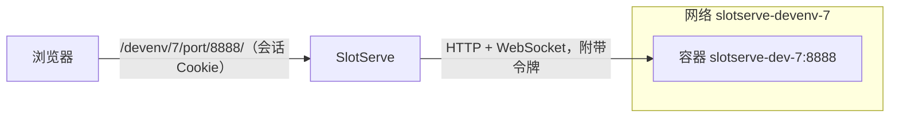
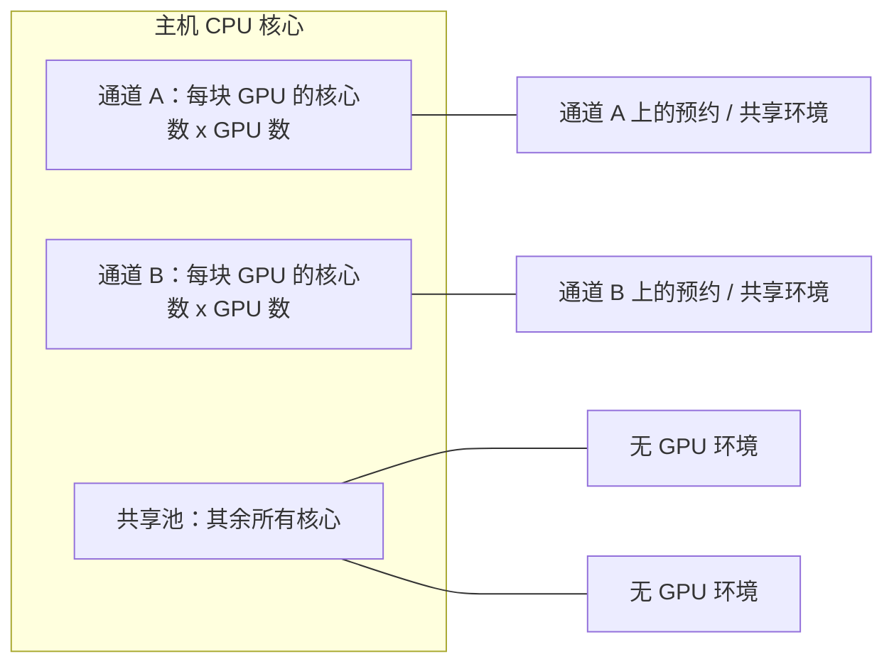

# 开发环境

除了运行模型和整卡，预约还可以是**开发环境**：预约期间，SlotServe 会运行一个带该通道 GPU 和 SSH 服务的 Docker 容器，你用 SSH 公钥或环境密码登录。`/workspace` 里的文件在多次预约之间一直保留，也可以把整个环境保留下来。通道还可以在无人预约时运行一个所有人都能登录的**共享环境**；任何人也可以随时在共享 CPU 核心上运行[无 GPU 模式](#without-a-gpu)的环境。


## 开启（管理员）

1. 把 Docker 套接字挂载进 SlotServe：在 `docker-compose.yml` 里取消注释

    ```yaml
    - /var/run/docker.sock:/var/run/docker.sock
    ```

    然后执行 `docker compose up -d`。容器通过 [NVIDIA Container Toolkit](https://docs.nvidia.com/datacenter/cloud-native/container-toolkit/latest/install-guide.html) 使用 GPU，SlotServe 本身已经依赖它。

2. 打开**管理 → 系统设置 → 开发环境 → 开发环境**。

3. 在宿主机防火墙中放行 **SSH 端口范围**（默认 `2200-2299`），每个运行中的环境占用其中一个端口。

4. 按需设置 **SSH 主机名**（用户在 `root@` 后面输入的地址）、CPU、内存、共享内存上限、允许的镜像仓库、是否允许**密码登录**、存放持久数据的**存储目录**，以及保留环境的限制。

!!! warning "安全"
    能控制 Docker 套接字就能控制宿主机。SlotServe 启动的容器不加额外特权，只挂载该通道的 GPU、用户自己的 `/workspace` 卷和只读的模型目录；但 SlotServe 的管理员从此可以在宿主机上运行容器。只在用户可信的服务器上开启开发环境。

    **Podman** 提供与 Docker 兼容、不需要 root 守护进程的接口。把 `SLOTSERVE_DOCKER_HOST` 指向它的套接字（如 `unix:///run/podman/podman.sock`）即可改用 Podman，GPU 需要按 Podman 的 CDI 方式配置。

## 使用

1. 在**访问凭据**页面添加 SSH 公钥或设置环境密码（见下文）。
2. 点**预约开发环境**（或在预约弹窗中选「开发环境」），选择模板（或保留的环境）和时间。
3. 镜像会提前下载，页面上能看到进度。预约开始后，页面会显示连接命令：

    ```bash
    ssh -p 2201 root@服务器
    ```

    在容器里你是 `root`。文件请放在 `/workspace`；共享模型在 `/models`（只读）。

4. **VS Code**：把页面上的配置片段加到 `~/.ssh/config`，用 Remote-SSH 连接。每次预约的端口可能不同。
5. **浏览器里的桌面、JupyterLab、VS Code**：带网页界面的模板运行时，卡片上有**打开桌面 / 打开 JupyterLab / 打开 VS Code** 按钮（见下文「网页界面」）。自己启动的其他网页工具可以用端口转发访问，如 `ssh -p 2201 -L 8888:localhost:8888 root@服务器`。

预约结束时容器会被删除（保留的环境除外）。需要更久的话请及时延长（结束前 10 分钟的提醒里有延长按钮）。

### 模板

| 模板 | 镜像 | 网页界面 |
| --- | --- | --- |
| PyTorch | `pytorch/pytorch:2.14.1-cuda12.6-cudnn9-devel` | |
| JupyterLab + PyTorch | `quay.io/jupyter/pytorch-notebook:cuda12-pytorch-2.11.0` | JupyterLab |
| TensorFlow | `tensorflow/tensorflow:2.21.0-gpu-jupyter` | |
| CUDA | `nvidia/cuda:12.9.2-cudnn-devel-ubuntu24.04` | |
| Ubuntu desktop | `linuxserver/webtop:ubuntu-xfce-388f14a2-ls7` | 桌面（XFCE） |
| VS Code | `codercom/code-server:4.141.0` | VS Code（code-server） |

内置模板使用 CUDA 12 版本，兼容的显卡和驱动范围更广。管理员可以更换镜像、停用模板或添加共享模板。

每个人都可以用任意镜像新建**自己的模板**（除非管理员关闭了自定义镜像或限制了镜像仓库），可以指定主进程和环境变量。镜像需要包含 `/bin/sh`；SSH 不依赖镜像，SlotServe 会放入自带的小型静态 SSH 服务。

### 网页界面

SlotServe 可以在浏览器里打开运行中环境的任意端口，地址是 SlotServe 下的 `/devenv/<会话>/port/<端口>/`。模板以端口列表的形式**声明网页界面**，每个端口有名称和类型（桌面、JupyterLab、VS Code 或其他网页应用）；环境运行时，卡片上每个端口都有一个**打开…**按钮（新标签页）。其他端口（比如自己在 6006 端口启动的 TensorBoard）可以直接输入 `/devenv/<会话>/port/6006/` 打开。只有预约人和管理员能打开（不属于任何预约的环境对所有已登录用户开放），并且需要先登录 SlotServe。



- **隔离**：每个环境运行在自己的 Docker 网络里。网页端口从不对外公开：SlotServe 运行在容器中时，会加入环境的网络，按容器名访问任意端口；直接运行在宿主机上时，Docker 把每个声明的端口绑定到 `127.0.0.1` 的随机端口，其他端口通过容器在其网络中的地址访问（Linux 宿主机）。环境停止时网络会被删除（保留环境会一直保留自己的网络和网页地址，直到它被删除），重启后会清理残留的网络。通道的共享环境也有自己的网络，它的网页界面对所有已登录用户开放。
- **代理**：SlotServe 转发 HTTP（流式）和 WebSocket（Jupyter 内核、VS Code、桌面画面都需要），让重定向和 Cookie 保持在环境的路径下，并且不会把自己的会话 Cookie 转给应用。
- **令牌**：每次启动生成一个随机令牌。JupyterLab 用它启动（`--IdentityProvider.token`），桌面用它作为密码；SlotServe 会在每个请求里带上它，所以不经过 SlotServe 就无法使用这些应用。
- **基础路径**：主进程和环境变量里可以使用占位符 `{base_path}` 和 `{port}`（第一个声明的端口，如 `/devenv/7/port/8888/` 和 `8888`）、`{base_path_<端口>}`（任一声明的端口，如 `{base_path_6006}`）、`{token}` 和 `{session}`。应用拿到自己基础路径的端口（Jupyter 的 `--ServerApp.base_url`、桌面的 `SUBFOLDER`）收到完整路径；其他端口（code-server、大多数简单应用、未声明的端口）由 SlotServe 去掉前缀后转发，这些应用应使用相对链接。另外还会设置 `SLOTSERVE_WEB_BASE`、`SLOTSERVE_WEB_PORT` 和 `SLOTSERVE_WEB_TOKEN` 环境变量（第一个声明的端口）。
- **保留镜像自带的入口程序**：linuxserver 桌面这类镜像运行自己的 init 系统。打开这个选项后，SlotServe 保留镜像的入口程序和命令，并通过 `docker exec` 在旁边启动 SSH 服务，而不是使用自己的启动脚本。

内置模板：**JupyterLab + PyTorch**（JupyterLab，端口 8888，文件在 `/workspace`）、**Ubuntu desktop**（XFCE 桌面串流到浏览器，端口 3000）和 **VS Code**（code-server，端口 8080，打开 `/workspace`；扩展来自 Open VSX）。SSH 照常可用。

!!! note
    桌面使用的浏览器视频接口需要安全上下文：请通过 HTTPS（或 `localhost`）访问 SlotServe。桌面里的硬件加速图形可能需要在模板环境变量中加入 `NVIDIA_DRIVER_CAPABILITIES=all`，取决于宿主机的驱动配置。

!!! warning "同源"
    网页界面和 SlotServe 使用同一个地址。某人环境里的网页会以打开者的身份运行，因此管理员只应打开可信用户的环境。code-server 没有自己的令牌，依靠每个环境独立的网络（以及 SlotServe 运行在宿主机上时绑定到 `127.0.0.1` 的端口）来隔离。

### 保存环境

**保存为镜像**会把运行中的容器（装好的软件、`/workspace` 以外的文件）保存成你自己的新模板，下次预约直接从这里继续。`/workspace` 本来就会保留，不会打进镜像。每人可保存的镜像数量有上限（默认 3 个）；删除已保存的模板会同时删除服务器上的镜像。

## 登录方式：SSH 公钥和环境密码

登录凭据在**访问凭据**页面（与 API 密钥在一起）：

- **SSH 公钥**：粘贴 `~/.ssh/id_ed25519.pub` 的内容（没有的话用 `ssh-keygen -t ed25519` 生成）。
- **环境密码**：登录开发环境用的 SSH 密码，与 SlotServe 登录密码相互独立。SlotServe 只保存它的 SHA-512-crypt 哈希（即 `/etc/shadow` 的格式），并把哈希写进容器；不会保存密码本身。每个连接最多尝试三次。

预约开发环境需要 SSH 公钥；在**密码登录**开启时（默认开启），设置了环境密码也可以。管理员可以关闭密码登录，此后只能用公钥，SSH 服务会拒绝密码。修改后的密码会在正在运行的预约环境下次启动时生效；共享环境会在一分钟内更新。

## 保留的环境（项目）

通常预约结束时容器会被删除，只保留 `/workspace`。如果想保留装好的一切，在预约对话框中选择**保留为新环境**并起个名字。这个预约结束时容器只会被停止（暂停）。之后的预约可以选择**继续使用**：同一个容器会重新启动，并放入你当前的公钥和密码。

- 如果下一次预约所在通道的 GPU 不同，SlotServe 会把容器保存为镜像（快照），再用新的 GPU 重新创建，保留的目录和设置不变。保留目录有变化或原来的 SSH 端口被占用时也会这样处理。
- **保留的目录**：除 `/workspace` 外，模板或保留的环境还可以列出其他要保留的目录，例如 `/root` 或 `/opt/conda`（绝对路径；不允许 `/etc`、`/usr`、`/proc`、`/opt/slotserve` 等系统目录）。新目录一开始会带有镜像里的内容。修改列表会在下次创建容器时生效。
- **开发环境**页面列出你保留的环境及其状态（已暂停、运行中、尚未启动、容器已丢失）、大小和上次使用时间。可以重命名、修改保留的目录或删除；删除会移除容器及其快照，并可选择同时删除保留的目录。`/workspace` 永远不会被删除。
- 同一个保留的环境不能在同一时间被预约两次。管理员可以限制每人可保留的数量（**每人可保留的环境数**，默认 3 个），并可自动删除闲置一定天数的保留环境（**自动删除闲置的保留环境**；0 表示从不；数据会保留）。

## 无 GPU 模式 {#without-a-gpu}

不是所有事情都需要 GPU。写代码、搬数据、装软件包或跑 CPU 任务，可以随时在**无 GPU** 的开发环境里进行，无需预约：

- 在**开发环境**页面的**无 GPU 模式**部分（或在模板、保留的环境上）点击**不用 GPU 启动**，选择一个模板或你保留的环境。它会立即在服务器的共享 CPU 核心上启动，SSH 登录、`/workspace`、保留的目录和网页界面都与预约的环境相同，只是没有 GPU。
- 它会一直运行，直到你**暂停**（保留的环境保留容器）或**停止**（其他环境；`/workspace` 保留）。没有空闲超时，也没有结束时间。卡片上会显示它当前使用的 CPU 核数和内存。
- 管理员可以限制每人同时运行的数量（**每人无 GPU 环境数**，默认 2 个）。

**同一个保留的环境，两种模式。** 保留的环境可以在两次预约之间以无 GPU 模式运行。它的预约开始时，SlotServe 会停止它，并带上预约通道的 GPU 继续运行：容器会保存为快照并带 GPU 重新创建，装好的东西都还在（与保留的环境换到其他 GPU 时一样）。预约结束时照常暂停；如果为这个保留的环境打开了**预约结束后继续无 GPU 运行**，它会改为继续以无 GPU 模式运行。你也可以随时再次以无 GPU 模式启动它。它的预约正在进行时，不能以无 GPU 模式启动。

!!! note "快照"
    每次在 CPU 和预约的 GPU 之间切换，都会把容器保存为一层镜像。如果一个保留的环境长期频繁切换，请不时删除它并重新保留一个（或把它保存为镜像，再从该镜像开始保留环境），因为镜像的层数有上限。

### 公平地共享 CPU



- 每个 GPU 通道为它的使用者**保留 CPU 核心**：**每块 GPU 保留的 CPU 核心**（默认 8）乘以它的 GPU 数（不限定 GPU 的通道按一块计）。它的预约容器和空闲时的共享环境只在这些核心上运行（Docker cpuset），因此 CPU 任务不会拖慢 GPU 预约。0 表示不保留。
- 无 GPU 环境共享**其余所有核心**（共享池）。它们的 CPU 权重相同，空闲的核心谁都能用，繁忙时平均分配。此外每个环境还有硬上限：**无 GPU 环境 CPU 上限**（核数，默认 4；0 表示整个共享池）和**无 GPU 环境内存上限**（默认 16 GB；0 表示不限）。
- **无 GPU 内存池**限制所有无 GPU 环境合计可占用的内存：启动时会把所有运行中环境的内存上限相加，放不下的新环境会被拒绝，直到有环境暂停。0 表示不限总量。
- SlotServe 从 Docker 读取主机的核心数和内存。如果核心数少于各通道想要的数量，每个通道按比例分配，并且共享池至少保留一个核心。开发环境页面的这一部分会显示共享池和每个通道的核心。保留的核心按逻辑 CPU 编号、按通道顺序分配。

修改这些设置只对之后创建的容器生效；保留的容器会在下次启动时获得新的 CPU 分配和上限。

### 用量

每个无 GPU 环境的 CPU 时间和内存每隔几秒从 Docker 读取一次，并每分钟记到它的使用者名下（类型为“纯 CPU 环境”）。**用量**页面会按人显示 **CPU 核时**。

### 管理员能看到什么

**无 GPU 模式**部分会列出所有正在运行的无 GPU 环境，包括使用者、状态、正在使用的 CPU 核数和内存，以及**暂停** / **停止**按钮（会记入审计日志）。相关设置在**管理 → 系统设置 → 开发环境**中。

## 空闲通道：共享环境

管理员可以为每个通道选择无人预约时运行什么（**管理 → GPU 与通道 → 未被预约时**）：

| 模式 | 通道未被预约时 |
| --- | --- |
| 运行默认模型 | 加载该通道的默认模型（与以前相同）。 |
| 共享开发环境 | 用所选模板运行一个使用该通道 GPU 的容器，所有人都可以登录。 |
| 什么都不运行 | 不运行推理服务也不运行容器，GPU 保持空闲。 |

共享环境会在下一个预约开始前停止（与模型预加载或整卡预约的提前量相同），通道空闲后再重新启动；在共享环境释放 GPU 之前，模型不会开始加载。总览和通道页面会显示空闲通道正在做什么。

在共享环境里，每个启用中的 SlotServe 用户都有自己的账号（用户名转为小写，字母、数字、`_` 和 `-` 以外的字符会被替换），`~/.ssh/authorized_keys` 中是他的 SSH 公钥；开启密码登录时还会设置他的环境密码。主目录位于每个通道独立的卷上，会一直保留。`root` 不能登录。**开发环境**页面会显示每个空闲通道的共享环境以及你自己的登录命令：

```bash
ssh -p 2205 alice@服务器
```

账号在容器启动时创建，并在有人修改公钥或密码时（以及每分钟一次）更新。镜像需要带有 `useradd` 或 `adduser`；两者都没有时环境会启动失败并给出明确的提示。只能使用面向所有人的模板（内置模板或管理员共享的模板）。

## 存储

管理员可以在**管理 → 存储**中添加主机目录、NFS 导出和 SMB 共享，用作共享数据、个人空间（`/workspace`）、项目数据和模型库，详见[存储](storage.md)。下面说明的是没有添加存储时的情况。

默认情况下，持久数据保存在 Docker 命名卷中：`/workspace` 使用 `slotserve-workspace-u<用户 ID>`，保留环境的目录使用 `slotserve-project<ID>-<路径>`，模板的保留目录使用 `slotserve-u<用户>-t<模板>-<路径>`，通道共享环境的主目录使用 `slotserve-idle-home-l<通道>`。

把**存储目录**设为 Docker 主机上的某个目录（例如 `/srv/slotserve`）后，改用绑定挂载：

| 数据 | 目录 |
| --- | --- |
| `/workspace` | `<存储目录>/users/u<用户 ID>/workspace` |
| 模板的保留目录 | `<存储目录>/users/u<用户 ID>/t<模板 ID>/<路径>` |
| 保留环境的目录 | `<存储目录>/projects/p<ID>/<路径>` |
| 共享环境的主目录 | `<存储目录>/lanes/l<通道 ID>/home` |

这里填写的是 Docker 主机上的路径，而不是 SlotServe 容器内的路径。缺少的目录会由一个基于环境镜像、用完即删的辅助容器创建（并像新卷一样填入镜像中的内容），因此 SlotServe 本身不需要访问该目录。

## 管理员能看到什么

- 在**开发环境**页面打开**所有人**，可以看到每个环境的状态、镜像、端口和错误；**日志**显示容器输出。
- 启动失败的环境（镜像不存在、容器退出、没有空闲端口）会显示原因，可以点**重试**重新启动，预约人也会收到通知。
- SlotServe 重启后会保留仍在运行的环境，停止预约已结束的保留环境，并清理残留的容器和网络。
- 共享环境：只有管理员可以重启它、查看它的日志和错误（例如账号更新失败）。
