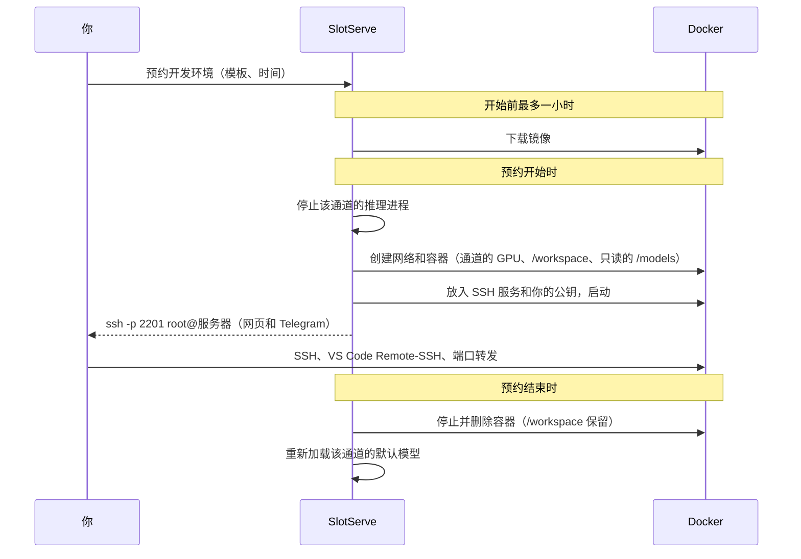
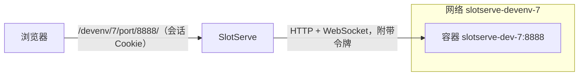

# 开发环境

除了运行模型和整卡，预约还可以是**开发环境**：预约期间，SlotServe 会运行一个带该通道 GPU 和 SSH 服务的 Docker 容器，你用 SSH 公钥登录。`/workspace` 里的文件在多次预约之间一直保留。



## 开启（管理员）

1. 把 Docker 套接字挂载进 SlotServe：在 `docker-compose.yml` 里取消注释

    ```yaml
    - /var/run/docker.sock:/var/run/docker.sock
    ```

    然后执行 `docker compose up -d`。容器通过 [NVIDIA Container Toolkit](https://docs.nvidia.com/datacenter/cloud-native/container-toolkit/latest/install-guide.html) 使用 GPU，SlotServe 本身已经依赖它。

2. 打开**管理 → 系统设置 → 开发环境 → 开发环境**。

3. 在宿主机防火墙中放行 **SSH 端口范围**（默认 `2200-2299`），每个运行中的环境占用其中一个端口。

4. 按需设置 **SSH 主机名**（用户在 `root@` 后面输入的地址）、CPU、内存、共享内存上限，以及允许的镜像仓库。

!!! warning "安全"
    能控制 Docker 套接字就能控制宿主机。SlotServe 启动的容器不加额外特权，只挂载该通道的 GPU、用户自己的 `/workspace` 卷和只读的模型目录；但 SlotServe 的管理员从此可以在宿主机上运行容器。只在用户可信的服务器上开启开发环境。

    **Podman** 提供与 Docker 兼容、不需要 root 守护进程的接口。把 `SLOTSERVE_DOCKER_HOST` 指向它的套接字（如 `unix:///run/podman/podman.sock`）即可改用 Podman，GPU 需要按 Podman 的 CDI 方式配置。

## 使用

1. 打开**开发环境**，点**添加 SSH 公钥**，粘贴 `~/.ssh/id_ed25519.pub` 的内容（没有的话用 `ssh-keygen -t ed25519` 生成）。只接受公钥登录。
2. 点**预约开发环境**（或在预约弹窗中选「开发环境」），选择模板和时间。
3. 镜像会提前下载，页面上能看到进度。预约开始后，页面会显示连接命令：

    ```bash
    ssh -p 2201 root@服务器
    ```

    在容器里你是 `root`。文件请放在 `/workspace`；共享模型在 `/models`（只读）。

4. **VS Code**：把页面上的配置片段加到 `~/.ssh/config`，用 Remote-SSH 连接。每次预约的端口可能不同。
5. **浏览器里的桌面、JupyterLab、VS Code**：带网页界面的模板运行时，卡片上有**打开桌面 / 打开 JupyterLab / 打开 VS Code** 按钮（见下文「网页界面」）。自己启动的其他网页工具可以用端口转发访问，如 `ssh -p 2201 -L 8888:localhost:8888 root@服务器`。

预约结束时容器会被删除。需要更久的话请及时延长（结束前 10 分钟的提醒里有延长按钮）。

### 模板

| 模板 | 镜像 | 网页界面 |
| --- | --- | --- |
| PyTorch | `pytorch/pytorch:2.14.1-cuda12.6-cudnn9-devel` | |
| JupyterLab + PyTorch | `quay.io/jupyter/pytorch-notebook:cuda12-pytorch-2.11.0` | JupyterLab |
| TensorFlow | `tensorflow/tensorflow:2.21.0-gpu-jupyter` | |
| CUDA | `nvidia/cuda:12.9.2-cudnn-devel-ubuntu24.04` | |
| Ubuntu desktop | `linuxserver/webtop:ubuntu-xfce-388f14a2-ls7` | 桌面（XFCE） |
| VS Code | `codercom/code-server:4.141.0` | VS Code（code-server） |

内置模板使用 CUDA 12 版本，兼容的显卡和驱动范围更广。管理员可以更换镜像、停用模板或添加共享模板。

每个人都可以用任意镜像新建**自己的模板**（除非管理员关闭了自定义镜像或限制了镜像仓库），可以指定主进程和环境变量。镜像需要包含 `/bin/sh`；SSH 不依赖镜像，SlotServe 会放入自带的小型静态 SSH 服务。

### 网页界面

SlotServe 可以在浏览器里打开运行中环境的任意端口，地址是 SlotServe 下的 `/devenv/<会话>/port/<端口>/`。模板以端口列表的形式**声明网页界面**，每个端口有名称和类型（桌面、JupyterLab、VS Code 或其他网页应用）；环境运行时，卡片上每个端口都有一个**打开…**按钮（新标签页）。其他端口（比如自己在 6006 端口启动的 TensorBoard）可以直接输入 `/devenv/<会话>/port/6006/` 打开。只有预约人和管理员能打开（不属于任何预约的环境对所有已登录用户开放），并且需要先登录 SlotServe。



- **隔离**：每个环境运行在自己的 Docker 网络里。网页端口从不对外公开：SlotServe 运行在容器中时，会加入环境的网络，按容器名访问任意端口；直接运行在宿主机上时，Docker 把每个声明的端口绑定到 `127.0.0.1` 的随机端口，其他端口通过容器在其网络中的地址访问（Linux 宿主机）。环境停止时网络会被删除，重启后会清理残留的网络。
- **代理**：SlotServe 转发 HTTP（流式）和 WebSocket（Jupyter 内核、VS Code、桌面画面都需要），让重定向和 Cookie 保持在环境的路径下，并且不会把自己的会话 Cookie 转给应用。
- **令牌**：每次启动生成一个随机令牌。JupyterLab 用它启动（`--IdentityProvider.token`），桌面用它作为密码；SlotServe 会在每个请求里带上它，所以不经过 SlotServe 就无法使用这些应用。
- **基础路径**：主进程和环境变量里可以使用占位符 `{base_path}` 和 `{port}`（第一个声明的端口，如 `/devenv/7/port/8888/` 和 `8888`）、`{base_path_<端口>}`（任一声明的端口，如 `{base_path_6006}`）、`{token}` 和 `{session}`。应用拿到自己基础路径的端口（Jupyter 的 `--ServerApp.base_url`、桌面的 `SUBFOLDER`）收到完整路径；其他端口（code-server、大多数简单应用、未声明的端口）由 SlotServe 去掉前缀后转发，这些应用应使用相对链接。另外还会设置 `SLOTSERVE_WEB_BASE`、`SLOTSERVE_WEB_PORT` 和 `SLOTSERVE_WEB_TOKEN` 环境变量（第一个声明的端口）。
- **保留镜像自带的入口程序**：linuxserver 桌面这类镜像运行自己的 init 系统。打开这个选项后，SlotServe 保留镜像的入口程序和命令，并通过 `docker exec` 在旁边启动 SSH 服务，而不是使用自己的启动脚本。

内置模板：**JupyterLab + PyTorch**（JupyterLab，端口 8888，文件在 `/workspace`）、**Ubuntu desktop**（XFCE 桌面串流到浏览器，端口 3000）和 **VS Code**（code-server，端口 8080，打开 `/workspace`；扩展来自 Open VSX）。SSH 照常可用。

!!! note
    桌面使用的浏览器视频接口需要安全上下文：请通过 HTTPS（或 `localhost`）访问 SlotServe。桌面里的硬件加速图形可能需要在模板环境变量中加入 `NVIDIA_DRIVER_CAPABILITIES=all`，取决于宿主机的驱动配置。

!!! warning "同源"
    网页界面和 SlotServe 使用同一个地址。某人环境里的网页会以打开者的身份运行，因此管理员只应打开可信用户的环境。code-server 没有自己的令牌，依靠每个环境独立的网络（以及 SlotServe 运行在宿主机上时绑定到 `127.0.0.1` 的端口）来隔离。

### 保存环境

**保存为镜像**会把运行中的容器（装好的软件、`/workspace` 以外的文件）保存成你自己的新模板，下次预约直接从这里继续。`/workspace` 本来就会保留，不会打进镜像。每人可保存的镜像数量有上限（默认 3 个）；删除已保存的模板会同时删除服务器上的镜像。

## 管理员能看到什么

- 在**开发环境**页面打开**所有人**，可以看到每个环境的状态、镜像、端口和错误；**日志**显示容器输出。
- 启动失败的环境（镜像不存在、容器退出、没有空闲端口）会显示原因，可以点**重试**重新启动，预约人也会收到通知。
- SlotServe 重启后会保留仍在运行的环境，并清理残留的容器和网络。
