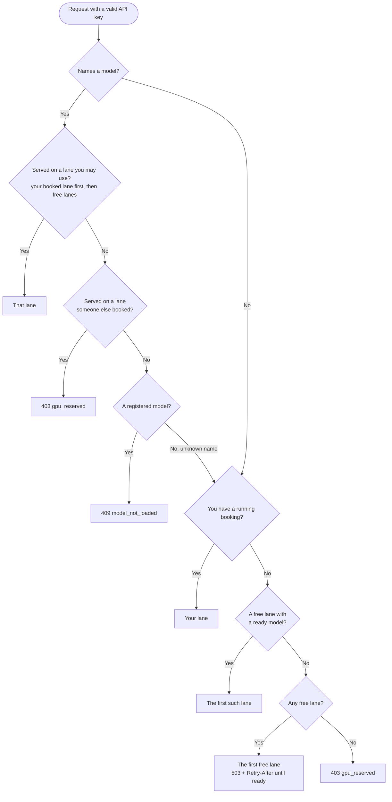
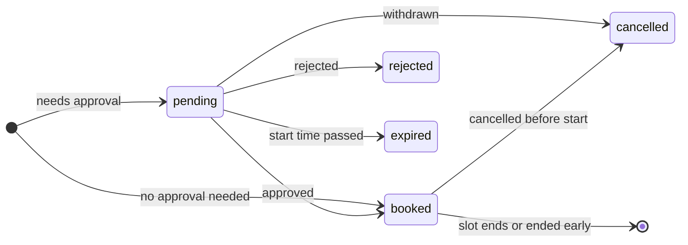

# GPUs, lanes and engines

## Lanes

A **lane** is a group of GPUs with its own model server process, its own scheduler and its own booking calendar. On first start SlotServe creates one lane containing every GPU that `nvidia-smi` reports, so a single-GPU machine needs no setup at all and shows no lane controls.

With several GPUs you decide how to split them in **Admin → GPUs & lanes**:

| Layout | Lanes | Good for |
| --- | --- | --- |
| One big GPU | `GPU 0,1,2,3` | Models that need all memory (tensor parallel) |
| One lane per GPU | `GPU 0`, `GPU 1`, … | Several people working at the same time |
| Mixed | `GPU 0+1`, `GPU 2`, `GPU 3` | One large model plus smaller ones |

Rules:

- A GPU belongs to at most one lane. Changing a lane's GPUs restarts its process.
- Each lane has its own **default model**, served to everyone while the lane is not booked. Instead, a lane can run a [shared dev environment](dev-environments.md#idle-lanes-a-shared-environment) or nothing while idle.
- **Arguments** edits the launch arguments of the model a lane is running and reloads every lane running it; **Reload** restarts a lane's model server. Arguments belong to the model, so they apply on every lane.
- Bookings, waitlist entries, manual load/unload and the "fall back to the default model" behaviour are per lane. Quotas count bookings across all lanes.
- A lane with bookings that have not ended cannot be deleted, and the last lane cannot be deleted.
- Each lane's process gets `CUDA_VISIBLE_DEVICES` set to its GPUs and listens on `SLOTSERVE_LLAMA_PORT + lane id - 1`. Logs are per lane (`llama-server-lane<N>.log`).

### Which lane serves an API request



In words:

1. If the request names a model, it goes to a lane the caller may use (free, or booked by the caller) that serves that model - the caller's own lane first. A model served only on a lane someone else has booked returns `403 gpu_reserved`; a registered model that no usable lane serves returns `409 model_not_loaded`.
2. Without a model name, the caller's own booked lane is used; otherwise the first free lane whose model is ready.
3. `/v1/models` lists every model the caller can use right now.

## Engines

Each model has an inference engine. Scheduling, booking and the gateway work the same for all of them.

| Engine | Model source | Command SlotServe runs | Ready when |
| --- | --- | --- | --- |
| llama.cpp (default) | `.gguf` file | `llama-server -m <file> --host --port --alias <name> <args>` | `/health` returns 200 |
| vLLM | repository id or directory | `vllm serve <model> --host --port --served-model-name <name> <args>` | `/health` returns 200 |
| SGLang | repository id or directory | `python -m sglang.launch_server --model-path <model> --host --port --served-model-name <name> <args>` | `/health` returns 200 |
| Custom | anything | your template, e.g. `my-server --model {model} --port {port}` | the configured health path returns 200 |

- Add models with **Models → Add model**. Scanned and downloaded `.gguf` files are llama.cpp models automatically.
- The engine commands are admin settings (**Admin → System settings → Inference engines**). The command must be available where SlotServe runs.
- Flags SlotServe sets itself (host, port, model, served name) are removed from your arguments. For tensor parallelism across a multi-GPU lane add, for example, `--tensor-parallel-size 2` (vLLM) or `--tp 2` (SGLang).
- The gateway always sends the served model name upstream, so clients may omit `model`.

### vLLM in Docker

The default image contains Python and the SlotServe server only; llama.cpp is mounted from the host. For vLLM, build the variant based on the official vLLM image:

```bash
docker build -f Dockerfile.vllm -t slotserve-vllm .
echo "SLOTSERVE_IMAGE=slotserve-vllm" >> .env
docker compose up -d
```

Pin `VLLM_IMAGE` (a build argument) to a vLLM version that supports your GPU and driver. llama.cpp can still be mounted as usual, so both engines are available.

## Approval mode

**Admin → System settings → Accounts → Approval** decides whether bookings need an admin:

| Mode | Needs approval |
| --- | --- |
| Off (default) | nothing |
| Long bookings | bookings longer than **Approval needed above** (default 4 hours) |
| All bookings | every booking |

Admins' own bookings, and bookings an admin makes for someone, never need approval. A pending booking holds its time (nobody else can book it) and counts towards quotas, but no model is loaded for it. Admins approve or reject in **Admin → Bookings → Awaiting approval** or with the buttons in the Telegram message; a weekly series can be handled at once. Requests still pending when they would start expire automatically and free their time for the waitlist.


