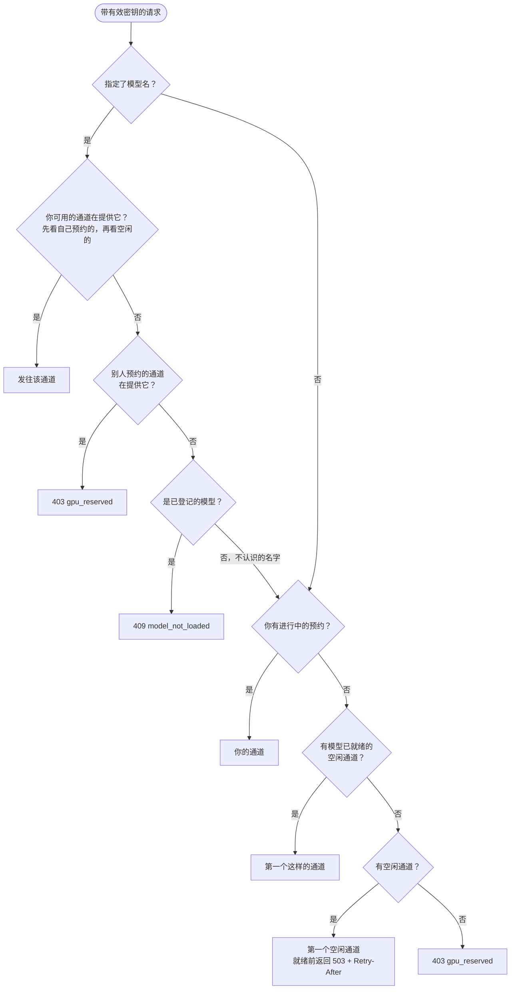
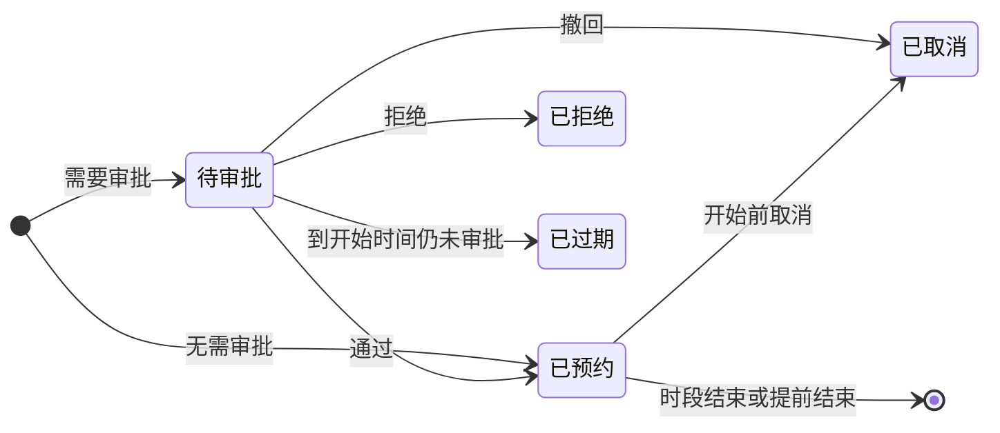

# 多 GPU、通道与推理后端

## 通道

**通道**是一组 GPU，拥有自己的推理进程、调度器和预约日历。首次启动时 SlotServe 会创建一个包含 `nvidia-smi` 检测到的全部 GPU 的通道，所以单卡机器无需任何设置，界面上也不会出现通道相关的内容。

有多张卡时，在**管理 → GPU 与通道**中自行划分：

| 划分方式 | 通道 | 适合 |
| --- | --- | --- |
| 一张大卡 | `GPU 0,1,2,3` | 需要全部显存的大模型（张量并行） |
| 每卡一个通道 | `GPU 0`、`GPU 1`… | 多人同时使用 |
| 混合 | `GPU 0+1`、`GPU 2`、`GPU 3` | 一个大模型加若干小模型 |

规则：

- 一张 GPU 最多属于一个通道。修改通道的 GPU 会重启该通道的进程。
- 每个通道有自己的**默认模型**，通道空闲时供所有人使用。通道空闲时也可以改为运行[共享开发环境](dev-environments.md)或什么都不运行。
- **启动参数**用于修改通道当前模型的参数，保存后所有运行该模型的通道会重新加载；**重新加载**会重启该通道的推理进程。参数属于模型，在所有通道上都生效。
- 预约、候补、手动加载/卸载、加载失败回退都按通道独立进行；配额按人跨通道累计。
- 还有未结束预约的通道不能删除，最后一个通道也不能删除。
- 每个通道的进程设置 `CUDA_VISIBLE_DEVICES` 为其 GPU，监听端口为 `SLOTSERVE_LLAMA_PORT + 通道号 - 1`，日志分开保存（`llama-server-lane<N>.log`）。

### 接口请求由哪个通道处理



文字说明：

1. 请求指定了模型名：发往调用者可用（空闲或自己预约）且正在提供该模型的通道，优先自己预约的通道。只有别人预约的通道提供该模型时返回 `403 gpu_reserved`；已登记但所有可用通道都没加载时返回 `409 model_not_loaded`。
2. 未指定模型名：有自己的预约就用自己的通道，否则用第一个模型已就绪的空闲通道。
3. `/v1/models` 列出调用者当前能用的所有模型。

## 推理后端

每个模型选择一个推理后端，调度、预约和网关对所有后端完全一样。

| 后端 | 模型来源 | SlotServe 执行的命令 | 就绪判断 |
| --- | --- | --- | --- |
| llama.cpp（默认） | `.gguf` 文件 | `llama-server -m <文件> --host --port --alias <名称> <参数>` | `/health` 返回 200 |
| vLLM | 仓库名或目录 | `vllm serve <模型> --host --port --served-model-name <名称> <参数>` | `/health` 返回 200 |
| SGLang | 仓库名或目录 | `python -m sglang.launch_server --model-path <模型> --host --port --served-model-name <名称> <参数>` | `/health` 返回 200 |
| 自定义 | 任意 | 你的命令模板，如 `my-server --model {model} --port {port}` | 配置的健康检查路径返回 200 |

- 在**模型 → 添加模型**中添加。扫描和下载得到的 `.gguf` 文件自动登记为 llama.cpp 模型。
- 各后端的启动命令是管理员设置（**管理 → 系统设置 → 推理后端**），命令需要在 SlotServe 运行的环境里可用。
- SlotServe 自己设置的参数（地址、端口、模型、服务名称）会从你的参数中去掉。多卡通道做张量并行时，请自行加上如 `--tensor-parallel-size 2`（vLLM）或 `--tp 2`（SGLang）。
- 网关总会把服务名称发给后端，所以客户端可以不填 `model`。

### 在 Docker 中使用 vLLM

默认镜像只包含 Python 和 SlotServe，llama.cpp 从宿主机挂载。要用 vLLM，请构建基于 vLLM 官方镜像的版本：

```bash
docker build -f Dockerfile.vllm -t slotserve-vllm .
echo "SLOTSERVE_IMAGE=slotserve-vllm" >> .env
docker compose up -d
```

请把构建参数 `VLLM_IMAGE` 固定到支持你的 GPU 和驱动的 vLLM 版本。llama.cpp 仍可照常挂载，两种后端可同时使用。

## 审批模式

**管理 → 系统设置 → 账号 → 审批**决定预约是否需要管理员审批：

| 模式 | 需要审批的预约 |
| --- | --- |
| 关闭（默认） | 无 |
| 长预约 | 超过「超过多久需审批」（默认 4 小时）的预约 |
| 全部预约 | 所有预约 |

管理员自己的预约、管理员替他人建的预约都不需要审批。待审批的预约会占住时段（别人不能再约）并计入配额，但不会为它加载模型。管理员在**管理 → 预约 → 待审批**中，或通过聊天消息里的按钮（Telegram、飞书 / Lark）或编号选项（钉钉、企业微信、QQ）通过或拒绝；每周重复的系列可以一次处理。到开始时间仍未审批的申请会自动失效，时段释放给候补的人。


