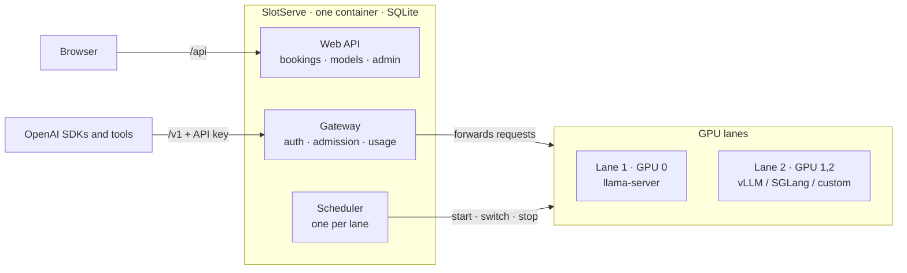

# SlotServe

**SlotServe turns a GPU server into a shared, bookable service.** People book time slots in a web calendar, get exclusive use of the GPU during their slot, and call models through an OpenAI-compatible API with their own key. SlotServe runs the model server for you - [llama.cpp](https://github.com/ggml-org/llama.cpp)'s `llama-server`, vLLM, SGLang or your own - and switches models automatically before each booking.

## Why

A lab or small team often shares a single big GPU. Without coordination people step on each other: one person's 30B model is unloaded by someone else's experiment, nobody knows who is using the card, and long model loads from spinning disks waste everyone's time. SlotServe fixes that with three rules:

1. **Bookings are exclusive.** During your slot only your API keys are accepted.
2. **Idle time is shared.** When nobody has booked the GPU, every key can use the default model.
3. **Switching models requires a booking.** That lets the scheduler load your model *before* your slot starts.

## Features

| | |
| --- | --- |
| Calendar booking | Drag across a week view to book; first come, first served; optional admin approval |
| OpenAI-compatible gateway | `/v1/chat/completions`, `/v1/completions`, `/v1/embeddings` and any other route of the model server, with streaming |
| Per-user API keys | Create, name and revoke keys; only a SHA-256 hash is stored |
| Managed model servers | Started, health-checked, restarted and switched by SlotServe; per-model launch arguments edited in the browser |
| Preloading | Load times are learned per model; the next booking's model is loaded ahead of time |
| Model downloads | Paste a direct link (e.g. a Hugging Face `resolve` URL); resumable, one at a time |
| Usage | Requests, prompt/completion tokens and booked hours per person and per model |
| Admin panel | Manage users, bookings and API keys, change settings at runtime, audit log |
| Flexible bookings | Whole-GPU slots, argument presets, weekly repeats, extensions, waitlist, quotas |
| Dev environments | Book GPU time as a Docker container you SSH into: PyTorch, TensorFlow, CUDA or your own image; save it as an image for next time |
| Multiple GPUs & engines | Lanes of GPUs booked independently; llama.cpp, vLLM, SGLang or custom servers; optional approval mode |
| Integrations | Telegram notifications and bot, calendar feeds, CSV export, Prometheus metrics |
| GPU status | Memory, utilization, temperature and power from `nvidia-smi` |
| Bilingual UI | English and Simplified Chinese |
| Simple deployment | One container, SQLite, three bind mounts |

## How it works

A **lane** is a group of GPUs with its own model server, scheduler and calendar. A single-GPU host has exactly one lane and never shows lane controls.

## Next steps

- [Getting started](getting-started.md) - deploy with Docker Compose in a few minutes.
- [How scheduling works](scheduling.md) - what happens around a booking.
- [API](api.md) - point your OpenAI client at SlotServe.
- [GPUs, lanes & engines](gpus-and-engines.md) - several GPUs, vLLM and SGLang, approval mode.
