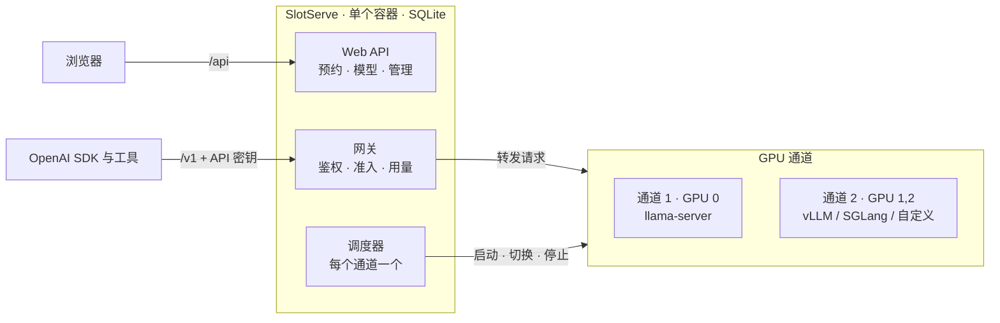

# SlotServe

**SlotServe 把 GPU 服务器变成可预约的共享服务。** 用户在网页日历上预约时段，预约期间独占 GPU，并用自己的 API 密钥通过 OpenAI 兼容接口调用模型。SlotServe 负责托管推理进程（[llama.cpp](https://github.com/ggml-org/llama.cpp) 的 `llama-server`、vLLM、SGLang 或你自己的服务），并在每个预约开始前自动切换模型。

## 为什么需要它

实验室或小团队常常共用一张大显卡。缺少协调时，你加载的 30B 模型会被别人的实验卸掉，没人知道谁在用卡，从机械盘加载模型又要等很久。SlotServe 用三条规则解决：

1. **预约独占。** 预约时段内只接受预约者的 API 密钥。
2. **空闲共享。** 没人预约时，所有密钥都能使用默认模型。
3. **切换模型需要预约。** 这样调度器能在你的时段开始*之前*把模型加载好。

## 功能

| | |
| --- | --- |
| 日历预约 | 在周视图上拖选即可预约；先到先得，可选管理员审批 |
| OpenAI 兼容网关 | `/v1/chat/completions`、`/v1/completions`、`/v1/embeddings` 及推理服务的其他接口，支持流式 |
| 个人 API 密钥 | 创建、命名、吊销；只保存 SHA-256 哈希 |
| 托管推理进程 | 由 SlotServe 启动、健康检查、重启和切换；每个模型的启动参数可在网页上编辑 |
| 预加载 | 自动学习每个模型的加载耗时，提前加载下一个预约的模型 |
| 模型下载 | 粘贴直链（如 Hugging Face 的 `resolve` 链接）；支持断点续传，逐个下载 |
| 用量统计 | 按用户、按模型统计请求数、输入/输出 token 和预约时长 |
| 管理面板 | 管理用户、预约和 API 密钥，在线修改系统设置，审计日志 |
| 灵活预约 | 整卡预约、参数预设、每周重复、延长、候补、配额 |
| 开发环境 | 把 GPU 时段预约成可 SSH 登录的 Docker 容器：PyTorch、TensorFlow、CUDA 或自己的镜像，可保存为镜像下次直接用 |
| 多 GPU 与多后端 | GPU 分通道独立预约；llama.cpp、vLLM、SGLang 或自定义服务；可选审批模式 |
| 集成 | Telegram、飞书 / Lark、钉钉、企业微信和 QQ 上的通知与预约机器人、群机器人、日历订阅、CSV 导出、Prometheus 指标 |
| GPU 状态 | 来自 `nvidia-smi` 的显存、利用率、温度和功耗 |
| 双语界面 | 简体中文与英文 |
| 部署简单 | 一个容器、SQLite、三个目录挂载 |

## 工作原理

**通道**是一组 GPU，有自己的推理进程、调度器和预约日历。单卡机器只有一个通道，界面上也不会出现通道相关的内容。

## 下一步

- [快速开始](getting-started.md)：几分钟内用 Docker Compose 部署。
- [调度原理](scheduling.md)：预约前后会发生什么。
- [接口](api.md)：把 OpenAI 客户端指向 SlotServe。
- [多 GPU 与推理后端](gpus-and-engines.md)：多张 GPU、vLLM 和 SGLang、审批模式。
