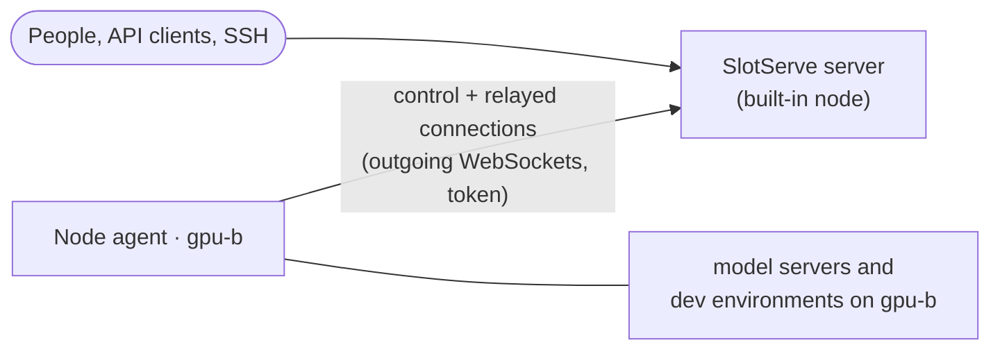

# Multiple machines

!!! note "Preview"
    Multiple machines are new and still being completed: model servers, downloads, model scanning, one-click deploys
    from the [model catalog](model-catalog.md), [model libraries](storage.md) and dev environments (with or without
    a GPU, their SSH, ports and web interfaces) work on every machine. Lanes of other machines reserve no CPU cores
    on the server.

One SlotServe server can use the GPUs (or CPUs) of several machines. Everyone keeps using one web address, one API
key and one booking calendar; each machine simply adds its own [lanes](gpus-and-engines.md#lanes).

| Role | What runs there | How many |
| --- | --- | --- |
| **Server** (control plane) | Web UI, API, database, bookings and scheduling, the OpenAI-compatible gateway, notifications, usage | One |
| **Node** | A small *node agent* that starts and stops model servers on that machine, reports its GPUs, CPU, memory and model files, sends live metrics and logs, and downloads models into its own models folder | One per extra machine |

The server is a node too (the **built-in node**), so a single machine needs nothing from this page and behaves exactly
as before.

Personal computers (gaming laptops and desktops, Windows with Docker Desktop, Macs) can join too, with one-line
installers, an owner who sets sharing hours and can pause sharing, and Wake-on-LAN: see
[Personal computers](personal-computers.md).

## How it works

- Each node agent connects **out** to the server over a WebSocket with its own token. Commands (start or stop a
  model server, read a log, scan models, download a file) travel over that connection; data (model requests, Docker,
  SSH, ports) is relayed through the server too (see below). Nodes need no open port at all.
- A **lane belongs to one node** and never spans machines. Its GPUs are numbered as that machine sees them.
- **Models are per node.** Every node scans its own models folder; a model can only be booked on, or be the default of,
  a lane whose node has its files. With shared storage (for example NFS mounted at the same path on every machine) one
  model is simply available on all of them.
- Model servers keep running when the server restarts or the connection drops. When the agent reconnects it reports
  what it is running; the server takes that over without restarting anything and stops servers of lanes that were
  deleted or moved in the meantime.

## Networking: everything goes through the server

Nodes never accept connections. Each agent connects **out** to the server and everything else travels through the
server over connections the agent opens itself (the *relay*): model requests from the gateway, the node's Docker
API, SSH into dev environments, their direct ports and web interfaces. So:

- **Only the server has to be reachable** (its web port, plus the SSH and direct port ranges if you use dev
  environments). Nodes can sit behind NAT, in another building or on a home connection, with no port opened and no
  VPN.
- Model servers on nodes listen on the node's loopback interface only (`SLOTSERVE_AGENT_MODEL_HOST`, default
  `127.0.0.1`); containers publish nothing beyond the node's loopback interface.
- The control connection carries commands only; each relayed connection gets a separate WebSocket, so a large
  transfer never delays heartbeats or other commands.



**Bandwidth.** Every byte to and from a node passes through the server twice (in and out), so the server's network
link is shared by all relayed traffic. Model requests and SSH sessions need little; copying large files into an
environment over SSH, big web downloads from an environment or moving a kept environment between machines (its
image is copied through the server) use the server's bandwidth. Put the server where the nodes and the people have
a good connection to it. Admins see how much each node relayed in Admin → Nodes.

How a relayed connection works: the server asks the agent over its control connection to open a stream to a target
on the node; the agent connects to the target, then opens a WebSocket of its own to the server
(`/api/cluster/stream/<id>`, authenticated with the node token and a one-time secret for that stream). Bytes flow
both ways with TCP backpressure; a half-closed connection (one side done sending) stays open for the other side.
A node may have at most `SLOTSERVE_RELAY_MAX_STREAMS` relayed connections open at once, and connections idle for
`SLOTSERVE_RELAY_IDLE_SECONDS` are closed, except SSH sessions (`SLOTSERVE_RELAY_SSH_IDLE_SECONDS`, default 0 =
never); connections whose other end is gone are noticed by keepalive pings.

## Dev environments on nodes

Dev environments work on every machine that runs Docker:

- **Bookings** of a lane on a node run their container on that node, with that node's GPUs. The image is pulled
  there (progress is shown as usual), SlotServe's SSH files are uploaded into the container through the relay.
- **Shared environments of idle lanes** run on the lane's node.
- **Kept environments** are paused and resumed on the node they live on; when the lane's GPUs change they are
  recreated from a snapshot as before. A kept environment can continue on another machine only when its
  `/workspace` and kept folders are on storage both machines use (a personal storage, plus a project storage if it
  keeps folders, e.g. NFS); otherwise they are Docker volumes on its machine and booking it elsewhere is refused
  (`devenv_project_data_elsewhere`) instead of starting it empty. When it moves, it is snapshotted where it is and
  its image is copied to the new machine (through the server); it waits while its old machine is offline. Saved
  images are copied the same way when they are used on another machine.
- **Environments without a GPU** can be started on any machine: the start dialog asks which one when nodes are
  connected. Their cores are that machine's own (its cores minus what its lanes reserve, see
  [dev environments](dev-environments.md)), and their CPU and memory use is recorded in usage like on the server.
- **SSH** for an environment on a node is served on the **server's** SSH port range (`SLOTSERVE_DEVENV_SSH_PORTS`):
  the server listens and relays to the container's port 22. The `ssh` command people see always names the server.
- **Direct ports** listen on the server's public port range (`SLOTSERVE_DEVENV_PUBLIC_PORTS`) and are relayed to the
  container port; no forwarder container is needed on the node. **Web interfaces** (JupyterLab, VS Code, desktop)
  open through the server's web interface listener as for local environments.
- **Storage**: NFS and SMB storages are mounted by the node's own Docker, so they work everywhere (the node needs the
  usual mount helpers). A **host directory** storage exists on the server only, unless an admin marks it as also
  present on certain nodes (Admin → Storage → *Also on these machines*, e.g. the same NFS mount at the same path).
  Without managed storage, `/workspace` and kept directories are Docker volumes on the node. The models folder is
  mounted read-only from the node's own models directory.

The server listens for SSH and direct ports of node environments on `SLOTSERVE_DEVENV_RELAY_HOST` (`0.0.0.0`).
Containers and networks are labelled with the machine they belong to; when a node reconnects, SlotServe removes its
leftover containers there (and pauses kept ones), as it does on the server after a restart.

## Add a machine

1. On the server, open **Admin → Nodes → Add node**. Give the machine a name (for example `gpu-b`). **Address** is
   only shown for your reference (empty: the address the agent connects from); nothing connects to it.
2. Copy the token and the command shown. **The token is shown only once.** You can issue a new one at any time with
   **New token** (the old one stops working immediately).
3. On the new machine, start the agent. With Docker (the same image as the server):

    ```bash
    docker run -d --name slotserve-agent --restart unless-stopped \
      --gpus all --network host \
      -v /path/to/llama.cpp:/opt/llama.cpp:ro \
      -v /path/to/models:/models \
      -v slotserve-agent:/data       -v /var/run/docker.sock:/var/run/docker.sock \
      -e SLOTSERVE_AGENT_SERVER=http://slotserve-server:8000 \
      -e SLOTSERVE_AGENT_TOKEN=ssn-... \
      ghcr.io/peleryuan/slotserve:latest slotserve agent
    ```

    Or with Compose: copy `docker-compose.node.yml` and a `.env` with `SLOTSERVE_AGENT_SERVER`,
    `SLOTSERVE_AGENT_TOKEN`, `LLAMA_CPP_DIR` and `MODELS_DIR` to the machine and run
    `docker compose -f docker-compose.node.yml up -d`.

    Without Docker, install SlotServe there and run
    `slotserve agent --server http://slotserve-server:8000 --token ssn-...`.

4. The node turns **Online** within seconds and shows its GPUs, CPU cores, memory, models folder and versions.
5. In **Admin → GPUs & lanes**, add a lane, pick the machine and its GPUs.
6. Press **Scan models** (on the Models page, or for one node in Admin → Nodes) to register the model files the node
   has, or download models straight to the node: with more than one machine the Models page asks **Download to**.

On a machine without NVIDIA GPUs leave out `--gpus all`; its lanes then have no GPUs and run CPU builds of the
engines. The Docker socket mount lets the server run dev environments on the node (leave it out to use the node for
model servers only); with `--network host` the agent reaches model servers and containers' ports on the node's
loopback interface.

## Choosing a machine

The **Machines** page (for everyone) shows a card per machine: whether it offers GPU or only CPU compute, its CPU
(model, threads and cores), memory, GPUs with their memory, current load (CPU, memory, per-GPU memory and utilization),
which GPU lanes are free now and who holds the others until when, the CPU cores and memory left for work without a GPU,
and the models it has. Filter by *has GPU*, *CPU only*, GPU memory, free RAM, free cores and *free now*, and sort by
free GPU memory, free cores, free RAM or load. **Details** opens everything else: per-GPU bars, today's and
tomorrow's bookings per lane, disks (models directory and Docker data), Docker version and runtimes, the GPU driver,
the models on the machine and a load history (one point a minute for the last hours, plus GPU use per hour of the last
day from the usage samples). Admins open the same view from **Admin → Nodes**.

Node agents report this themselves (CPU, memory, disks, operating system, Docker and its container runtimes, GPU
driver, then live CPU, memory, network and disk readings with every heartbeat). Nothing GPU-specific is required: a
machine without a GPU driver or GPU container runtime reports what it has and offers CPU compute; it has no GPU lanes.

**CPU left for work without a GPU** is the machine's logical cores minus the cores its GPU lanes reserve
(`SLOTSERVE_DEVENV_CPU_CORES_PER_GPU` per GPU) minus what running environments without a GPU there claim (their core
limit); memory left is the total minus what is in use or claimed by those environments, whichever is more.

Everywhere a machine is chosen, its numbers are visible while choosing:

- **Booking**: machine, then lane, then time. With lanes on several machines the booking dialog lists the machines
  first; the schedule groups lane tabs by machine and can show one machine only.
- **Start without GPU** (dev environments): pick the machine with the free cores and memory shown. For now these
  environments start on the server's own machine; others are listed but cannot be chosen yet.
- **Model catalog → Deploy**: pick the machine, then a lane; each lane shows whether the model fits.
- **Usage**: narrow the page to one machine's lanes.

**Pick for me** (in each of these, and on the Machines page using its filters as the requirements) asks the server for
the best machine and lane: it must fit the request (a GPU or not, GPU memory, cores, RAM, the model being on the machine,
the lane being free in the booking's time), and among those it prefers online machines with the most free capacity
and a low current load. CPU work prefers machines without GPUs, so GPU machines keep their cores for whoever books their
GPUs. The choice is a suggestion; you can always pick another machine. Machines that do not fit are listed with the
reason. The API is `GET /api/machines`, `GET /api/machines/{id}`, `GET /api/machines/{id}/history` and
`POST /api/machines/recommend`.

## When a node goes offline

- A node that sent nothing for `SLOTSERVE_NODE_OFFLINE_SECONDS` (30) is **offline**: its lanes show as offline, the
  gateway no longer routes to them (a request for a lane you booked there gets `503`), and nothing is started there.
- Once it stays offline, admins are notified, and so is everyone with a booking on its lanes that runs now or starts
  within 24 hours. Admins are notified again when it is back.
- The agent reconnects by itself (with increasing delays) and the server reconciles what is running.
- **Revoke** disconnects a node and refuses its token; its agent stops its model servers. **New token** admits it again.
  A revoked node without lanes can be deleted.

## Versions

The server and the agents speak a versioned protocol. An agent with an incompatible version is refused with a clear
message on both sides (shown on the node in Admin → Nodes as **Version mismatch**); run the same SlotServe version
everywhere.

## Securing the link

The agent's connection carries the node token and every command, so outside a trusted network run it over TLS:

- Serve SlotServe over **https** - behind a TLS reverse proxy (set `SLOTSERVE_PUBLIC_URL=https://...`), or directly
  with `SLOTSERVE_SSL_CERTFILE` / `SLOTSERVE_SSL_KEYFILE` - and give the agents an `https://` server URL. They then
  connect over `wss://` and verify the server certificate.
- A certificate from a public CA needs nothing else. For a **private CA**, give the agent the CA certificate with
  `--ca-bundle` (`SLOTSERVE_AGENT_CA_BUNDLE`). For a **self-signed** certificate, pin it: **Admin → Nodes** shows the
  SHA-256 fingerprint of the server certificate (read from the certificate file, or from the certificate presented at
  the public URL); pass it with `--fingerprint` (`SLOTSERVE_AGENT_SERVER_FINGERPRINT`). The agent checks the
  fingerprint before it sends its token and refuses to connect to anything else. Remember to update the pin when the
  certificate is renewed.
- With an `http://` server URL the agent logs a warning and **Admin → Nodes** says the link is unencrypted.

Tokens:

- The server stores only the SHA-256 of each node token; the token itself is shown once.
- **New token** rotates it. A connected agent receives the new token over its connection, stores it in its data
  directory (`agent-token.json`, used instead of the configured token as long as that one is not changed) and keeps
  running - nothing to change on the machine. An offline node gets the new token to put into its configuration.
- Failed agent logins (unknown or rotated tokens) are limited per address: after `SLOTSERVE_NODE_LOGIN_ATTEMPTS` (20)
  within 15 minutes the address is refused for a while, also with a valid token.
- Adding, renaming, rotating, revoking and deleting nodes are recorded in **Admin → Audit log**.

## Downloads on nodes

- Every machine has its **own download queue**: one file at a time per machine, machines in parallel. An offline or
  busy node never holds up downloads of other machines; **Admin → Nodes** shows each node's running and queued
  downloads.
- When a node goes offline during a download, the download goes back to its queue and **resumes** where it stopped
  (the `.part` file stays on the node) once the node is back. A download that finished while the connection was down
  is not downloaded again; one that was cancelled meanwhile is cancelled on the node when it reconnects.
- **Model catalog**: deploying to a lane of another machine downloads the files into that node's models directory
  and registers the model on that node. Whether a variant fits is judged with the GPUs of the lane's own machine (as
  its agent reported them), and the free space the node reported is checked first. The node must have connected once.
- **Model libraries** (Admin → Storage, purpose *model library*): **Also on nodes** makes a library usable on other
  machines. A **host directory** must exist at the same path on those machines. An **NFS / SMB** share is mounted by
  each node's agent the same way the server does it: the agent creates the Docker volume on its machine and keeps a
  tiny holder container (`SLOTSERVE_STORAGE_HELPER_IMAGE`) running so the share stays mounted, then uses the volume's
  directory for downloads and model servers. The agent needs the Docker socket for that, and when it runs in a
  container it must see the volumes at the same path:
  `-v /var/run/docker.sock:/var/run/docker.sock -v /var/lib/docker/volumes:/var/lib/docker/volumes:rslave`.
  The share's credentials are sent to the agent over its connection (another reason to use TLS). Libraries a node
  cannot mount are shown with the error in Admin → Nodes. Downloads with `storage_id` to a node the library is not
  available on are refused (`storage_remote_node`).

## Clocks, versions and stopping the agent

- **Clocks**: agents send their time with every heartbeat; **Admin → Nodes** shows each node's clock difference and
  warns above `SLOTSERVE_NODE_CLOCK_SKEW_WARN_SECONDS` (10). Usage samples and load events are always recorded with the
  server's clock (events at the time they arrive), and times a node reports are shifted by its difference, so a wrong
  clock does not distort statistics. Keep NTP running on every machine all the same.
- **Versions**: an agent older than the server is marked **Update the agent** in Admin → Nodes with the exact commands
  (Compose, `docker run`, pip); the agent logs the same hint. Incompatible protocol versions are refused with the
  command in the message.
- **Reconnecting**: the agent reconnects by itself with exponential back-off (`SLOTSERVE_AGENT_RETRY_SECONDS` 1,
  doubled up to `SLOTSERVE_AGENT_MAX_RETRY_SECONDS` 60) and random jitter, so many nodes do not all reconnect at the
  same moment after a server restart.
- **Stopping**: on `SIGTERM` / Ctrl+C the agent shuts down cleanly. With `SLOTSERVE_AGENT_ON_EXIT=stop` (default) it
  stops its model servers. With `keep` (`--on-exit keep`) it leaves ready model servers running and the next agent
  started on the machine takes them over without reloading the models - useful for updating an agent installed without
  Docker. In a container the model servers always end with the container.

## Monitoring

- `GET /api/health` (the metrics token as `Authorization: Bearer`, or an admin session) returns one summary: `ok`,
  `degraded` (a node with lanes offline, an outdated agent, a wrong clock, a failed lane, failed downloads) or `down`
  (no lane can serve), with the problems, nodes, lanes and downloads. `?strict=true` answers `503` unless everything is
  `ok`, for simple uptime checks.
- Prometheus: GPU gauges and the sampled GPU counters carry a `node` label (GPU numbers are per machine);
  `slotserve_node_up` and `slotserve_node_clock_skew_seconds` per node; `slotserve_lane_occupant` has the lane's node.
- **Usage**: with several machines the Usage page adds a table per machine (booked and used GPU-hours, utilization,
  share of time occupied, occupancy by kind); lanes and GPUs name their machine; CSV exports have a `node` column in
  *compute* and a per-machine export (`kind=nodes`).

## Settings

Server:

| Variable | Default | Description |
| --- | --- | --- |
| `SLOTSERVE_LOCAL_NODE_NAME` | `local` | Name of the built-in node on first start (rename it in Admin → Nodes) |
| `SLOTSERVE_NODE_HEARTBEAT_SECONDS` | `5` | How often agents report metrics (sent to agents when they connect) |
| `SLOTSERVE_NODE_OFFLINE_SECONDS` | `30` | Silence after which a node counts as offline |
| `SLOTSERVE_NODE_RPC_TIMEOUT_SECONDS` | `30` | How long the server waits for an agent to answer a command |
| `SLOTSERVE_RELAY_MAX_STREAMS` | `256` | Relayed connections one node may have open at once |
| `SLOTSERVE_RELAY_IDLE_SECONDS` | `3600` | Relayed connections without traffic for this long are closed |
| `SLOTSERVE_RELAY_SSH_IDLE_SECONDS` | `0` | Quiet SSH sessions into node environments are closed after this long (0: never) |
| `SLOTSERVE_RELAY_OPEN_SECONDS` | `15` | How long opening a relayed connection may take |
| `SLOTSERVE_DEVENV_RELAY_HOST` | `0.0.0.0` | Where the server listens for SSH and direct ports of environments on nodes |
| `SLOTSERVE_NODE_LOGIN_ATTEMPTS` | `20` | Failed agent logins per address within 15 minutes before it is refused |
| `SLOTSERVE_NODE_CLOCK_SKEW_WARN_SECONDS` | `10` | Clock difference above which Admin → Nodes warns |
| `SLOTSERVE_SSL_CERTFILE`, `SLOTSERVE_SSL_KEYFILE` | *empty* | Serve HTTPS directly; the certificate's fingerprint is shown for pinning |

Agent (besides the usual model server settings such as `SLOTSERVE_LLAMA_SERVER_CMD`, `SLOTSERVE_LLAMA_PORT`,
`SLOTSERVE_MODELS_DIR`, `SLOTSERVE_DATA_DIR`, which apply to that machine):

| Variable | Default | Description |
| --- | --- | --- |
| `SLOTSERVE_AGENT_SERVER` | *required* | The server's URL, e.g. `http://slotserve-server:8000` (`--server`) |
| `SLOTSERVE_AGENT_TOKEN` | *required* | The node's token from Admin → Nodes (`--token`) |
| `SLOTSERVE_AGENT_ADDRESS` | *empty* | Address shown for this machine (`--address`); an address set in Admin → Nodes wins |
| `SLOTSERVE_AGENT_MODEL_HOST` | `127.0.0.1` | Interface the node's model servers listen on (the agent relays to them; keep it on loopback, they have no authentication) |
| `SLOTSERVE_DOCKER_HOST` | `unix:///var/run/docker.sock` | The node's Docker API (dev environments); `tcp://` and, on Windows, `npipe://` work too |
| `SLOTSERVE_AGENT_CA_BUNDLE` | *empty* | CA certificates to trust for an `https://` server (`--ca-bundle`); also used for relayed connections |
| `SLOTSERVE_AGENT_SERVER_FINGERPRINT` | *empty* | Pinned SHA-256 fingerprint of the server certificate (`--fingerprint`); also checked for relayed connections |
| `SLOTSERVE_AGENT_ON_EXIT` | `stop` | `stop` the model servers when the agent stops, or `keep` them for the next agent (`--on-exit`) |
| `SLOTSERVE_AGENT_RETRY_SECONDS`, `SLOTSERVE_AGENT_MAX_RETRY_SECONDS` | `1`, `60` | Reconnect back-off (doubling, with jitter) |

Hugging Face downloads use the server's `SLOTSERVE_HF_TOKEN`; it is passed to the node only for downloads from
`SLOTSERVE_HF_ENDPOINT`.
