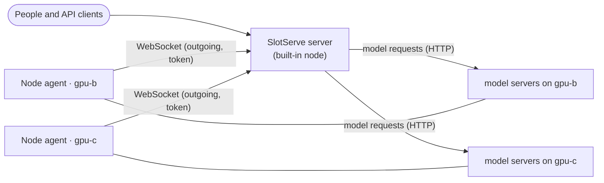

# Multiple machines

!!! note "Preview"
    Multiple machines are new and still being completed: model servers, downloads and model scanning work on every
    machine; **dev environments still run on the server's own machine only**.

One SlotServe server can use the GPUs (or CPUs) of several machines. Everyone keeps using one web address, one API
key and one booking calendar; each machine simply adds its own [lanes](gpus-and-engines.md#lanes).

| Role | What runs there | How many |
| --- | --- | --- |
| **Server** (control plane) | Web UI, API, database, bookings and scheduling, the OpenAI-compatible gateway, notifications, usage | One |
| **Node** | A small *node agent* that starts and stops model servers on that machine, reports its GPUs, CPU, memory and model files, sends live metrics and logs, and downloads models into its own models folder | One per extra machine |

The server is a node too (the **built-in node**), so a single machine needs nothing from this page and behaves exactly
as before.



## How it works

- Each node agent connects **out** to the server over a WebSocket with its own token, so nodes need no open port for
  the control connection. Commands (start or stop a model server, read a log, scan models, download a file) travel over
  that connection.
- The **data plane** goes directly to the node: the gateway forwards API requests to `http://<node address>:<port>` of
  the lane's model server. The server must therefore be able to reach the nodes' model server ports (`SLOTSERVE_LLAMA_PORT`
  + lane id − 1 on that node). Keep these ports on a trusted network; they have no authentication of their own.
- A **lane belongs to one node** and never spans machines. Its GPUs are numbered as that machine sees them.
- **Models are per node.** Every node scans its own models folder; a model can only be booked on, or be the default of,
  a lane whose node has its files. With shared storage (for example NFS mounted at the same path on every machine) one
  model is simply available on all of them.
- Model servers keep running when the server restarts or the connection drops. When the agent reconnects it reports
  what it is running; the server takes that over without restarting anything and stops servers of lanes that were
  deleted or moved in the meantime.

## Add a machine

1. On the server, open **Admin → Nodes → Add node**. Give the machine a name (for example `gpu-b`). Leave **Address**
   empty to use the address the agent connects from, or enter the host name / IP the server should use to reach that
   machine (needed behind NAT or a proxy).
2. Copy the token and the command shown. **The token is shown only once.** You can issue a new one at any time with
   **New token** (the old one stops working immediately).
3. On the new machine, start the agent. With Docker (the same image as the server):

    ```bash
    docker run -d --name slotserve-agent --restart unless-stopped \
      --gpus all --network host \
      -v /path/to/llama.cpp:/opt/llama.cpp:ro \
      -v /path/to/models:/models \
      -v slotserve-agent:/data \
      -e SLOTSERVE_AGENT_SERVER=http://slotserve-server:8000 \
      -e SLOTSERVE_AGENT_TOKEN=ssn-... \
      ghcr.io/peleryuan/slotserve:latest slotserve agent
    ```

    Or with Compose: copy `docker-compose.node.yml` and a `.env` with `SLOTSERVE_AGENT_SERVER`,
    `SLOTSERVE_AGENT_TOKEN`, `LLAMA_CPP_DIR` and `MODELS_DIR` to the machine and run
    `docker compose -f docker-compose.node.yml up -d`.

    Without Docker, install SlotServe there and run
    `slotserve agent --server http://slotserve-server:8000 --token ssn-...`.

4. The node turns **Online** within seconds and shows its GPUs, CPU cores, memory, models folder and versions.
5. In **Admin → GPUs & lanes**, add a lane, pick the machine and its GPUs.
6. Press **Scan models** (on the Models page, or for one node in Admin → Nodes) to register the model files the node
   has, or download models straight to the node: with more than one machine the Models page asks **Download to**.

On a machine without NVIDIA GPUs leave out `--gpus all`; its lanes then have no GPUs and run CPU builds of the
engines. `--network host` lets the server reach the model servers on the node's own address. Without it, publish the model
server ports (`-p 8081-8090:8081-8090`) and set the node's **Address** accordingly.

## When a node goes offline

- A node that sent nothing for `SLOTSERVE_NODE_OFFLINE_SECONDS` (30) is **offline**: its lanes show as offline, the
  gateway no longer routes to them (a request for a lane you booked there gets `503`), and nothing is started there.
- Once it stays offline, admins are notified, and so is everyone with a booking on its lanes that runs now or starts
  within 24 hours. Admins are notified again when it is back.
- The agent reconnects by itself (with increasing delays) and the server reconciles what is running.
- **Revoke** disconnects a node and refuses its token; its agent stops its model servers. **New token** admits it again.
  A revoked node without lanes can be deleted.

## Versions

The server and the agents speak a versioned protocol. An agent with an incompatible version is refused with a clear
message on both sides (shown on the node in Admin → Nodes as **Version mismatch**); run the same SlotServe version
everywhere.

## Settings

Server:

| Variable | Default | Description |
| --- | --- | --- |
| `SLOTSERVE_LOCAL_NODE_NAME` | `local` | Name of the built-in node on first start (rename it in Admin → Nodes) |
| `SLOTSERVE_NODE_HEARTBEAT_SECONDS` | `5` | How often agents report metrics (sent to agents when they connect) |
| `SLOTSERVE_NODE_OFFLINE_SECONDS` | `30` | Silence after which a node counts as offline |
| `SLOTSERVE_NODE_RPC_TIMEOUT_SECONDS` | `30` | How long the server waits for an agent to answer a command |

Agent (besides the usual model server settings such as `SLOTSERVE_LLAMA_SERVER_CMD`, `SLOTSERVE_LLAMA_PORT`,
`SLOTSERVE_MODELS_DIR`, `SLOTSERVE_DATA_DIR`, which apply to that machine):

| Variable | Default | Description |
| --- | --- | --- |
| `SLOTSERVE_AGENT_SERVER` | *required* | The server's URL, e.g. `http://slotserve-server:8000` (`--server`) |
| `SLOTSERVE_AGENT_TOKEN` | *required* | The node's token from Admin → Nodes (`--token`) |
| `SLOTSERVE_AGENT_ADDRESS` | *empty* | Address the server should use for this machine (`--address`); an address set in Admin → Nodes wins |
| `SLOTSERVE_AGENT_MODEL_HOST` | `0.0.0.0` | Interface the node's model servers listen on |

Hugging Face downloads use the server's `SLOTSERVE_HF_TOKEN`; it is passed to the node only for downloads from
`SLOTSERVE_HF_ENDPOINT`.
