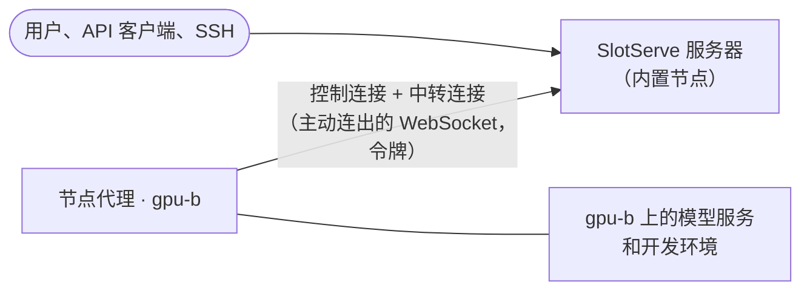

# 多台机器

!!! note "预览"
    多机支持是新功能，仍在完善中：模型服务、下载、模型扫描和开发环境（含无 GPU 环境及其 SSH、端口和网页界面）已可在每台机器上运行；**[模型目录](model-catalog.md)的一键部署以及下载到[模型库](storage.md)目前仍只在服务器本机上进行**。其他机器上的通道不会占用服务器的 CPU 核心预留。

一个 SlotServe 服务器可以使用多台机器的 GPU（或 CPU）。大家仍然使用同一个网址、同一个 API 密钥和同一个预约日历；每台机器只是增加了自己的[通道](gpus-and-engines.md)。

| 角色 | 运行内容 | 数量 |
| --- | --- | --- |
| **服务器**（控制平面） | 网页、API、数据库、预约与调度、OpenAI 兼容网关、通知、用量统计 | 一个 |
| **节点** | 一个轻量的*节点代理*：在该机器上启动和停止模型服务，上报 GPU、CPU、内存和模型文件，发送实时指标和日志，并把模型下载到自己的模型目录 | 每台额外机器一个 |

服务器本身也是一个节点（**内置节点**），所以只有一台机器时无需本页的任何设置，行为与以前完全相同。

## 工作方式

- 每个节点代理使用自己的令牌，通过 WebSocket **主动连接**服务器。各种命令（启动或停止模型服务、读取日志、扫描模型、下载文件）都通过这条连接传递；数据（模型请求、Docker、SSH、端口）也经由服务器中转（见下文）。节点上不需要开放任何端口。
- **一个通道只属于一个节点**，不会跨机器。它的 GPU 编号以该机器上看到的为准。
- **模型按节点区分。** 每个节点扫描自己的模型目录；只有当通道所在的节点有某个模型的文件时，才能在该通道上预约这个模型或把它设为默认模型。使用共享存储（例如在每台机器的同一路径挂载 NFS）时，同一个模型就会在所有机器上可用。
- 服务器重启或连接中断时，模型服务会继续运行。代理重新连接后会上报正在运行的内容；服务器直接接管，不会重启任何东西，并会停止在此期间被删除或迁移的通道的模型服务。

## 网络：所有流量都经过服务器

节点从不接受连接。每个代理**主动连出**到服务器，其余一切都通过代理自己建立的连接经由服务器中转（*中继*）：网关的模型请求、节点的 Docker API、进入开发环境的 SSH、环境的直连端口和网页界面。因此：

- **只有服务器需要可访问**（它的网页端口；使用开发环境时还有 SSH 和直连端口范围）。节点可以在 NAT 后面、在另一栋楼里或家庭宽带上，无需开放端口，也无需 VPN。
- 节点上的模型服务只监听本机回环地址（`SLOTSERVE_AGENT_MODEL_HOST`，默认 `127.0.0.1`）；容器也只在节点的回环地址上发布端口。
- 控制连接只传递命令；每个中转连接使用单独的 WebSocket，因此大流量传输不会拖慢心跳或其他命令。



**带宽。** 进出节点的每个字节都会经过服务器两次（进和出），所以服务器的网络带宽由所有中转流量共享。模型请求和 SSH 会话占用很少；通过 SSH 向环境复制大文件、从环境的网页界面下载大文件，或在机器之间迁移保留环境（其镜像会经由服务器复制）会占用服务器的带宽。请把服务器放在节点和用户都能良好连接的位置。管理员可以在“管理 → 节点”中看到每个节点中转了多少流量。

中转连接的工作方式：服务器通过控制连接请代理在节点上打开一个到目标的流；代理连接目标后，自己再向服务器建立一条 WebSocket（`/api/cluster/stream/<id>`，使用节点令牌和该流的一次性密钥认证）。数据双向传输，并有 TCP 背压；半关闭的连接（一方已发送完毕）仍会为另一方保持打开。每个节点同时最多有 `SLOTSERVE_RELAY_MAX_STREAMS` 个中转连接，空闲超过 `SLOTSERVE_RELAY_IDLE_SECONDS` 的连接会被关闭。

## 节点上的开发环境

开发环境可以运行在每台运行 Docker 的机器上：

- 节点上通道的**预约**会在该节点上用该节点的 GPU 运行容器。镜像在那里拉取（照常显示进度），SlotServe 的 SSH 文件经由中转上传到容器中。
- **空闲通道的共享环境**运行在通道所在的节点上。
- **保留环境**在它所在的节点上暂停和继续；通道的 GPU 变化时，会像以前一样从快照重建。如果预约到另一台机器的通道上，保留环境会在原机器上做快照，其镜像经由服务器复制到新机器；原机器离线时会等待。保存的镜像在另一台机器上使用时也以同样方式复制。
- **无 GPU 环境**可以在任意机器上启动：连接了节点时，启动对话框会询问在哪台机器上运行。它们使用该机器自己的 CPU 核心（该机器的核心减去其通道预留的部分，见[开发环境](dev-environments.md)），CPU 和内存用量会像在服务器上一样计入用量统计。
- 节点上环境的 **SSH** 使用**服务器**的 SSH 端口范围（`SLOTSERVE_DEVENV_SSH_PORTS`）：由服务器监听并中转到容器的 22 端口。用户看到的 `ssh` 命令始终指向服务器。
- **直连端口**在服务器的公开端口范围（`SLOTSERVE_DEVENV_PUBLIC_PORTS`）上监听并中转到容器端口；节点上不需要转发容器。**网页界面**（JupyterLab、VS Code、桌面）与本机环境一样，通过服务器的网页界面端口打开。
- **存储**：NFS 和 SMB 存储由节点自己的 Docker 挂载，因此在每台机器上都可用（节点需要常规的挂载工具）。**主机目录**存储只存在于服务器上，除非管理员把它标记为也存在于某些节点上（管理 → 存储 → *同样存在于这些机器上*，例如在相同路径挂载了同一个 NFS）。没有托管存储时，`/workspace` 和保留目录是节点上的 Docker 卷。模型目录以只读方式从节点自己的模型目录挂载。

服务器在 `SLOTSERVE_DEVENV_RELAY_HOST`（`0.0.0.0`）上监听节点环境的 SSH 和直连端口。容器和网络都会标注所属的机器；节点重新连接时，SlotServe 会清理它在该节点上遗留的容器（并暂停保留环境），就像服务器重启后在本机上做的那样。

## 添加机器

1. 在服务器上打开**管理 → 节点 → 添加节点**，为机器起个名字（例如 `gpu-b`）。**地址**仅供参考显示（留空表示代理连接时的来源地址），不会有任何连接发往该地址。
2. 复制显示的令牌和命令。**令牌只显示一次。**随时可以用**新令牌**重新生成（旧令牌立即失效）。
3. 在新机器上启动代理。使用 Docker（与服务器相同的镜像）：

    ```bash
    docker run -d --name slotserve-agent --restart unless-stopped \
      --gpus all --network host \
      -v /path/to/llama.cpp:/opt/llama.cpp:ro \
      -v /path/to/models:/models \
      -v slotserve-agent:/data \
      -v /var/run/docker.sock:/var/run/docker.sock \
      -e SLOTSERVE_AGENT_SERVER=http://slotserve-server:8000 \
      -e SLOTSERVE_AGENT_TOKEN=ssn-... \
      ghcr.io/peleryuan/slotserve:latest slotserve agent
    ```

    或者使用 Compose：把 `docker-compose.node.yml` 和包含 `SLOTSERVE_AGENT_SERVER`、`SLOTSERVE_AGENT_TOKEN`、`LLAMA_CPP_DIR`、`MODELS_DIR` 的 `.env` 复制到该机器，然后运行 `docker compose -f docker-compose.node.yml up -d`。

    不使用 Docker 时，在该机器上安装 SlotServe 并运行 `slotserve agent --server http://slotserve-server:8000 --token ssn-...`。

4. 几秒钟内节点会变为**在线**，并显示其 GPU、CPU 核数、内存、模型目录和版本。
5. 在**管理 → GPU 与通道**中添加通道，选择这台机器及其 GPU。
6. 点击**扫描模型**（在模型页面，或在“管理 → 节点”中针对单个节点）登记该节点上已有的模型文件；也可以直接把模型下载到节点：有多台机器时，模型页面会询问**下载到**哪台机器。

没有 NVIDIA GPU 的机器请去掉 `--gpus all`；它的通道没有 GPU，使用推理后端的 CPU 版本。挂载 Docker 套接字后服务器才能在该节点上运行开发环境（只用节点运行模型服务时可以去掉）；`--network host` 让代理可以在节点的回环地址上访问模型服务和容器端口。

## 节点离线时

- 在 `SLOTSERVE_NODE_OFFLINE_SECONDS`（30）秒内没有任何消息的节点会被视为**离线**：它的通道显示为离线，网关不再把请求转发到这些通道（发往你在该机器上预约的通道的请求会得到 `503`），也不会在其上启动任何东西。
- 如果持续离线，会通知管理员，以及在其通道上有正在进行或 24 小时内开始的预约的用户。节点恢复后会再次通知管理员。
- 代理会自动重连（间隔逐渐增加），服务器会核对实际运行的内容。
- **吊销**会断开节点并拒绝其令牌；代理会停止其模型服务。**新令牌**可以让它重新接入。没有通道的已吊销节点可以删除。

## 版本

服务器和代理之间使用带版本号的协议。版本不兼容的代理会被拒绝，双方都会给出明确的提示（在“管理 → 节点”中显示为**版本不匹配**）；请在所有机器上运行相同版本的 SlotServe。

## 设置

服务器：

| 变量 | 默认值 | 说明 |
| --- | --- | --- |
| `SLOTSERVE_LOCAL_NODE_NAME` | `local` | 首次启动时内置节点的名称（可在“管理 → 节点”中改名） |
| `SLOTSERVE_NODE_HEARTBEAT_SECONDS` | `5` | 代理上报指标的间隔（代理连接时下发） |
| `SLOTSERVE_NODE_OFFLINE_SECONDS` | `30` | 超过这么久没有消息即视为离线 |
| `SLOTSERVE_NODE_RPC_TIMEOUT_SECONDS` | `30` | 服务器等待代理回应命令的时间 |
| `SLOTSERVE_RELAY_MAX_STREAMS` | `256` | 每个节点同时最多打开的中转连接数 |
| `SLOTSERVE_RELAY_IDLE_SECONDS` | `3600` | 中转连接无流量超过这么久后关闭 |
| `SLOTSERVE_RELAY_OPEN_SECONDS` | `15` | 打开一个中转连接最多等待的时间 |
| `SLOTSERVE_DEVENV_RELAY_HOST` | `0.0.0.0` | 服务器为节点上环境的 SSH 和直连端口监听的地址 |

代理（此外，`SLOTSERVE_LLAMA_SERVER_CMD`、`SLOTSERVE_LLAMA_PORT`、`SLOTSERVE_MODELS_DIR`、`SLOTSERVE_DATA_DIR` 等常规模型服务设置作用于该机器）：

| 变量 | 默认值 | 说明 |
| --- | --- | --- |
| `SLOTSERVE_AGENT_SERVER` | *必填* | 服务器地址，例如 `http://slotserve-server:8000`（`--server`） |
| `SLOTSERVE_AGENT_TOKEN` | *必填* | “管理 → 节点”中生成的节点令牌（`--token`） |
| `SLOTSERVE_AGENT_ADDRESS` | *空* | 为这台机器显示的地址（`--address`）；在“管理 → 节点”中设置的地址优先 |
| `SLOTSERVE_AGENT_MODEL_HOST` | `127.0.0.1` | 节点上模型服务监听的网卡地址（由代理中转） |
| `SLOTSERVE_DOCKER_HOST` | `unix:///var/run/docker.sock` | 节点的 Docker API（开发环境）；也支持 `tcp://`，Windows 上支持 `npipe://` |

Hugging Face 下载使用服务器的 `SLOTSERVE_HF_TOKEN`；只有从 `SLOTSERVE_HF_ENDPOINT` 下载时才会把它传给节点。
