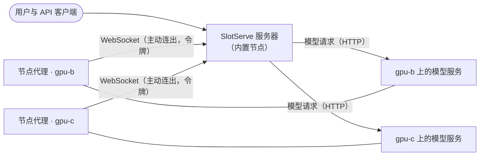

# 多台机器

!!! note "预览"
    多机支持是新功能，仍在完善中：模型服务、下载和模型扫描已可在每台机器上运行；**开发环境（含无 GPU 环境及其端口）、[模型目录](model-catalog.md)的一键部署以及下载到[模型库](storage.md)目前仍只在服务器本机上进行**。其他机器上的通道不会占用服务器的 CPU 核心预留。

一个 SlotServe 服务器可以使用多台机器的 GPU（或 CPU）。大家仍然使用同一个网址、同一个 API 密钥和同一个预约日历；每台机器只是增加了自己的[通道](gpus-and-engines.md)。

| 角色 | 运行内容 | 数量 |
| --- | --- | --- |
| **服务器**（控制平面） | 网页、API、数据库、预约与调度、OpenAI 兼容网关、通知、用量统计 | 一个 |
| **节点** | 一个轻量的*节点代理*：在该机器上启动和停止模型服务，上报 GPU、CPU、内存和模型文件，发送实时指标和日志，并把模型下载到自己的模型目录 | 每台额外机器一个 |

服务器本身也是一个节点（**内置节点**），所以只有一台机器时无需本页的任何设置，行为与以前完全相同。



## 工作方式

- 每个节点代理使用自己的令牌，通过 WebSocket **主动连接**服务器，因此控制连接不需要在节点上开放端口。各种命令（启动或停止模型服务、读取日志、扫描模型、下载文件）都通过这条连接传递。
- **数据流量**直接发往节点：网关把 API 请求转发到该通道模型服务的 `http://<节点地址>:<端口>`。因此服务器必须能访问节点上的模型服务端口（该节点上的 `SLOTSERVE_LLAMA_PORT` + 通道 ID − 1）。请把这些端口放在可信网络中，它们本身没有鉴权。
- **一个通道只属于一个节点**，不会跨机器。它的 GPU 编号以该机器上看到的为准。
- **模型按节点区分。** 每个节点扫描自己的模型目录；只有当通道所在的节点有某个模型的文件时，才能在该通道上预约这个模型或把它设为默认模型。使用共享存储（例如在每台机器的同一路径挂载 NFS）时，同一个模型就会在所有机器上可用。
- 服务器重启或连接中断时，模型服务会继续运行。代理重新连接后会上报正在运行的内容；服务器直接接管，不会重启任何东西，并会停止在此期间被删除或迁移的通道的模型服务。

## 添加机器

1. 在服务器上打开**管理 → 节点 → 添加节点**，为机器起个名字（例如 `gpu-b`）。**地址**留空表示使用代理连接时的来源地址；如果中间有 NAT 或代理，请填写服务器访问该机器时使用的主机名或 IP。
2. 复制显示的令牌和命令。**令牌只显示一次。**随时可以用**新令牌**重新生成（旧令牌立即失效）。
3. 在新机器上启动代理。使用 Docker（与服务器相同的镜像）：

    ```bash
    docker run -d --name slotserve-agent --restart unless-stopped \
      --gpus all --network host \
      -v /path/to/llama.cpp:/opt/llama.cpp:ro \
      -v /path/to/models:/models \
      -v slotserve-agent:/data \
      -e SLOTSERVE_AGENT_SERVER=http://slotserve-server:8000 \
      -e SLOTSERVE_AGENT_TOKEN=ssn-... \
      ghcr.io/peleryuan/slotserve:latest slotserve agent
    ```

    或者使用 Compose：把 `docker-compose.node.yml` 和包含 `SLOTSERVE_AGENT_SERVER`、`SLOTSERVE_AGENT_TOKEN`、`LLAMA_CPP_DIR`、`MODELS_DIR` 的 `.env` 复制到该机器，然后运行 `docker compose -f docker-compose.node.yml up -d`。

    不使用 Docker 时，在该机器上安装 SlotServe 并运行 `slotserve agent --server http://slotserve-server:8000 --token ssn-...`。

4. 几秒钟内节点会变为**在线**，并显示其 GPU、CPU 核数、内存、模型目录和版本。
5. 在**管理 → GPU 与通道**中添加通道，选择这台机器及其 GPU。
6. 点击**扫描模型**（在模型页面，或在“管理 → 节点”中针对单个节点）登记该节点上已有的模型文件；也可以直接把模型下载到节点：有多台机器时，模型页面会询问**下载到**哪台机器。

没有 NVIDIA GPU 的机器请去掉 `--gpus all`；它的通道没有 GPU，使用推理后端的 CPU 版本。`--network host` 让服务器可以通过节点自身的地址访问模型服务。不使用它时，请发布模型服务端口（`-p 8081-8090:8081-8090`）并相应地设置节点的**地址**。

## 选择机器

**机器** 页面（所有人可见）为每台机器显示一张卡片：提供 GPU 还是仅 CPU 算力、CPU（型号、线程数和物理核数）、内存、GPU 及其显存、
当前负载（CPU、内存、每块 GPU 的显存与占用）、哪些 GPU 通道当前空闲、其他通道由谁占用到何时、可用于无 GPU 工作的 CPU 核与内存，
以及机器上有哪些模型。可按 *有 GPU*、*仅 CPU*、显存、空闲内存、空闲核数和 *当前空闲* 筛选，并按空闲显存、空闲核数、空闲内存或负载排序。
**详情** 显示其余信息：每块 GPU 的用量条、每个通道今明两天的预约、磁盘（模型目录与 Docker 数据）、Docker 版本与运行时、GPU 驱动、
机器上的模型，以及负载历史（最近几小时每分钟一个点，另有来自用量采样的最近一天每小时 GPU 占用）。管理员可在 **管理 → 节点** 打开同样的视图。

节点代理自行上报这些信息（CPU、内存、磁盘、操作系统、Docker 及其容器运行时、GPU 驱动，并随每次心跳上报 CPU、内存、网络和磁盘的实时读数）。
不需要任何 GPU 相关组件：没有 GPU 驱动或 GPU 容器运行时的机器照常上报已有的硬件并提供 CPU 算力，它没有 GPU 通道。

**无 GPU 工作可用的 CPU** = 机器的逻辑核数 − GPU 通道预留的核（每块 GPU `SLOTSERVE_DEVENV_CPU_CORES_PER_GPU` 个）− 该机器上运行中的无 GPU 环境占用的核（其核数上限）；
可用内存 = 总内存 − max(已用内存, 这些环境申请的内存)。

凡是需要选择机器的地方，选择时都能看到这些数字：

- **预约**：先选机器，再选通道，最后选时间。通道分布在多台机器上时，预约对话框先列出机器；预约日历按机器分组显示通道标签，也可以只看一台机器。
- **无 GPU 启动**（开发环境）：选择机器时可看到空闲核数和内存。目前这类环境只在服务器本机启动，其他机器会列出但暂不可选。
- **模型目录 → 部署**：先选机器，再选通道，每个通道显示模型是否放得下。
- **用量**：可以只看一台机器上的通道。

**帮我选**（上述每处都有；机器页面上则以当前筛选条件作为要求）请服务器推荐最合适的机器和通道：必须满足要求（是否需要 GPU、显存、核数、内存、
模型在该机器上、预约时段内通道空闲），在满足要求的机器中优先选择在线、空闲容量最多、当前负载低的机器。CPU 工作优先选择没有 GPU 的机器，
让 GPU 机器的 CPU 留给预约其 GPU 的人。推荐只是建议，随时可以改选其他机器；不满足要求的机器会列出原因。
对应接口为 `GET /api/machines`、`GET /api/machines/{id}`、`GET /api/machines/{id}/history` 和 `POST /api/machines/recommend`。

## 节点离线时

- 在 `SLOTSERVE_NODE_OFFLINE_SECONDS`（30）秒内没有任何消息的节点会被视为**离线**：它的通道显示为离线，网关不再把请求转发到这些通道（发往你在该机器上预约的通道的请求会得到 `503`），也不会在其上启动任何东西。
- 如果持续离线，会通知管理员，以及在其通道上有正在进行或 24 小时内开始的预约的用户。节点恢复后会再次通知管理员。
- 代理会自动重连（间隔逐渐增加），服务器会核对实际运行的内容。
- **吊销**会断开节点并拒绝其令牌；代理会停止其模型服务。**新令牌**可以让它重新接入。没有通道的已吊销节点可以删除。

## 版本

服务器和代理之间使用带版本号的协议。版本不兼容的代理会被拒绝，双方都会给出明确的提示（在“管理 → 节点”中显示为**版本不匹配**）；请在所有机器上运行相同版本的 SlotServe。

## 设置

服务器：

| 变量 | 默认值 | 说明 |
| --- | --- | --- |
| `SLOTSERVE_LOCAL_NODE_NAME` | `local` | 首次启动时内置节点的名称（可在“管理 → 节点”中改名） |
| `SLOTSERVE_NODE_HEARTBEAT_SECONDS` | `5` | 代理上报指标的间隔（代理连接时下发） |
| `SLOTSERVE_NODE_OFFLINE_SECONDS` | `30` | 超过这么久没有消息即视为离线 |
| `SLOTSERVE_NODE_RPC_TIMEOUT_SECONDS` | `30` | 服务器等待代理回应命令的时间 |

代理（此外，`SLOTSERVE_LLAMA_SERVER_CMD`、`SLOTSERVE_LLAMA_PORT`、`SLOTSERVE_MODELS_DIR`、`SLOTSERVE_DATA_DIR` 等常规模型服务设置作用于该机器）：

| 变量 | 默认值 | 说明 |
| --- | --- | --- |
| `SLOTSERVE_AGENT_SERVER` | *必填* | 服务器地址，例如 `http://slotserve-server:8000`（`--server`） |
| `SLOTSERVE_AGENT_TOKEN` | *必填* | “管理 → 节点”中生成的节点令牌（`--token`） |
| `SLOTSERVE_AGENT_ADDRESS` | *空* | 服务器访问这台机器时使用的地址（`--address`）；在“管理 → 节点”中设置的地址优先 |
| `SLOTSERVE_AGENT_MODEL_HOST` | `0.0.0.0` | 节点上模型服务监听的网卡地址 |

Hugging Face 下载使用服务器的 `SLOTSERVE_HF_TOKEN`；只有从 `SLOTSERVE_HF_ENDPOINT` 下载时才会把它传给节点。
