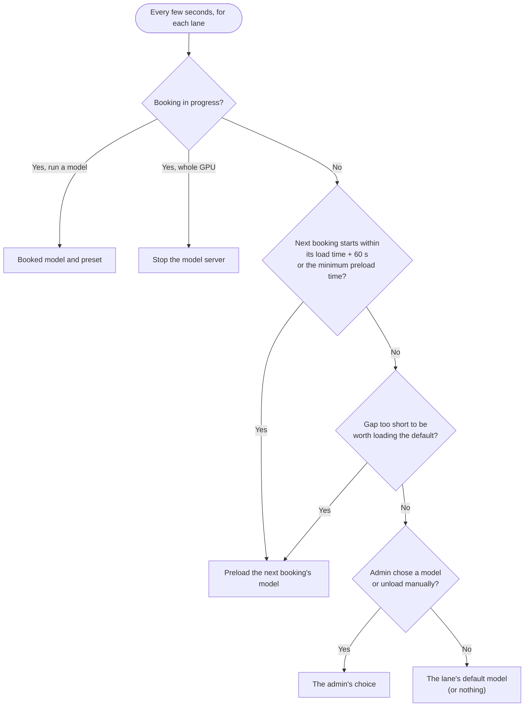
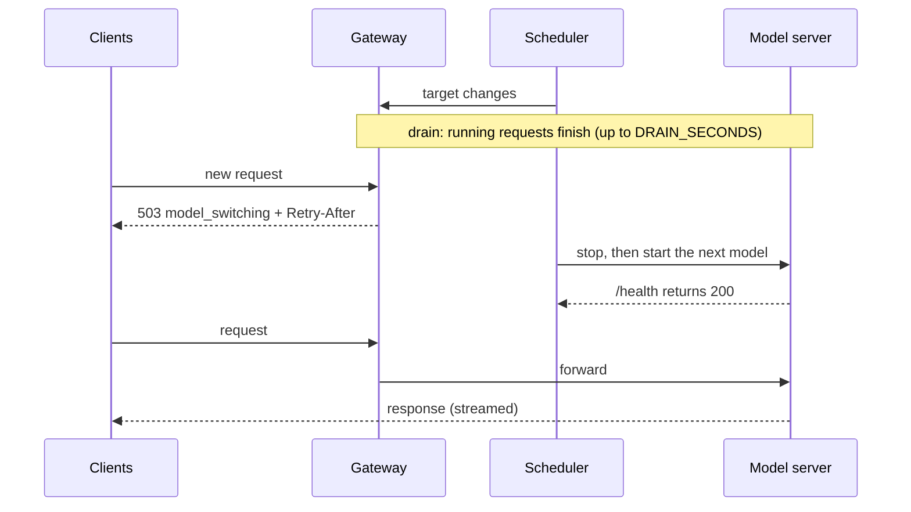

# How scheduling works

Each lane (a group of GPUs; a single-GPU host has one) runs exactly one model server process. Every few seconds - and immediately after a booking or model change - the lane's scheduler decides which model *should* be loaded and moves the process towards it. Lanes are scheduled independently.

## Choosing the target model

In detail:

1. **A booking is in progress** → that booking's model and preset. For a *whole GPU* booking: nothing (the model server is stopped).
2. **The next booking starts within its model's estimated load time + 60 s, or within the minimum preload time (3 minutes by default), whichever is earlier** → preload the next booking's model now. Before a whole-GPU booking, the model server is stopped `SLOTSERVE_STOP_TIMEOUT_SECONDS` + 60 s early.
3. **The next booking is so close that loading the default model would only be usable briefly** (gap < default load + next load + 2 × buffer) → skip the default and load the next booking's model directly.
4. **An admin chose a model (or unloading) manually** → that, until its time is up or the next booking starts.
5. **Otherwise** → the lane's default model (or nothing, if no default is set).

A model plus a preset counts as one target: switching presets of the same file reloads the model server.

The process is only restarted when the target differs from what is loaded. Releasing a booking early triggers an immediate re-evaluation.

## Load time estimates

- After a model has loaded at least once, its estimate is the average of its last five successful loads.
- Before that, it is `file size ÷ SLOTSERVE_DISK_READ_MBPS + 15 s`.

Loads from spinning disks are slow and the page cache only helps when the host has more free RAM than the model's size. Keeping frequently used models on an SSD is the single biggest improvement.

## Who may call the API

| Situation | Booking owner | Everyone else |
| --- | --- | --- |
| Lane not booked | allowed (current model) | allowed (current model) |
| Booking active, its model ready | allowed | `403 gpu_reserved` |
| Booking active, its model still loading | `503` + `Retry-After` | `403 gpu_reserved` |
| Whole-GPU booking active | `503 gpu_exclusive` | `403 gpu_reserved` |

A booking that is still awaiting approval does not make the lane busy and loads nothing; it only keeps others from booking the same time. With several lanes, see [which lane serves a request](gpus-and-engines.md#which-lane-serves-an-api-request).

Free use of the idle GPU is best-effort: it may be interrupted when the next booking's model is preloaded.

## Back-to-back bookings

Loading can only start after the previous booking ends. If two adjacent bookings use different models, the second booking spends the start of its slot loading. When both use the same model there is no reload at all. The booking dialog points this out.

## Switching without cutting requests off

When the target model changes, SlotServe first lets requests that are already running finish (up to `SLOTSERVE_DRAIN_SECONDS`, 30 s by default). Meanwhile new requests get `503 model_switching` with a `Retry-After` header. Then the model server is stopped and the next model loads. **Reload model** restarts immediately.

## Failures

- If the log shows that the GPU ran out of memory, the error says so and suggests lowering `-ngl` or `-c`. Models whose file is larger than the GPU's memory are marked **Larger than GPU memory** in the model list and the booking dialog.

- If the model server exits or does not become healthy within `SLOTSERVE_LOAD_TIMEOUT_SECONDS`, the runtime is marked **failed** with the reason, and the scheduler retries with a growing back-off (30 s → 10 min).
- **Fallback**: while a booked model is waiting for its next retry, the default model serves the booking so the booker is not left without a model. The overview shows a banner, and the booker and admins are notified. When the retry succeeds, the booked model takes over again.
- The overview page shows the error, and **Server log** shows the model server's own output.
- The flags SlotServe sets itself (for llama.cpp `-m`, `--host`, `--port` and `--alias`; for vLLM and SGLang the model, host, port and served name) are stripped from user arguments, so a typo there cannot break routing.
