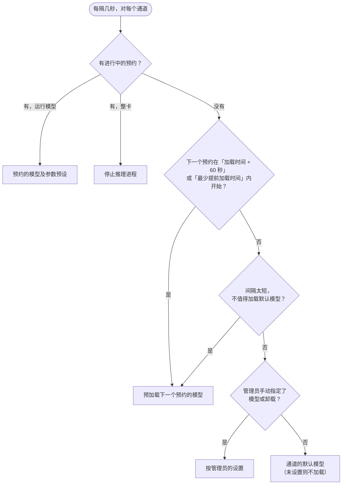
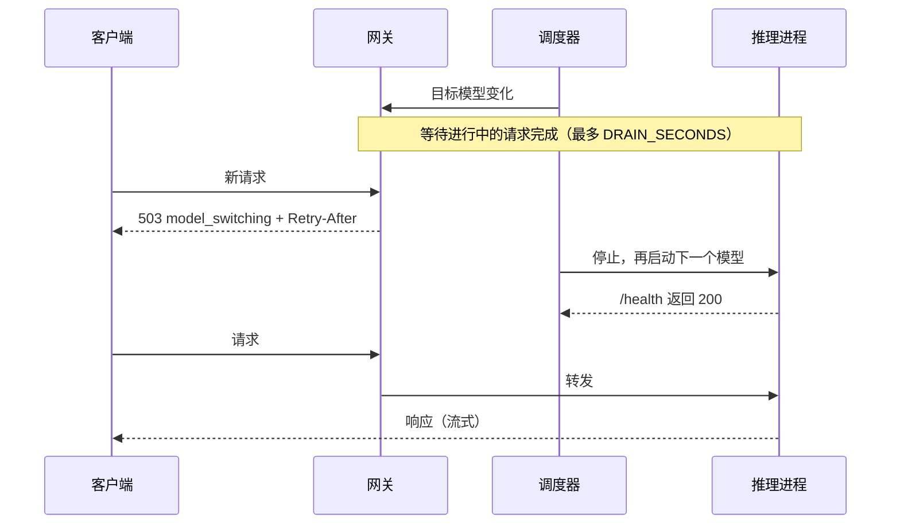

# 调度原理

每个通道（一组 GPU；单卡机器只有一个通道）只运行一个推理进程。通道的调度器每隔几秒（以及预约或模型变更后立即）判断此刻*应当*加载哪个模型，并让进程向它靠拢。各通道独立调度。

## 选择目标模型

具体规则：

1. **有进行中的预约** → 该预约的模型及参数预设；*整卡*预约则不加载任何模型（停止推理进程）。
2. **下一个预约将在「其模型的预计加载时间 + 60 秒」或「最少提前加载时间」（默认 3 分钟）内开始，取两者中较早的** → 立即预加载下一个预约的模型。整卡预约会提前 `SLOTSERVE_STOP_TIMEOUT_SECONDS` + 60 秒停止推理进程。
3. **下一个预约太近，切回默认模型只能用一小会儿**（间隔 < 默认模型加载时间 + 下一个模型加载时间 + 2 × 缓冲）→ 跳过默认模型，直接加载下一个预约的模型。
4. **管理员手动指定了模型（或卸载）** → 按手动设置，直到时间到或下一个预约开始。
5. **其他情况** → 通道的默认模型（未设置默认模型则不加载）。

「模型 + 参数预设」作为一个整体：同一文件换预设也会重启推理进程。

只有目标与当前模型不同时才会重启进程。提前结束预约会立即触发重新评估。

## 加载时间估算

- 模型成功加载过之后，取其最近 5 次成功加载的平均耗时。
- 在此之前按 `文件大小 ÷ SLOTSERVE_DISK_READ_MBPS + 15 秒` 估算。

机械盘加载很慢，而页缓存只有在空闲内存大于模型大小时才有帮助。把常用模型放在 SSD 上是最有效的改进。

## 谁能调用接口

| 情况 | 预约者 | 其他人 |
| --- | --- | --- |
| 通道未被预约 | 可用（当前模型） | 可用（当前模型） |
| 有进行中的预约，模型已就绪 | 可用 | `403 gpu_reserved` |
| 有进行中的预约，模型仍在加载 | `503` + `Retry-After` | `403 gpu_reserved` |
| 有进行中的整卡预约 | `503 gpu_exclusive` | `403 gpu_reserved` |

待审批的预约不会让通道变忙，也不会加载模型，只是别人不能再约同一时段。有多个通道时，见[接口请求由哪个通道处理](gpus-and-engines.md#which-lane-serves-an-api-request)。

空闲时段的使用属于尽力而为：预加载下一个预约的模型时可能会被打断。

## 相邻预约

加载只能在前一个预约结束后开始。如果两个相邻预约使用不同模型，后一个预约的开头会用于加载；若使用同一模型则完全不需要重新加载。预约对话框会给出提示。

## 切换时不打断请求

目标模型变化时，SlotServe 先让已在进行的请求跑完（最多 `SLOTSERVE_DRAIN_SECONDS`，默认 30 秒），期间新请求返回 `503 model_switching` 和 `Retry-After`；之后才停止推理进程并加载下一个模型。**重新加载模型**仍立即重启。

## 失败处理

- 如果日志显示显存不足，错误信息会直接说明，并建议调小 `-ngl` 或 `-c`。文件比显存还大的模型会在模型列表和预约对话框中标记**超出显存**。

- 推理进程退出，或在 `SLOTSERVE_LOAD_TIMEOUT_SECONDS` 内未就绪时，运行状态标记为**失败**并记录原因，调度器以递增的间隔重试（30 秒 → 10 分钟）。
- **自动回退**：预约的模型在等待下一次重试期间，由默认模型为该预约提供服务，预约人不会无模型可用。总览页会显示提示，预约人和管理员会收到通知；重试成功后切回预约的模型。
- 总览页会显示错误，**运行日志**里能看到推理进程自己的输出。
- SlotServe 自己设置的参数（llama.cpp 的 `-m`、`--host`、`--port`、`--alias`；vLLM 和 SGLang 的模型、地址、端口和服务名称）会从用户参数中剔除，写错也不会影响转发。
