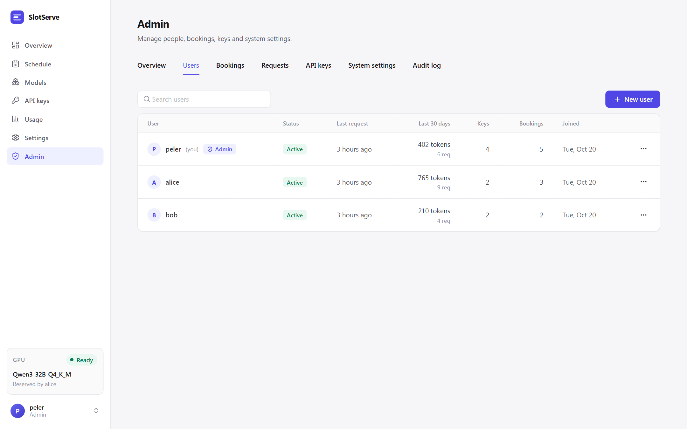

# User guide

## Booking the GPU

Open **Schedule** and drag across the calendar, or press **New booking**. Choose what to book, adjust the time and add an optional note.


- Bookings snap to 30-minute slots (configurable) and cannot overlap.
- A slot that has already started can still be booked; it starts *now*. **Start now** in the dialog does this for you.
- The dialog shows the model's **estimated load time**. If someone else's booking ends exactly when yours starts and uses a different model, loading happens inside your slot and the dialog warns you.
- During your booking only **your** API keys are accepted.
- **Cancel** an upcoming booking, or **End now** to release the GPU early. The default model comes back right away.

### Booking types

| Type | What happens during the slot |
| --- | --- |
| **Run a model** | Your model (optionally with one of its **presets**) is loaded before the slot starts. Only your API keys are accepted. |
| **Whole GPU** | llama-server is stopped shortly before the slot, so the GPU is completely free for training or any other program. The API returns `503 gpu_exclusive`. The default model comes back when the slot ends. |

### Changing bookings

- **Edit** an upcoming booking to move it or change its model, preset or note.
- **Extend** a running booking by 30 minutes, 1 hour or 2 hours, if the time after it is free. You can also shorten it with **Edit**.
- **Repeat weekly** creates the same slot for several weeks. Either every week fits, or nothing is booked and the dialog says which week clashes. Cancelling one booking of a series asks whether to cancel only that one or the rest of the series as well.
- Admins can edit or cancel anyone's booking and **book for someone else**. The person is notified on Telegram.

### Waitlist

If the time you want is taken, the dialog offers **Join waitlist**. When that time frees up (a cancellation or an early end), SlotServe books it for you automatically, or just notifies you if you unticked **Book automatically**. Your open waitlist entries appear under **My bookings**.

### Lanes and approval

With several GPU groups ("lanes"), the calendar shows a tab per lane and the booking dialog asks which lane to book. When approval mode is on, the dialog says if your booking needs an admin's approval; it then shows as **Awaiting approval** and you are notified of the decision. See [GPUs, lanes & engines](gpus-and-engines.md).

### Quotas

Admins can limit how many hours one person may book per calendar week and how many open bookings they may hold. The limits do not apply to admins.

## Models

**Models** lists every registered GGUF file with its size, estimated load time and launch arguments.


- **Scan folder** registers new `.gguf` files from the models directory.
- **Edit** changes the name (the `model` id clients see), launch arguments and description. The person who added a model and admins can edit or delete it.
- **Set as default** (admin) chooses the model used when nobody has booked the GPU.
- **Server log** shows the tail of llama-server's output - the first place to look when a model fails to start.
- **Presets** (in **Edit**) store alternative argument sets for the same file, for example a long-context variant with a larger `-c`. People pick a preset when booking; the model's own arguments are the default.

### Downloading models

Paste a direct link to a `.gguf` file and press **Download**, for example:

```text
https://huggingface.co/<user>/<repo>/resolve/main/<file>.gguf
https://hf-mirror.com/<user>/<repo>/resolve/main/<file>.gguf
```

Or open the **Hugging Face** tab, enter a repository such as `Qwen/Qwen3-8B-GGUF` and press **List files**. Pick the quantizations you want; split models are grouped and all parts are queued. Set **Hugging Face endpoint** (for example `https://hf-mirror.com`) and **Hugging Face token** in the admin settings if needed.

Downloads run one at a time, write to `<file>.part` and resume from where they stopped if retried. A finished `.gguf` is registered automatically. For split models (`-00001-of-0000N.gguf`) add every part; the first part becomes the model.

## API keys

**API keys → New key** creates a key and shows it **once**. Store it in your client or a secret manager. Revoke a key to stop it immediately. See [API](api.md) for client setup.

## Usage

**Usage** shows requests, tokens and booked hours per person and per model for the last 7, 30 or 90 days. **Export CSV** downloads a daily summary or every request.

## Settings

- **Appearance**: language and light, dark or system theme.
- **Telegram**: link your account and choose which notifications you get. See [Notifications & integrations](integrations.md).
- **Calendar subscription**: private links that show bookings in your calendar app.


## Administration

The first account is the admin. Admins see an **Admin** entry in the sidebar.



| Tab | What you can do |
| --- | --- |
| Overview | Counts of users, keys, open bookings, requests and tokens in the last 24 h; recent model loads with failures; restart llama-server and read its log; **load a model now** or **unload** while nobody has the GPU booked, for a set time or until the next booking |
| Users | Create users (no invite code needed), reset passwords, grant or remove admin, disable, enable or delete accounts |
| Bookings | Every booking, filtered by status or person; edit, cancel or end any booking; book for someone else |
| Requests | Every API request with person, key, model, status, duration and tokens; filter to errors |
| Overview → Backups | Daily database copies; back up now and download |
| API keys | Every active key with its owner and last use; revoke any key |
| System settings | Open registration, invite code, longest booking, booking horizon, default launch arguments |
| Audit log | Who did what and when, for every admin action |

Rules that protect the system:

- You cannot disable, demote or delete your own account, and at least one active admin always remains.
- Disabling an account signs it out, refuses its API keys and cancels its open bookings. Enabling it again restores the keys.
- Deleting an account also deletes its keys, bookings and usage history. Disable instead if you want to keep the history.
- System settings take effect immediately and are stored in the database, overriding `.env`.
