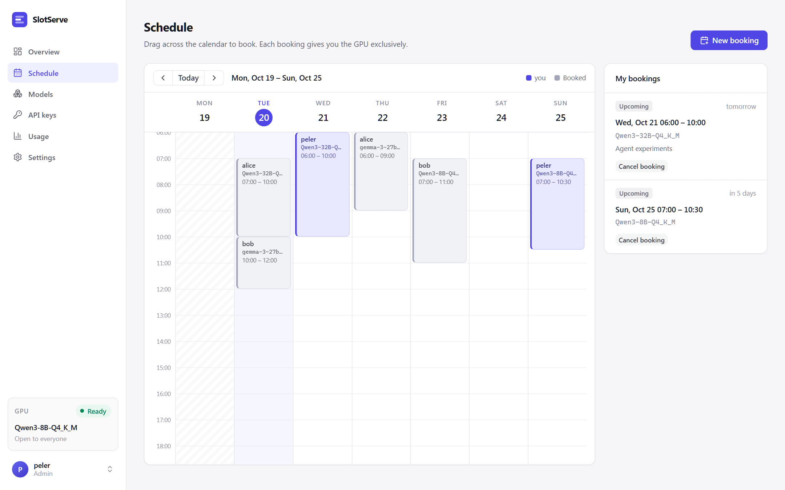
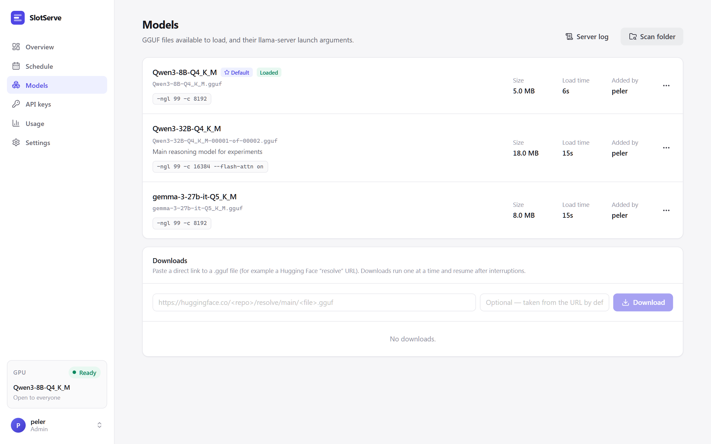
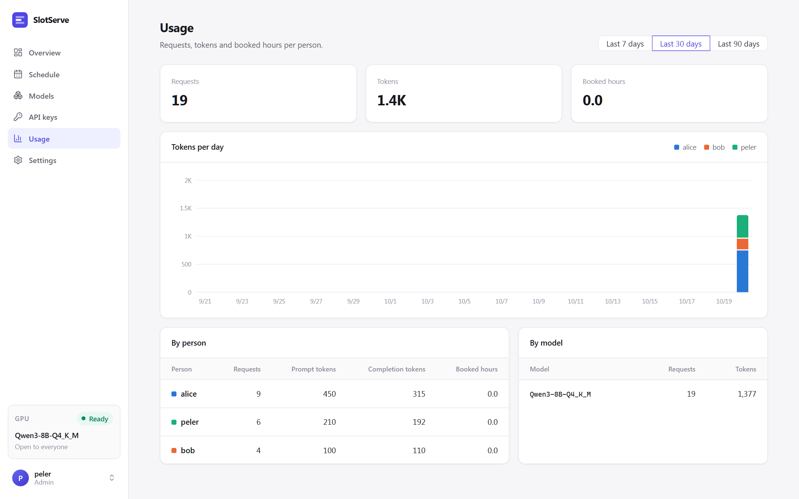

# User guide

## Booking the GPU

Open **Schedule** and drag across the calendar, or press **New booking**. Pick a model, adjust the time and add an optional note.



- Bookings snap to 30-minute slots (configurable) and cannot overlap.
- A slot that has already started can still be booked; it starts *now*. **Start now** in the dialog does this for you.
- The dialog shows the model's **estimated load time**. If someone else's booking ends exactly when yours starts and uses a different model, loading happens inside your slot and the dialog warns you.
- During your booking only **your** API keys are accepted.
- **Cancel** an upcoming booking, or **End now** to release the GPU early. The default model comes back right away.

Admins can cancel anyone's booking.

## Models

**Models** lists every registered GGUF file with its size, estimated load time and launch arguments.



- **Scan folder** registers new `.gguf` files from the models directory.
- **Edit** changes the name (the `model` id clients see), launch arguments and description. The person who added a model and admins can edit or delete it.
- **Set as default** (admin) chooses the model used when nobody has booked the GPU.
- **Server log** shows the tail of llama-server's output - the first place to look when a model fails to start.

### Downloading models

Paste a direct link to a `.gguf` file and press **Download**, for example:

```text
https://huggingface.co/<user>/<repo>/resolve/main/<file>.gguf
https://hf-mirror.com/<user>/<repo>/resolve/main/<file>.gguf
```

Downloads run one at a time, write to `<file>.part` and resume from where they stopped if retried. A finished `.gguf` is registered automatically. For split models (`-00001-of-0000N.gguf`) add every part; the first part becomes the model.

## API keys

**API keys → New key** creates a key and shows it **once**. Store it in your client or a secret manager. Revoke a key to stop it immediately. See [API](api.md) for client setup.

## Usage

**Usage** shows requests, tokens and booked hours per person and per model for the last 7, 30 or 90 days.


