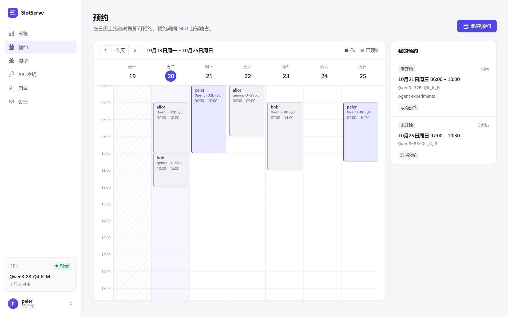
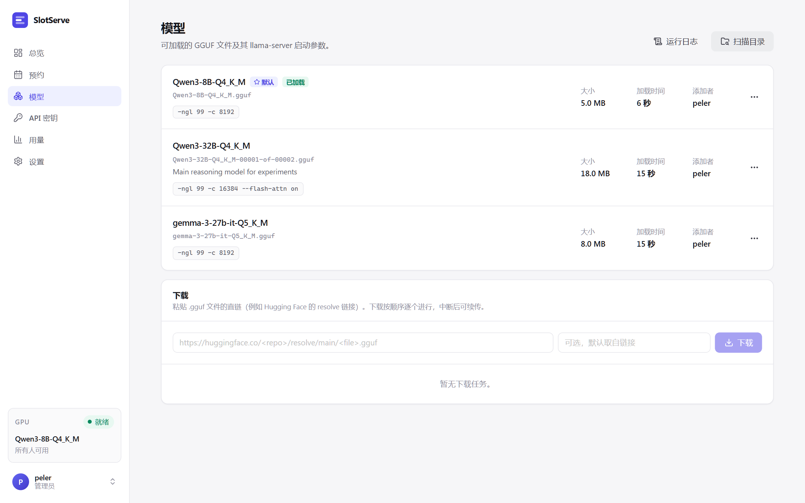
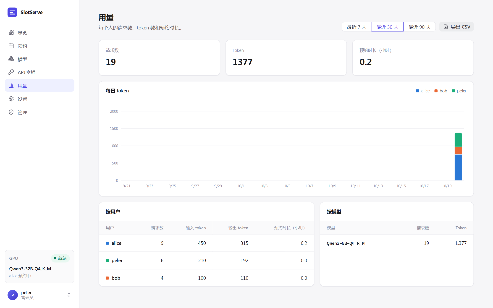
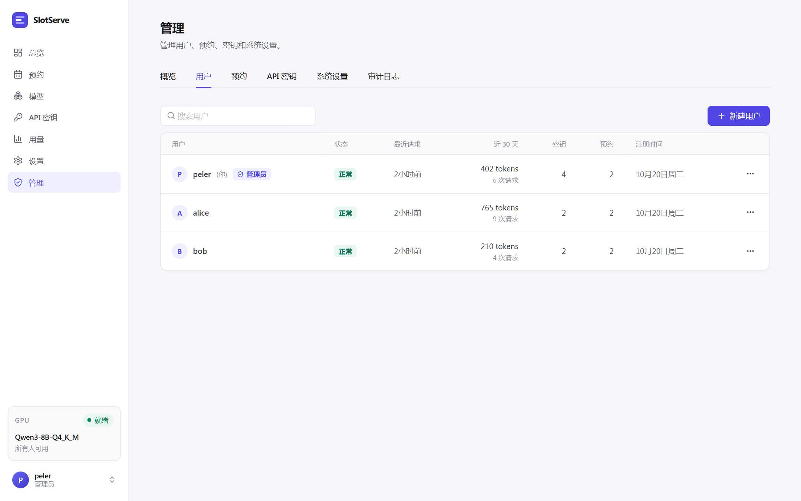

# 使用指南

## 预约 GPU

打开**预约**页面，在日历上拖选时段，或点击**新建预约**。选择预约类型、调整时间，可选填写备注。



- 预约按 30 分钟对齐（可配置），不能重叠。
- 已经开始的时段仍可预约，从*现在*开始；对话框里的**立即开始**就是做这个。
- 对话框会显示模型的**预计加载时间**。如果前一个预约正好在你开始时结束且使用不同模型，加载会占用你时段的开头，对话框会提示。
- 预约期间只接受**你的** API 密钥。
- 未开始的预约可**取消**；进行中的可**提前结束**，默认模型会立即恢复。

### 预约类型

| 类型 | 时段内会发生什么 |
| --- | --- |
| **运行模型** | 开始前加载你选的模型（可选它的某个**参数预设**），期间只接受你的 API 密钥。 |
| **整卡** | 开始前停止推理进程，整张 GPU 空出来跑训练或其他程序，期间接口返回 `503 gpu_exclusive`；结束后自动恢复默认模型。 |

### 修改预约

- 未开始的预约可以**编辑**：改时间、模型、参数预设或备注。
- 进行中的预约可以**延长** 30 分钟、1 小时或 2 小时（前提是之后的时间空闲），也可以通过**编辑**缩短。
- **每周重复**会在之后几周的同一时间创建预约：要么每周都能约上，要么一个都不建，并提示哪一周冲突。取消系列中的一次时，可选择只取消这一次或连同之后的全部取消。
- 管理员可以编辑、取消任何人的预约，也可以**替他人预约**，当事人会收到 Telegram 通知。

### 候补

想要的时段已被占用时，对话框会提供**加入候补**。该时段空出来后（有人取消或提前结束），SlotServe 会自动为你预约；如果取消勾选**空出时自动预约**，则只通知你。未结束的候补显示在**我的预约**下方。

### 通道与审批

有多组 GPU（「通道」）时，日历上方按通道分页，预约弹窗里要选择通道。开启审批模式后，弹窗会提示你的预约是否需要管理员审批；提交后显示为**待审批**，审批结果会通知你。详见[多 GPU 与推理后端](gpus-and-engines.md)。

### 配额

管理员可以限制每人每周最多预约的小时数，以及同时持有的未结束预约数。管理员本人不受限制。

## 模型

**模型**页面列出所有登记的模型，包括推理后端、大小、预计加载时间和启动参数。



- **扫描目录**：把模型目录中新增的 `.gguf` 文件登记为 llama.cpp 模型。
- **添加模型**：手动登记模型：选择推理后端（llama.cpp、vLLM、SGLang 或自定义），填写文件、目录或 Hugging Face 仓库名。
- **编辑**：修改名称（客户端看到的 `model` id）、启动参数和说明。模型的添加者和管理员可以编辑或删除。
- **设为默认**（管理员）：没人预约时使用的模型。有多个通道时，这里设置的是第一个通道的默认模型，其他通道在**管理 → GPU 与通道**中设置。
- **运行日志**：显示推理进程输出的末尾部分，模型启动失败时先看这里。
- **参数预设**（在**编辑**中）：为同一个文件保存其他参数组合，例如 `-c` 更大的长上下文版本。预约时可以选择预设，默认使用模型自己的参数。

### 下载模型

粘贴 `.gguf` 文件的直链并点击**下载**，例如：

```text
https://huggingface.co/<用户>/<仓库>/resolve/main/<文件>.gguf
https://hf-mirror.com/<用户>/<仓库>/resolve/main/<文件>.gguf
```

也可以切到 **Hugging Face** 标签页，输入仓库名（如 `Qwen/Qwen3-8B-GGUF`）并点**列出文件**，勾选需要的量化版本即可；分卷模型会自动归为一组并下载全部分卷。需要时在管理设置中填写 **Hugging Face 地址**（如 `https://hf-mirror.com`）和 **Hugging Face Token**。

下载逐个进行，先写入 `<文件>.part`，重试时从中断处续传。完成的 `.gguf` 会自动登记。分片模型（`-00001-of-0000N.gguf`）请把每一片都添加进来，第一片会成为模型。

## API 密钥

**API 密钥 → 新建密钥**会生成密钥并**只显示一次**，请保存到客户端或密钥管理工具中。吊销后立即失效。客户端配置见[接口](api.md)。

## 用量

**用量**页面按用户、按模型展示最近 7、30 或 90 天的请求数、token 数和预约时长。**导出 CSV** 可下载按天汇总或逐条请求。

## 设置

- **外观**：语言，以及浅色、深色或跟随系统的主题。
- **Telegram**：绑定账号并选择接收哪些通知，见[通知与集成](integrations.md)。
- **日历订阅**：在日历应用中查看预约的私有链接。



## 管理

第一个注册的账号是管理员。管理员的侧边栏里有**管理**入口。



| 标签页 | 能做什么 |
| --- | --- |
| 概览 | 用户数、密钥数、未结束和待审批的预约、近 24 小时请求与 tokens；最近的模型加载记录（含失败原因）；重启某个通道的推理进程、查看日志；没人预约时可**立即加载模型**或**卸载**，持续指定时长或直到下一个预约 |
| 运行监控 | 每个通道的状态、模型、推理后端、GPU、端口、PID、进行中的请求和调度目标；加载进度（来自推理进程的输出，没有时按时间估算）；失败时显示错误、退出码、重试倒计时和最后几行输出；完整启动命令；可筛选、暂停、下载的实时输出；每次加载的命令和输出摘录 |
| GPU 与通道 | 检测到的 GPU；新建、编辑、删除通道，设置每个通道的默认模型；修改通道当前模型的启动参数并重新加载 |
| 用户 | 新建用户（不需要邀请码）、重置密码、设置或取消管理员、停用、启用或删除账号 |
| 预约 | 所有人的预约，可按状态或用户筛选；通过或拒绝申请；编辑、取消或结束任何预约；替他人预约 |
| 请求 | 每一次接口请求的用户、密钥、模型、状态码、耗时和 tokens，可只看错误 |
| 概览 → 备份 | 每日数据库备份；可立即备份和下载 |
| API 密钥 | 所有有效密钥及其所属用户、最近使用时间；可吊销任意密钥 |
| 系统设置 | 所有运行参数：注册、预约限制与配额、审批、预加载与超时、推理后端命令、下载、Telegram、数据保留与备份 |
| 审计日志 | 每一次管理操作：谁、在什么时间、做了什么 |

保护规则：

- 不能停用、降级或删除自己的账号，并且始终至少保留一位正常状态的管理员。
- 停用账号会立即登出该用户、拒绝其 API 密钥并取消其未结束的预约；重新启用后密钥恢复可用。
- 删除账号会一并删除其密钥、预约和用量记录。如需保留历史，请改用停用。
- 系统设置立即生效，保存在数据库中并覆盖 `.env` 的值。
